# (0) Оценка и декомпозиция фичи «Управление возвратами»

## 1. Верхнеуровневая оценка фичи
Фича "Управление возвратами" позволяет B2B-клиенту управлять обратным потоком отправлений:
1. Оформлять возврат одиночно (через экран) и массово списком (через файл или API)
2. Отслеживать перечень возвратов, их текущие статусы и точную причину возврата
3. Контролировать финансовые последствия (удержание стоимости обратной пересылки, списание при приёме, возврат при отмене/неприёме, перерасчёт по весу)

Фича обязана поддерживать оба входа в систему: пользовательский интерфейс (Микрофронтенды + BFF) и программный интерфейс (API Gateway)

## 2. Затрагиваемые существующие модули системы

Декомпозиция опирается на реальный состав модулей личного кабинета:

| Модуль / Контейнер              | Роль в системе (существующая)                       | Что меняется для поддержки фичи                                                                                                                                 |
|:--------------------------------|:----------------------------------------------------|:----------------------------------------------------------------------------------------------------------------------------------------------------------------|
| **Микрофронтенды (React)**      | Клиентский веб-интерфейс                            | Добавление раздела "Возвраты": форма одиночного возврата, загрузка файла списком (до 1000 строк), реестр возвратов с фильтрацией по причинам                    |
| **web-client (BFF)**            | Агрегация данных для экранов фронтенда              | Новые эндпоинты для экранов возвратов; агрегация данных из `REST API`, `Онлайн Баланс` и `Сервис отслеживания РПО` в единую карточку возврата                   |
| **API Gateway**                 | Внешний вход для интеграторов (авторизация, лимиты) | Маршрутизация новых публичных методов `/returns` и `/returns/batch` в `REST API`, применение квот и проверка Bearer-токена                                      |
| **REST API**                    | Ядро бизнес-логики отправлений                      | Новые методы создания возврата (одиночного и пакетного); валидация бизнес-правил (уровень 2); создание встречного отправления со ссылкой на прямое              |
| **Сервис разбора файлов (FPP)** | Парсинг и формальная валидация файлов               | Добавление шаблона разбора файла на массовый возврат (проверка формата трек-номеров, лимита в 1000 строк — валидация уровня 1)                                  |
| **Онлайн Баланс**               | Управление счетами, холдированием и списаниями      | Поддержка операций удержания (холдирования) под возвратное отправление, окончательного списания по событию приёма и возврата/корректировки при расхождении веса |
| **Сервис отслеживания РПО**     | Получение статусов из корпоративной шины            | Сохранение не только клиентского статуса, но и исходного кода причины возврата из учётного справочника операций                                                 |
| **Фоновая публикация в шину**   | Вычитка событий из RabbitMQ и отправка в шину       | Подписка на события регистрации возвратных отправлений для передачи информации в корпоративную шину данных                                                      |
| **Сервис отчётов (ip-report)**  | Формирование фоновых `.xlsx` отчётов                | Добавление шаблона отчёта по возвратам с указанием причин, статусов и финансовых операций                                                                       |

## 3. Обоснование отказа от создания новых микросервисов

**Решение:** Новые развёртываемые микросервисы (контейнеры) не вводятся (0 новых сервисов, при допустимом лимите до 2)

**Обоснование:**
1. **Единый домен с прямыми отправлениями:** По предметной области системы возврат - это не отдельный процесс, а встречное отправление с переставленными ролями отправителя и получателя. Вся логика валидации атрибутов отправления, генерации идентификаторов и взаимодействия с тарификатором уже инкапсулирована в `REST API`. Выделение отдельного `return-service` привело бы к дублированию бизнес-правил валидации и распределённым транзакциям при проверке исходного отправления
2. **Профиль нагрузки идентичен оперативному:** Массовые возвраты проходят через тот же асинхронный конвейер (`Сервис разбора файлов` + `REST API` с ограничением 1000 строк на пакет), что и создание обычных отправлений
3. **Унаследованный ландшафт:** В системе уже около 60 микросервисов и 9 инфраструктурных технологий. Каждый новый контейнер увеличивает стоимость эксплуатации, мониторинга и требует прохождения согласований для интеграции с внешними контурами

## 4. Диаграмма контейнеров (C4 Container Diagram)

*Примечание: Показаны контейнеры, задействованные в сквозной фиче «Управление возвратами». Протоколы, не подтверждённые документацией системы, помечены `[?]`*

```mermaid
C4Container
    title Container Diagram: Фича «Управление возвратами» в контуре ЛК ЮЛ

    Person(user, "Пользователь клиента", "Сотрудник B2B-организации")
    System_Ext(integrator, "Клиент-интегратор", "Внешняя ИС клиента")

    System_Boundary(lk, "ЛК ЮЛ (Личный кабинет юридического лица)") {
        Container(mfe, "Микрофронтенды (React)", "TypeScript, React", "Экран оформления возвратов, загрузка файлов, реестр")
        Container(bff, "web-client (BFF)", "Java", "Агрегация данных для интерфейса возвратов")
        Container(gw, "API Gateway", "Java", "Проверка токенов, контроль лимитов, маршрутизация API")
        Container(fpp, "Сервис разбора файлов", "Java", "Приём файлов до 1000 строк, валидация уровня 1")
        Container(rest, "REST API", "Java", "Валидация уровня 2, создание встречного отправления, воркеры")
        Container(balance, "Онлайн Баланс", "Java", "Удержание, списание, возврат средств и перерасчёт по весу")
        Container(tracking, "Сервис отслеживания РПО", "Java", "Чтение статусов и причин возврата из шины")
        Container(publisher, "Фоновая публикация в шину", "Java", "Передача событий создания возвратов во внешний контур")
        Container(report, "Сервис отчётов (ip-report)", "Java", "Фоновая генерация .xlsx отчётов по возвратам")
        
        ContainerDb(pg, "Postgres", "PostgreSQL", "Базы данных сервисов (по БД на сервис) + таблицы outbox")
        ContainerDb(s3, "Файловое хранилище", "S3 / MinIO", "Хранение загруженных .xlsx файлов массовых возвратов")
        ContainerQueue(rmq, "RabbitMQ", "Message Broker", "Очередь событий интеграции и RPC-синхронизации баланса")
    }

    System_Ext(auth, "Единый шлюз авторизации", "Внутреннее и внешнее исполнение")
    System_Ext(tarif, "Тарификатор", "Внешний сервис расчёта стоимости пересылки")
    System_Ext(bus, "Корпоративная шина данных", "Обмен событиями с учётной системой почтовой сети")
    System_Ext(billing, "Система бухгалтерского учёта", "Внешний биллинг и сверка сальдо")

    Rel(user, mfe, "Оформляет возврат, смотрит статусы", "HTTPS")
    Rel(integrator, gw, "Вызывает методы API возвратов", "HTTPS / JSON + Bearer")

    Rel(mfe, bff, "Запрашивает данные экранов", "HTTP / JSON")
    Rel(gw, auth, "Проверяет токен клиента", "OAuth 2.0 / OIDC")
    Rel(gw, rest, "Маршрутизирует API-запросы", "HTTP / JSON")

    Rel(bff, rest, "Передаёт команды создания, читает реестр", "HTTP / JSON")
    Rel(bff, fpp, "Загружает файл массового возврата", "HTTP / Multipart [?]")
    Rel(bff, balance, "Запрашивает баланс и историю удержаний", "HTTP / JSON")
    Rel(bff, tracking, "Запрашивает статусы и причины возврата", "HTTP / JSON")
    Rel(bff, report, "Заказывает выгрузку отчёта", "HTTP / JSON [?]")

    Rel(fpp, s3, "Сохраняет исходный файл", "HTTP / S3 API [?]")
    Rel(fpp, rest, "Передаёт пакет валидных возвратов (<=1000)", "HTTP / JSON [?]")

    Rel(rest, tarif, "Запрашивает расчёт стоимости возврата", "HTTP / JSON (sync)")
    Rel(rest, balance, "Инициирует удержание средств", "HTTP / JSON [?]")
    Rel(rest, pg, "Читает и пишет заявки, отправления, outbox", "SQL")
    Rel(rest, rmq, "Публикует события о возвратах", "AMQP")

    Rel(balance, pg, "Хранит операции удержания и списания", "SQL")
    Rel(balance, rmq, "Синхронизирует состояние баланса (RPC)", "AMQP")
    Rel(balance, billing, "Выгружает операции и сверяет сальдо", "Обмен таблицами / REST [?]")

    Rel(rmq, publisher, "Потребляет события для внешней отправки", "AMQP")
    Rel(publisher, bus, "Публикует данные о созданных возвратах", "REST")
    Rel(tracking, bus, "Вычитывает операции приёма и причины возврата", "REST")
    Rel(tracking, pg, "Сохраняет историю статусов и коды причин", "SQL")
    Rel(report, pg, "Читает данные из реплик БД сервисов", "SQL")
```

