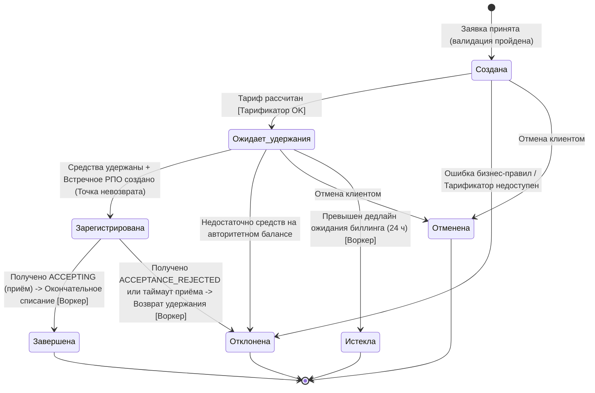

# (б) Машина состояний и событийная интеграция

## 1. Область моделирования и владелец состояния

В системе существуют два независимых контура состояний:
1. **Контур заявки на возврат (внутри ЛК ЮЛ):** владелец - сервис `REST API`. Описывает процесс оформления возврата от инициации клиентом до регистрации встречного отправления и финансового расчёта
2. **Контур физического движения посылки (почтовая сеть):** Владелец - учётная система почтовой сети. Возвратное отправление наследует статусы из внешнего контура (`Приём`, `Обработка`, `Вручение отправителю`) через `Сервис отслеживания РПО` и не имеет собственного конечного автомата внутри кабинета

Ниже описан конечный автомат заявки на оформление возврата

## 2. Множество состояний заявки

| Состояние               | Тип                                    | Разрешённые операции                                                                             | Запрещённые операции                                                     |
|:------------------------|:---------------------------------------|:-------------------------------------------------------------------------------------------------|:-------------------------------------------------------------------------|
| **`Создана`**           | Начальное                              | Расчёт тарифа, перевод в ожидание оплаты, отмена клиентом                                        | Передача в почтовую сеть, списание средств без удержания                 |
| **`Ожидает удержания`** | Промежуточное                          | Повторные попытки удержания средств воркером, отмена клиентом                                    | Регистрация трек-номера возврата, повторное создание заявки на то же РПО |
| **`Зарегистрирована`**  | Промежуточное (после точки невозврата) | Отслеживание физического статуса через шину, окончательное списание или возврат по неприёму/весу | Отмена заявки клиентом, изменение параметров возврата                    |
| **`Завершена`**         | Конечное (успех)                       | Только чтение (просмотр в реестре, включение в отчёты)                                           | Любые изменения состояния, повторное списание или возврат                |
| **`Отменена`**          | Конечное (отказ инициатора)            | Только чтение                                                                                    | Возобновление заявки, списание средств                                   |
| **`Отклонена`**         | Конечное (отказ системы/отделения)     | Только чтение                                                                                    | Повторное проведение без создания новой заявки                           |
| **`Истекла`**           | Конечное (таймаут)                     | Только чтение                                                                                    | Удержание или списание средств после истечения дедлайна                  |

## 3. Диаграмма переходов (Mermaid State Diagram)

## 4. Точка невозврата и обработка запрещённых переходов

### Точка невозврата
**Где проходит:** Переход из состояния `Ожидает_удержания` в состояние `Зарегистрирована`
**Обоснование:** В этот момент средства клиента заблокированы на балансе, встречному отправлению присвоен почтовый идентификатор, а событие о создании возврата опубликовано в `Корпоративную шину данных`. Внешний по отношению к кабинету мир (почтовая сеть и отделение связи) узнал о возврате - простая отмена записи в базе кабинета больше невозможна. Дальнейшее прекращение процесса возможно только как компенсирующая процедура (неприём в отделении и возврат удержанных средств)

### Перечень запрещённых переходов и реакция системы
Система перехватывает попытки выполнить недопустимые команды (при гонке запросов или повторной доставке) и возвращает явную диагностируемую ошибку, не меняя состояние:

| Исходное состояние            | Запрещённая команда / попытка перехода                     | Реакция системы (код и поведение)                                                                                                                                             |
|:------------------------------|:-----------------------------------------------------------|:------------------------------------------------------------------------------------------------------------------------------------------------------------------------------|
| **`Зарегистрирована`**        | Команда `Отменить заявку` от пользователя                  | Возврат ошибки бизнес-логики (`HTTP 409 Conflict`, код `RETURN_ALREADY_REGISTERED`: "Отмена невозможна, отправление передано в обработку")                                    |
| **`Завершена` / `Отклонена`** | Повторная доставка события `ACCEPTING` из шины             | Идемпотентная обработка: проверка ключа операции показывает, что переход уже выполнен. Система подтверждает получение сообщения брокеру (`ACK`) без повторного списания денег |
| **`Истекла`**                 | Запоздалый ответ от `Онлайн Баланса` об успешном удержании | Переход в `Зарегистрирована` запрещён. Система инициирует компенсирующую операцию разблокировки (возврата) средств на баланс                                                  |
| **`Ожидает_удержания`**       | Попытка списать средства минуя этап удержания              | Блокировка на уровне конечного автомата сервиса (`IllegalStateException`), запись в лог инцидентов                                                                            |

## 5. Поведение при недоступности смежного сервиса
* **Недоступен `Онлайн Баланс` при переходе из `Создана`:** Заявка фиксируется в статусе `Ожидает_удержания`. Пользователь видит статус В обработке (ожидает подтверждения резервирования средств) и отметку времени последнего обновления баланса. Если сервис не ответит в течение 24 часов, воркер переводит заявку в `Истекла`, а клиент может создать её заново без потери денег
* **Недоступна `Корпоративная шина данных` после удержания средств:** Заявка переходит в `Зарегистрирована`, а задача на отправку в шину сохраняется в локальной таблице `outbox` в одной транзакции с изменением статуса. Пользователь видит трек-номер возврата; данные уйдут во внешний контур автоматически при восстановлении шины

## 6. Разделение слоёв: Переходы состояния vs Событийные уведомления

| Стрелка / Взаимодействие                                         | Слой                                    | Обоснование (по 3 проверочным вопросам)                                                                                                                                                                                                            |
|:-----------------------------------------------------------------|:----------------------------------------|:---------------------------------------------------------------------------------------------------------------------------------------------------------------------------------------------------------------------------------------------------|
| **Перевод заявки в `Ожидает_удержания` и `Зарегистрирована`**    | Переход состояния                       | 1. Если вызов не дойдёт, состояние не изменится. 2. Состояние меняет сервис-владелец (`REST API`) в своей БД. 3. Защищено проверкой текущего статуса                                                                                         |
| **Публикация события `ReturnCreated` в RabbitMQ**                | Событийное уведомление                  | 1. Потеря сообщения не меняет факт регистрации заявки в БД `REST API`. 2. Владелец не меняется; потребители (`Фоновая публикация`, `ЕИАП`) только узнают о факте. 3. Потребители обязаны поддерживать идемпотентную обработку по `return_id` |
| **Получение операции `ACCEPTING` из шины сервисом отслеживания** | Событийное уведомление (для контура ЛК) | Внешний контур уже принял посылку. `Сервис отслеживания` сохраняет факт, а `REST API` по этому факту продвигает финансовый расчёт заявки в `Завершена`                                                                                             |

## 7. Работа воркера (планировщика) из З-8

Для гарантированного завершения распределённых шагов без паттерна Saga используется механизм Outbox + Планировщик-воркер внутри `REST API`:
* **Какой переход продвигает:**
  1. `Ожидает_удержания` → `Зарегистрирована` (повторные запросы в `Онлайн Баланс` при его временной недоступности)
  2. `Зарегистрирована` → `Отклонена` (автоматический возврат удержания при отсутствии события приёма `ACCEPTING` по истечении контрольного срока)
  3. Доставка событий в `RabbitMQ` из таблицы `outbox` после коммита в БД
* **По какому полю узнаёт, что пора:**
  * Опрашивает таблицу задач `return_outbox_tasks` по условию: `status = 'PENDING' AND next_execution_time <= NOW()`
  * При ошибке вызова смежного сервиса обновляет `next_execution_time` по стратегии экспоненциальной паузы (1 мин → 2 мин → 4 мин → до 1 часа)
  * Проверяет поле `deadline_at`: если `NOW() > deadline_at` (24 часа для удержания), прекращает попытки и переводит заявку в конечное состояние `Истекла`