# (0) Оценка и декомпозиция

[К оглавлению](README.md)

Клиент оформляет обратную пересылку по исходному отправлению, смотрит причину и ход доставки, проверяет состояние расчётов. Для ручной работы предусмотрен веб-кабинет, для интеграции — внешний API. Массовая загрузка использует тот же сценарий оформления для каждой строки.

Возвратное отправление — отдельный объект со своим ШПИ. Ссылка на исходный ШПИ обязательна для рассматриваемого сценария оформления из списка исходных отправлений. В общем почтовом контуре встречное отправление может существовать без такой ссылки (занятие 6). Расчёт тарифных правил, физический приём в отделении и определение статусов в почтовой сети остаются у смежных систем.

## Диаграмма контейнеров C4

Название существующего модуля взято из занятий 5–9. Стрелки показывают связи в предлагаемом решении. HTTP/JSON и SQL на проектируемых связях — предлагаемые протоколы; `[?]` означает, что контракт смежной системы требуется уточнить.

```mermaid
C4Container
    Person(operator, "Сотрудник организации", "Оформляет и отслеживает возвраты")
    System_Ext(client, "Система клиента", "Оформляет возвраты через внешний API")
    System_Ext(post, "Логистическая система", "Ведёт отправления и подтверждает операции приёма")
    System_Ext(bus, "Корпоративная шина данных", "Передаёт почтовые операции")
    System_Ext(tariff, "Тарификатор", "Рассчитывает стоимость пересылки")

    System_Boundary(lk, "Почтовый бизнес-кабинет") {
        Container(ui, "Микрофронтенд кабинета", "React, существующий", "Экран оформления, батчи и статусы")
        Container(bff, "web-client (BFF)", "Существующий", "Готовит данные для браузера")
        Container(gw, "API Gateway", "Существующий", "Контролирует внешний машинный вход")
        Container(api, "REST API", "Java, существующий", "Предоставляет единые операции возвратов")
        Container(returns, "Сервис возвратов", "Java, новый", "Ведёт заявки, пакетные задания, воркер и журнал исходящих событий")
        ContainerDb(db, "База возвратов", "PostgreSQL, новая схема", "Заявки, строки пакета, отложенные задачи и исходящие события")
        Container(shipment, "API отправлений", "Смежный модуль оператора", "Адаптер к данным и операциям отправлений")
        Container(track, "Сервис отслеживания РПО", "Существующий", "Отдаёт подтверждённые почтовые операции")
        Container(wallet, "Онлайн Баланс", "Существующий", "Подтверждает финансовые операции")
        ContainerQueue(queue, "RabbitMQ", "Существующий", "Доставляет события возвратов в статистику")
        Container(stats, "Статистика отправлений", "Существующий модуль", "Загружает события и обновляет отчёт")
        ContainerDb(dwh, "Аналитическое хранилище", "Аналитическая СУБД", "Хранит журнал и витрину возвратов")
    }

    Rel(operator, ui, "Оформляет возврат и читает статус", "HTTPS")
    Rel(ui, bff, "Отправляет форму или файл, запрашивает результат", "HTTPS")
    Rel(client, gw, "Отправляет запрос и опрашивает статус", "HTTPS")
    Rel(bff, api, "Передаёт запрос веб-кабинета", "HTTP/JSON")
    Rel(gw, api, "Передаёт авторизованный запрос интеграции", "HTTP/JSON")
    Rel(api, returns, "Регистрирует заявку или пакет, читает статус", "HTTP/JSON")
    Rel(returns, db, "Записывает состояния, задачи и события", "SQL")
    Rel(returns, shipment, "Проверяет исходное и оформляет встречное отправление", "HTTP/JSON")
    Rel(shipment, post, "Оформляет, закрывает регистрацию и сверяет её исход", "?")
    Rel(track, bus, "Читает подтверждённые почтовые операции", "REST-обвязка")
    Rel(returns, track, "Читает статус и причину по ШПИ", "HTTP/JSON")
    Rel(returns, tariff, "Запрашивает цену обратной пересылки", "?")
    Rel(returns, wallet, "Удерживает, списывает и освобождает средства, сверяет исход", "?")
    Rel(returns, queue, "Публикует подтверждённые изменения", "AMQP")
    Rel(stats, queue, "Читает события возвратов", "AMQP")
    Rel(stats, dwh, "Загружает журнал, строит и читает витрину", "SQL")
    Rel(api, stats, "Запрашивает агрегаты отчёта", "HTTP/JSON")
```

## Какие модули меняются

| Модуль | Изменение |
|---|---|
| Микрофронтенд и web-client | Форма и загрузка списка, опрос задания, раздельные статусы заявки, трекинга и денег. |
| API Gateway и REST API | Доступ к операциям возвратов через два входа, передача контекста клиента и ключа запроса. |
| API отправлений | Адаптер для проверки исходного отправления, регистрации встречного и сверки результата с логистическим контуром. Доступность нужных операций проверяется до внедрения. |
| Сервис отслеживания РПО | Чтение операций для встречного ШПИ. Для проекта нужны метка времени, идентификатор или версия операции и исходная причина, если источник её передаёт. |
| Онлайн Баланс | Использование подтверждённых удержаний, списаний и освобождений через границу финансового контура; уточняется поддержка ключа операции и запроса её результата. |
| Статистика отправлений и хранилище | Подписка на новые события, журнал аналитики и витрина. Выбор аналитической СУБД в проекте не подтверждает, где сейчас работает отчётность. |

Добавляется один прикладной сервис. Он хранит заявку, строки пакета и задания на продолжение, которые должны фиксироваться вместе с её состоянием. Вынос нужен, чтобы массовые повторы и ожидание биллинга не занимали ресурсы общего REST API и не связывали его выпуск с изменениями модели возвратов. Вариант с модулем прямо в REST API проще в развёртывании, но оставляет очередь и пользовательские запросы в одном контуре отказа. Парсер, воркер, адаптеры тарифов и баланса остаются частями сервиса; отдельные сервисы для них не требуются. База — отдельная логическая схема проекта.

**Вопрос к владельцам интеграций:** можно ли по стабильному внешнему ключу получить исход регистрации встречного отправления и денежной операции после потери ответа? Для закрытия регистрации дополнительно нужна гарантия, что подтверждение закрытия исключает последующий приём в отделении.
