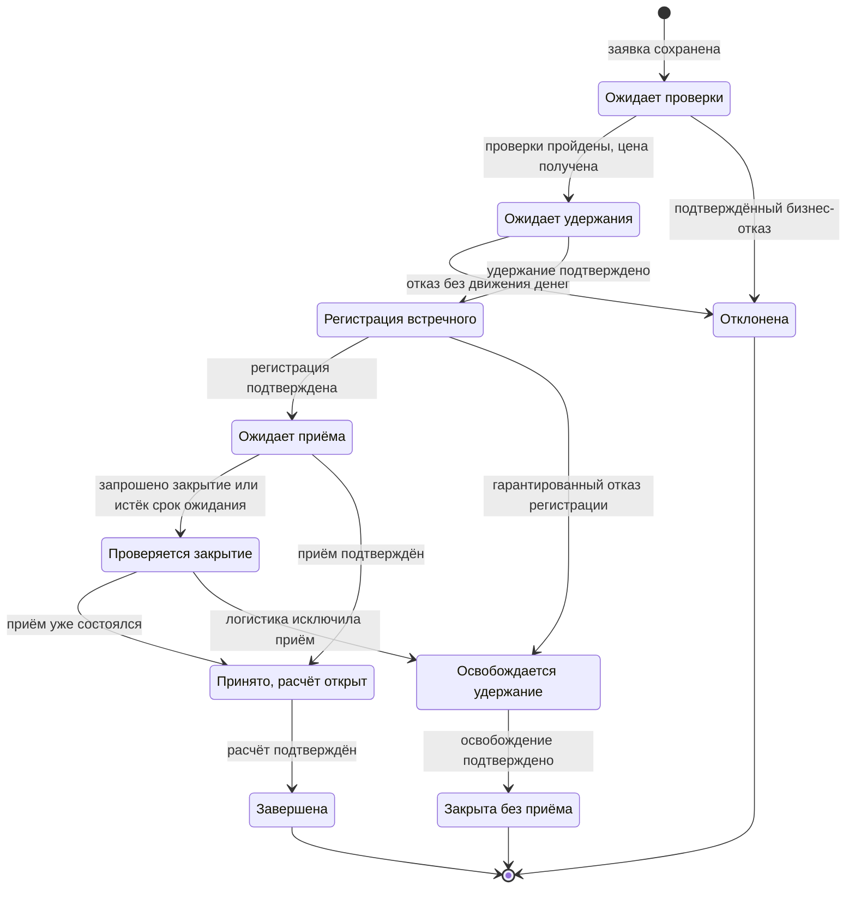

# (б) Машина состояний

[К оглавлению](README.md) · [Архитектура](a-architecture.md)

Сервис возвратов владеет **заявкой** и её состоянием. У встречного отправления свой ШПИ; его физический путь ведёт почтовая система. В ЛК сохраняется последнее подтверждённое состояние отправления и время обновления. Деньги подтверждаются «Онлайн Балансом». Успешный исход заявки в этой модели означает завершение оформления и расчёта, а не вручение посылки.

## Заявка в кабинете

| Состояние | Что разрешено и кто продвигает |
|---|---|
| Ожидает проверки | Воркер проверяет исходное отправление и получает цену. При техническом отказе сохраняет этап и назначает повтор. При бизнес-отказе закрывает с причиной. |
| Ожидает удержания | Воркер повторяет сверку по ключу удержания до подтверждённого исхода. Приём заявки ещё не разрешает регистрировать отправление. |
| Регистрация встречного | Воркер отправляет команду регистрации после подтверждённого удержания. При неизвестном исходе сверяет прежний ключ. Гарантированный отказ означает, что регистрация не выполнена и больше не будет выполнена по этому ключу. |
| Ожидает приёма | Кабинет показывает встречный ШПИ. Воркер читает почтовые операции, включая приём, который мог произойти до получения ответа о регистрации; можно запросить закрытие. Просрочка сама по себе даёт повод запросить закрытие, средства остаются удержанными. |
| Проверяется закрытие | Логистика атомарно определяет исход гонки между закрытием и фактическим приёмом. Если приём подтверждён, продолжается расчёт; если регистрация закрыта и приём исключён, начинается освобождение средств. Без подтверждения сохраняется ожидание или требуется вмешательство. |
| Принято, расчёт открыт | Подтверждённый приём — **точка невозврата**. Отделение уже приняло отправление в физический оборот. Сервис завершает списание и при необходимости корректировку по весу; в разделе трекинга виден независимый почтовый статус. |
| Освобождается удержание | Отправляется команда освобождения, затем проверяется её исход. При потерянном ответе используется тот же ключ. |
| Завершена / отклонена / закрыта без приёма | Состояние заявки больше не меняется. По оформленному отправлению трекинг продолжает показывать новые почтовые операции независимо от завершения расчёта. |

Воркер из массовой операции выбирает заявку по `status` и `next_attempt_at`, учитывает `lease_until` и версию записи. Он продвигает, например, «Ожидает удержания → Регистрация встречного» **после подтверждения** операции. Запись новой версии, результата строки пакета (когда результат определился) и исходящих событий фиксируется вместе. Внешний вызов выполняется вне транзакции БД, поэтому перед ним сохраняется ключ. Сбой между внешним выполнением и записью результата разрешается сверкой, а не созданием новой операции.

## Запрещённые переходы и ответы

| Попытка | Поведение |
|---|---|
| Зарегистрировать встречное отправление без подтверждённого удержания | Отказ перехода; клиенту показывается текущий статус, внешняя команда не отправляется. |
| Повторить оформление уже зарегистрированного возврата | Повтор того же запроса возвращает прежнюю заявку. Запрос на новое оформление того же возврата возвращает конфликт. |
| Закрыть после приёма или отменить списание переходом назад | Конфликт с текущим состоянием. Отдельная финансовая корректировка проходит с собственным ключом. |
| Освободить удержание при неизвестном результате приёма | Переход блокируется, сохраняется ожидание сверки. |
| Переоткрыть конечное состояние | Переход блокируется. Если правила допускают новую попытку после закрытия без приёма, это новая заявка с новым ключом. |

## Финансовые операции

| Движение денег | Переход или условие | Что подтверждает результат |
|---|---|---|
| Удержание предварительной цены | «Ожидает удержания → Регистрация встречного» | Подтверждённое удержание от «Онлайн Баланса». |
| Списание удержанной суммы | В «Принято, расчёт открыт», после подтверждения приёма | Ответ о финальном списании или результат сверки по ключу. |
| Доначисление или возврат разницы | В том же состоянии, после пересчёта по подтверждённому весу. Без требуемого подтверждения переход в «Завершена» не выполняется. | Отдельная операция корректировки; при нулевой разнице отдельной операции нет. |
| Освобождение удержания | «Освобождается удержание → Закрыта без приёма» | Подтверждённое освобождение после окончательного отказа регистрации или закрытия, исключающего приём. |

Списание и корректировка — переходы отдельного финансового учёта операций: `pending → confirmed` по ответу финансовой системы; при потерянном ответе остаётся `pending`, при явном отказе выставляется `failed` с причиной. Для обязательной доплаты после отказа оператор может разрешить новую попытку лишь после проверки результата прежней операции. Итог по заявке рассчитывается после всех необходимых подтверждений. При сбое биллинга после приёма клиент видит «принято, расчёт не завершён»; отправление из-за этого не возвращается в состояние до приёма.

## События и уведомления

Команда клиента и подтверждённый исход смежной операции служат основанием для перехода. Например, подтверждение приёма из логистики обрабатывается в контексте текущего состояния и только затем сохраняется переход. Повтор уже учтённой почтовой операции ничего не списывает; запоздалый статус не замещает более новую версию. Деньги, журнал и переходы сверяются по ключу операции, даже если обработчик перезапустился после внешнего вызова.

После транзакции публикуются уведомления:

| Уведомление | Что уже зафиксировано | Кто использует |
|---|---|---|
| `ReturnRequested` | Создание заявки и время поступления. | Статистика. |
| `ReturnStateChanged` | Переход заявки с причиной решения, предыдущим и новым состоянием. | Статистика; в том числе считает отклонения и время до регистрации. |
| `ReturnTrackingUpdated` | Связь встречного ШПИ с полученной почтовой операцией, время операции, исходный код причины при наличии. | Статистика; уточняет логистическую причину. |
| `ReturnMoneyConfirmed` | Подтверждённая операция с её ключом, видом, суммой, валютой и временем. | Статистика; считает денежный результат. |

Уведомления не меняют заявку при доставке: её состояние уже записано сервисом возвратов. При задержке публикации отстаёт отчёт. При повторной доставке потребитель отбрасывает повтор по `event_id`; финансовые факты дополнительно сводятся по ключу операции. Владелец физического статуса — логистика, владелец денежного подтверждения — финансовая система. Брокер ни одну из этих ролей не выполняет.
