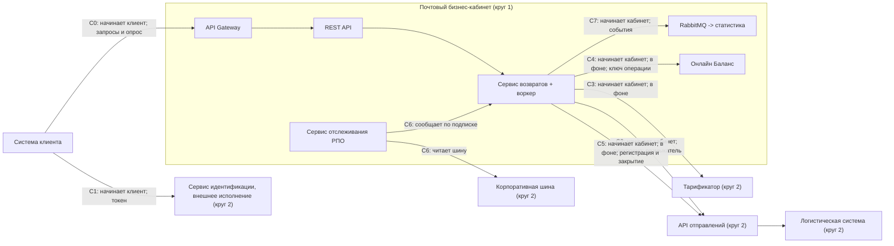

# ЛР-3. API и интеграции

Работа продолжает [ЛР-2](../lr2/README.md) на той же фиче — управление возвратами. В работе спроектирован публичный API, через который программа клиента оформляет, закрывает и отслеживает возвраты без экрана кабинета. Состояния возврата взяты из [машины состояний ЛР-2](../lr2/b-states.md), смежные системы — из [схемы контейнеров ЛР-2](../lr2/0-decomposition.md).

## Оглавление

- (а) Три операции — [a-openapi.yaml](a-openapi.yaml); интеграционная карта — [ниже](#интеграционная-карта)
- (б) Документация для разработчика — [b-docs.md](b-docs.md)
- (в) Размыкатель цепи — [v_circuit_breaker.py](v_circuit_breaker.py), демонстрация [v_demo.py](v_demo.py), тесты [v_test.py](v_test.py), пояснения [v-notes.md](v-notes.md)
- (г) Роли и матрица прав — [g-access.md](g-access.md)
- [Что изменилось относительно черновиков](#что-изменилось-относительно-черновиков)
- [Найденные расхождения](#найденные-расхождения)

Запуск кода (Python 3.8+, ничего ставить не нужно):

```bash
python3 v_demo.py
```

Тесты: `python3 -m unittest v_test -v`. Спецификация проверена `openapi-spec-validator`, ошибок нет. Она открывается в Swagger Editor.

Все числа в работе — учебные допущения. Таймаут 3 с и паузы повторов взяты из ЛР-2, остальное (окно размыкателя, срок хранения ключа, время жизни токена, суммы в примерах) задано для проекта. Квота шлюза из материалов курса цифрой не приводится.

## Интеграционная карта

Круги — по занятию 13: 1 — сам кабинет, 2 — другие системы организации, 3 — вне организации. Связей третьего круга в фиче нет.



| Связь | Что передаётся | Круг | Кто начинает | Гарантия доставки | Что при отказе | Операции |
|---|---|---|---|---|---|---|
| C0 | Запросы клиента через шлюз | шлюз — 1 | клиент | хотя бы один раз: клиент повторяет, пока не получит ответ. Поэтому у POST есть `Idempotency-Key` | клиент получает ошибку или обрыв и повторяет с тем же ключом | все три |
| C1 | Выдача токена, ключи для проверки подписи | 2 | клиент (токен), шлюз (ключи) | не более одного раза, но это чтение, повторять можно | новые токены не выдаются, старые работают до истечения. Размыкатель здесь не ставится: если разомкнуть цепь к сервису входа, никто не войдёт | все три |
| C2 | Проверка исходного отправления: есть ли оно и принадлежит ли клиенту | 2 | кабинет, синхронно, клиент ждёт | не более одного раза, чтение | отказ или таймаут — `503 DEPENDENCY_UNAVAILABLE`; много отказов подряд — `503 CIRCUIT_OPEN`. Заявка не создаётся. **Здесь стоит размыкатель** | `createReturn` |
| C3 | Цена пересылки | 2 | кабинет, в фоне | не более одного раза, чтение | заявка остаётся `queued`, повторы 10/30/90 с как в ЛР-2 | `createReturn` |
| C4 | Удержание, списание, освобождение денег | 1, дальше учётные системы — 2 | кабинет, в фоне | хотя бы один раз + ключ денежной операции. Без ключа повтор спишет деньги дважды | `holding` или `reconciling: true`, потом сверка по ключу | `createReturn`, `closeReturn` |
| C5 | Регистрация встречного отправления и её закрытие | 2 | кабинет, в фоне | с ключом, если логистика умеет проверять исход по ключу (открытый вопрос из ЛР-2); иначе не более одного раза + сверка | `registering` или `closing` с `reconciling: true`, удержание не освобождается | `createReturn`, `closeReturn` |
| C6 | Почтовые операции по встречному ШПИ | шина — 2, подписка внутри кабинета — 1 | сервис отслеживания | нет данных. Принято, что возможны повторы; они отбрасываются по идентификатору операции (как в ЛР-2) | `tracking.stale: true`, показывается последнее известное состояние | `listReturns`, итог `closeReturn` |
| C7 | События для статистики | 1 | кабинет | хотя бы один раз, повтор отбрасывается по `event_id` | отстаёт отчёт, на API не влияет | — |

Как из карты получаются коды ошибок:

- Пока клиент ждёт ответа, `createReturn` ходит только в одну смежную систему (C2). Поэтому `503 DEPENDENCY_UNAVAILABLE` и `503 CIRCUIT_OPEN` есть только у этой операции.
- `closeReturn` и `listReturns` синхронно никуда наружу не ходят, у них таких 503 нет. Они работают, даже если лежат API отправлений, баланс и логистика.
- Всё, что идёт в фоне (C3–C5), клиент видит по статусу возврата и флагу `reconciling`, а не по коду ошибки. Поэтому ответ `202` и опрос.
- Уведомлений наружу нет, поэтому в документации указано, как часто опрашивать.
- Кабинет отвечает за оформление, удержание и показ статуса. За сроки доставки отвечает почтовая сеть, поэтому в документации они не обещаются.

## Что изменилось относительно черновиков

- **(а), З-10.** В практикуме была одна операция. Теперь их три: оформление, закрытие (это переход `awaiting_acceptance → closing` из ЛР-2) и перечень. Для каждой указано, где именно запрос ограничивается своим клиентом: `client_id` берётся только из токена, в теле и параметрах его нет. Для чужого объекта возвращается `404`, а не `403`, чтобы не показывать, что такой объект вообще есть.
- **(а), идемпотентность.** Расписаны все случаи: тот же ключ и то же тело — прежний ответ; тот же ключ и другое тело — `422`; первый запрос ещё идёт — `409`; ключ истёк — дубль всё равно не создастся из-за правила «одна открытая заявка на отправление». Ответы `429` и `503` ключ не тратят.
- **(а), модель ошибок.** Добавлено поле `category`, чтобы программа отличала «неправильный запрос», «не ответила смежная система» и «цепь разомкнута, вызова не было», не разбирая текст сообщения.
- **(а), З-13.** В карту добавлен столбец с операциями. Теперь видно, откуда берутся коды 503. Гарантия для C6 записана как «нет данных».
- **(б).** К примеру запроса из З-10 добавлено: как получить секрет и токен, из какого контура доступен API, тестовый и боевой контуры, ограничение по IP, лимиты и что делать при каждой ошибке. Частота опроса привязана к тому, сколько длится каждый статус.
- **(в), З-11.** Было два состояния, стало три: добавлены полуоткрытое с пробным запросом, растущую паузу и предел времени для полуоткрытого. Ошибка разомкнутой цепи стала ответом API с `Retry-After`. Фиктивный сервис заменён на проверку отправления: чужое отправление — это ошибка запроса, она цепь не размыкает.
- **(г), З-12.** К ролям из заготовки добавлены субаккаунт в области видимости, программу как отдельного субъекта и аудитора. Операции в матрице совпадают со спецификацией, плюс вход через API. Явно записано правило «запрещено всё, что не разрешено».

## Найденные расхождения

1. **Машина состояний ЛР-2 и спецификация.** В ЛР-2 нет отмены заявки клиентом, пока она в `queued`, `holding` или `registering`. Закрыть можно только из «Ожидает приёма». То есть если клиент ошибся с ШПИ, отменить он не может, пока идёт оформление. В ЛР-3 `closeReturn` в этих статусах отвечает `409 INVALID_STATE` с советом повторить позже. Переход «отмена до удержания» предлагается добавить в ЛР-4.
2. **Пакетное оформление.** В ЛР-2 и в матрице прав оно есть, а в спецификации нет. Это сознательно: в задании три операции. В матрице строка помечена, чтобы права на неё не потерялись. В ЛР-4 можно добавить `POST /v1/return-jobs`.
3. **Где проверяется принадлежность отправления.** В ЛР-2 это делал воркер. В ЛР-3 добавлена синхронная проверка при приёме запроса (C2), чтобы интегратор сразу получил `404`. Проверка в воркере сохранена: отправление может измениться, пока заявка ждёт обработки. Из-за синхронной проверки появилась внешняя зависимость прямо в запросе, и поэтому на C2 нужен размыкатель.
4. **Размыкатель, документация и спецификация.** Проведена сверка: все коды, которые возвращает `to_http_error` в коде размыкателя, есть и в спецификации, и в таблице ошибок `b-docs.md`. `CIRCUIT_OPEN` описан только у `createReturn`. Если указать его у всех операций, интегратор будет ждать ошибку там, где её не бывает.
5. **Частота опроса.** В ЛР-2 было «раз в 5 секунд». Для возврата, который несколько дней ждёт приёма, это очень много холостых запросов, а квота шлюза общая. 5 секунд оставлены только на время оформления, дальше — раз в час, и все возвраты одним запросом с `updatedFrom`.
6. **Срок хранения ключа.** В ЛР-2 срок не был указан. Теперь ключ хранится 24 часа. После этого повтор вернёт не прежний `202`, а `409 RETURN_ALREADY_EXISTS` с номером заявки. Дубля всё равно не будет.
7. **Отличие от системы из курса.** В системе из занятий 10 и 11 превышение лимита даёт нестандартный `509`, а разомкнутая цепь — `503` без времени повтора. В проекте — `429` и `503 CIRCUIT_OPEN` с точным `Retry-After`. Это проектное предложение, а не описание того, как сейчас работает система.
8. **Матрица и API.** В матрице есть действия, которых нет в API: выпуск учётной записи интеграции, назначение ролей, журнал аудита. Они делаются только в веб-кабинете, чтобы программа не могла выдать себе секрет или права.
