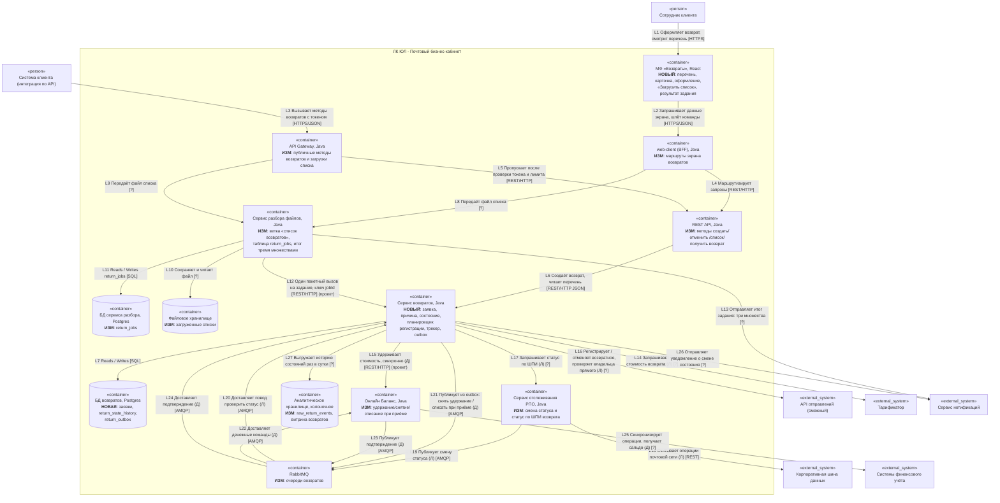

Черновик: З-5 (схема дополнена конвейером З-8, денежными связями З-7 и загрузкой в аналитику З-9)
## Фича на верхнем уровне
### Кто и зачем
Клиент-организация ведёт обратный поток своих отправлений: оформляет возврат по одному и списком, видит, где возврат сейчас и по какой причине и понимает, что возврат значит для его денег.

Слово "возврат" в фиче употребляется в двух смыслах, это два разных контура.

|                        | Возврат **отправления** (Л) - ядро                                    | Возврат **денег** (Д) - следствие                                                             |
| ---------------------- | --------------------------------------------------------------------- | --------------------------------------------------------------------------------------------- |
| Что движется           | Встречное отправление со своим ШПИ                                    | Удержание, окончательное списание, снятие удержания, доначисление или возврат разницы по весу |
| Кто владеет состоянием | Заявку ведёт сервис возвратов, физическое отправление - почтовая сеть | Онлайн Баланс                                                                                 |
| Смежные системы        | API отправлений, корпоративная шина                                   | Тарификатор, Онлайн Баланс -  системы финансового учёта                                       |
| Когда движется         | По командам клиента и операциям почтовой сети                         | За приёмом в отделении                                                                        |

Сущность фичи - заявка на возврат, оформленная клиентом.
Качественная оценка объема. Затрагиваются 10 существующих контейнеров и добавляются 2 новых.
## Контейнерная диаграмма (C4, уровень container)
Обозначения как в черновике З-5:
- НОВЫЙ - контейнер, который добавляет фича
- ИЗМ - что меняется в существующем
- `[?]` - связь известна, протокол неизвестен
- `(проект)` - протокол выбран мной, потому что связь новая
- (Л) - возврат отправления
- (Д) - возврат денег. 
  Смежные корпоративные системы названы по функции.

## Какие существующие модули затрагиваются и что в каждом меняется

| Контейнер                                | Что меняется                                                                                                                                                                                | Тип изменения                  |
| ---------------------------------------- | ------------------------------------------------------------------------------------------------------------------------------------------------------------------------------------------- | ------------------------------ |
| web-client (BFF)                         | Маршруты экрана возвратов                                                                                                                                                                   | новые маршруты                 |
| API Gateway                              | Публичные методы возвратов (создать, отменить, список, загрузить список, статус задания)                                                                                                    | новые методы, политика лимитов |
| REST API                                 | Методы-фасады к сервису возвратов, общие для обоих входов                                                                                                                                   | новые методы                   |
| Сервис разбора файлов                    | Новая ветка логики "список возвратов" - проверка задания, ключ задания "клиент + хэш файла", построчная формальная валидация, один пакетный вызов в сервис возвратов, итог из трёх множеств | новая ветка, новая таблица     |
| Файловое хранилище                       | Загруженные списки                                                                                                                                                                          | новый каталог                  |
| Сервис отслеживания РПО                  | Публикует смену статуса по ШПИ возвратных отправлений                                                                                                                                       | новая подписка, новый метод    |
| Онлайн Баланс                            | Удержание и снятие удержания по ключу `ID заявки + тип`, списание при приёме (с доначислением или возвратом разницы по весу) по ключу `ШПИ возвратного + тип`                               | новые операции                 |
| RabbitMQ                                 | Очереди: поводы проверить статус, денежные команды и подтверждения, уведомления                                                                                                             | новые очереди                  |
| Аналитическое хранилище                  | Сырой слой `raw_return_events` и витрина возвратов                                                                                                                                          | новая схема                    |
| Сервис уведомлений (смежный, по функции) | Окно в ЛК и письмо - итог задания, смена состояния заявки                                                                                                                                   | новые шаблоны                  |
Смежные системы, у которых я ничего не меняю, но от которых завишу:
- API отправлений
- тарификатор
- корпоративная шина
- системы финансового учёта
## Новые модули и почему их нельзя не заводить
1. Сервис возвратов (со своей БД). 
   У фичи появляется новая сущность - заявка с собственной моделью состояний, и ей нужен один владелец. Ни один существующий модуль не может быть им:
   - REST API - Общий фасад двух входов. Фоновые задачи и outbox заявки связали бы выпуск возвратов с выпуском всех методов
   - Сервис отправлений - Возврат - это отдельная сущность со своим ШПИ, а не состояние
   - Сервис отслеживания - Отражает чужое состояние и не принимает команды клиента
   - Онлайн баланс - Деньги это следствие, два контура слились бы в один процесс

1. Микрофронтенд "Возвраты". 
   Отдельный функциональный блок интерфейса: перечень, карточка, загрузка списка и её результат. Внутри чужого МФ его выпуск был бы привязан к выпуску чужого блока.