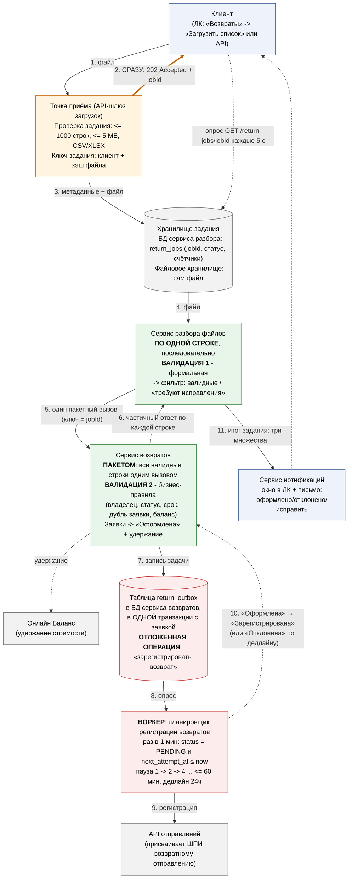

Черновики: З-5, З-7 (вариант 2 «сообщение пришло дважды»), З-8
## Статус чисел
 1000 строк на файл - из открытого источника. Все остальные числа файла - учебные допущения: 5 МБ, 5с, паузы повторов, 24ч, 14 и 15 дней, период воркера, период сверки. Коды ответов HTTP - проектное решение.
 
 ## Границы ответственности

| Кто                                         | Чем владеет (истина)                                                                                        | Чего не делает                                                                   |
| ------------------------------------------- | ----------------------------------------------------------------------------------------------------------- | -------------------------------------------------------------------------------- |
| Сервис возвратов                            | Заявка, её состояние и причина; `return_state_history`; задачи `return_outbox`; бизнес-проверки (уровень 2) | Не ведёт состояние физического отправления, не хранит баланс, не разбирает файлы |
| Сервис разбора файлов                       | Задание массовой загрузки, файл, формальная проверка строк (уровень 1), итог из трёх множеств               | Не решает, можно ли оформить возврат: это знание владельца домена                |
| Почтовая сеть (шина -> сервис отслеживания) | Состояние физического возвратного отправления, факт и время приёма, вес и ОПС приёма                        | -                                                                                |
| Сервис отслеживания РПО                     | Копия операций почтовой сети в кабинете                                                                     | Не меняет состояние заявки, только уведомляет и отвечает на запрос статуса       |
| Онлайн Баланс                               | Баланс и авторитетный остаток, денежные операции и отметки "уже обработано" по ключам                       | Не решает, когда наступает фаза                                                  |
| Тарификатор                                 | Стоимость пересылки S                                                                                       | -                                                                                |
| API отправлений                             | Регистрация встречного отправления (ШПИ), отмена по требованию отправителя, данные прямого отправления      | -                                                                                |
| BFF / API Gateway                           | Вход экрана: агрегация под экран/вход интеграции: токен, лимиты, маршрутизация                              | Не содержат бизнес-правил возврата                                               |

## Связи и протоколы
Номера как на контейнерной диаграмме. `[?]` - источник называет связь, но не называет протокол. (проект) - связь новая, выбор протокола при проектировании.

| №       | Откуда -> куда                                      | Действие                                                                                        | Протокол           | Режим                                    | Почему так                                                                                                                                      |
| ------- | --------------------------------------------------- | ----------------------------------------------------------------------------------------------- | ------------------ | ---------------------------------------- | ----------------------------------------------------------------------------------------------------------------------------------------------- |
| L1      | Сотрудник -> МФ                                     | оформляет, смотрит                                                                              | HTTPS              | синхр.                                   | -                                                                                                                                               |
| L2      | МФ -> BFF                                           | данные экрана, команды                                                                          | HTTPS/JSON         | синхр.                                   | вход экрана                                                                                                                                     |
| L3      | Система клиента -> Gateway                          | методы возвратов                                                                                | HTTPS/JSON + токен | синхр.                                   | вход интеграции                                                                                                                                 |
| L4/L5   | BFF/Gateway -> REST API                             | маршрутизирует/пропускает после токена и лимита                                                 | REST/HTTP          | синхр.                                   | точка схождения двух входов - общий REST API                                                                                                    |
| L6      | REST API -> сервис возвратов                        | создать, отменить, прочитать                                                                    | REST/HTTP JSON     | синхр.                                   | клиенту нужен немедленный ответ (принято, отказано и почему)                                                                                    |
| L7      | Сервис возвратов -> своя БД                         | заявка, история, outbox                                                                         | SQL                | -                                        | заявка и задача outbox пишутся одной транзакцией                                                                                                |
| L8/L9   | BFF/Gateway -> сервис разбора файлов                | файл списка                                                                                     | `[?]`              | синхр., ответ 202                        | маршрут загрузки файлов в источниках описан без протокола                                                                                       |
| L10     | Сервис разбора -> файловое хранилище                | файл                                                                                            | `[?]`              | -                                        | файл отдельно от метаданных задания                                                                                                             |
| L11     | Сервис разбора -> своя БД                           | `return_jobs`                                                                                   | SQL                | -                                        | метаданные задания и счётчики                                                                                                                   |
| L12     | Сервис разбора -> сервис возвратов                  | один пакетный вызов со всеми валидными строками, ключ `jobId`; частичный ответ по каждой строке | REST/HTTP (проект) | синхр.                                   | <= 1000 позиций помещаются в одно тело вызова. Ответ должен быть частичным по составу.                                                          |
| L13     | Сервис разбора -> сервис нотификаций                | итог задания                                                                                    | `[?]`              | -                                        | окно в ЛК и письмо                                                                                                                              |
| L14     | Сервис возвратов -> тарификатор                     | стоимость S                                                                                     | `[?]`              | синхр.                                   | без цены не оформить; режима деградации нет                                                                                                     |
| L15     | Сервис возвратов -> Онлайн Баланс                   | удержать S, ключ - ID заявки + "удержание"                                                      | REST/HTTP (проект) | синхр., ответ обязателен                 | результат удержания - условие перехода "Черновик -> Оформлена", значит это команда с ответом. Решение принимает баланс по авторитетному остатку |
| L16     | Сервис возвратов -> API отправлений                 | регистрация, отмена, проверка владельца прямого                                                 | `[?]`              | синхр.; регистрацию вызывает планировщик | регистрация может ждать, клиенту не нужно держать соединение                                                                                    |
| L17     | Сервис возвратов -> сервис отслеживания             | статус по ШПИ (уровень 2: "ещё не вручено"; трекер)                                             | `[?]`              | синхр.                                   | истина о статусе читается, а не выводится из сообщения                                                                                          |
| L18     | Сервис отслеживания -> корп. шина                   | считывает операции                                                                              | REST               | синхр.                                   | статус рождается вне кабинета                                                                                                                   |
| L19-L20 | Сервис отслеживания -> RabbitMQ -> сервис возвратов | "статус изменился"                                                                              | AMQP               | событие                                  | повод проверить раньше                                                                                                                          |
| L21-L22 | Сервис возвратов -> RabbitMQ -> Онлайн Баланс       | снять удержание/списать при приёме                                                              | AMQP               | событие из outbox                        | следствие уже зафиксированного перехода; у баланса идемпотентно по ключу                                                                        |
| L23-L24 | Онлайн Баланс -> RabbitMQ -> сервис возвратов       | подтверждение                                                                                   | AMQP               | событие                                  | закрывает задачу outbox                                                                                                                         |
| L25     | Онлайн Баланс -> системы фин. учёта                 | операции, сальдо                                                                                | `[?]`              | -                                        | существующий механизм, не меняется                                                                                                              |
| L26     | Сервис возвратов ->  сервис нотификаций             | смена состояния                                                                                 | `[?]`              | из outbox                                | дубль отсекается парой "заявка + состояние"                                                                                                     |
| L27     | Сервис возвратов ->  аналитическое хранилище        | история состояний раз в сутки                                                                   | `[?]`              | пакетно                                  | [в организация аналитики.md](в%20организация%20аналитики.md)                                                                                    |

Синхронно - там, где ответ является условием перехода или нужен инициатору. Через outbox и брокер - всё, что является следствием перехода. Если такое сообщение потеряется, состояние заявки не изменится, поэтому это интеграция.
## Конвейер массового оформления возвратов

Клиент загружает список отправлений (ШПИ + причина)

## Механизм изоляции отказов смежных систем

Отказ зависимости не должен выводить из строя сценарии, которые её не используют. Перечень и карточка читаются только из БД сервиса возвратов, поэтому при отказе любой смежной системы перечень открывается, а недоступная часть помечена.

| Что отказало                        | Что перестаёт работать                                                                                     | Что продолжает работать                                                              | Что видит пользователь                                                                                                                                                               | Как восстанавливается                                                           |
| ----------------------------------- | ---------------------------------------------------------------------------------------------------------- | ------------------------------------------------------------------------------------ | ------------------------------------------------------------------------------------------------------------------------------------------------------------------------------------ | ------------------------------------------------------------------------------- |
| API Gateway (свой вход)             | Все методы возвратов и загрузка списков у интеграторов                                                     | Экран целиком (другой вход)                                                          | Интегратор - отказ соединения или 5xx от шлюза. Пользователи экрана ничего не замечают.                                                                                              | Повтор загрузки того же файла даёт тот же `jobId`.                              |
| web-client (BFF) (свой вход)        | Экран возвратов и вместе с ним все МФ кабинета                                                             | API интеграторов; фоновая обработка заданий, регистрация                             | Раздел не загружается                                                                                                                                                                | Состояние в сервисе возвратов и сервисе разбора                                 |
| REST API (общая точка обоих входов) | Одиночное оформление и чтение через оба входа                                                              | Загрузка списков, воркеры, деньги                                                    | Ошибка при открытии перечня                                                                                                                                                          | Единая точка отказа двух входов                                                 |
| Сервис разбора файлов               | Массовая загрузка                                                                                          | Одиночное оформление и всё остальное                                                 | "Загрузка списков временно недоступна, оформите возвраты по одному"                                                                                                                  | Принятые задания лежат в `return_jobs`, разбор продолжится после восстановления |
| Тарификатор                         | Оформление                                                                                                 | Перечень, отслеживание, отмена, деньги по уже оформленным                            | "Расчёт стоимости временно недоступен, черновик сохранён, оформите позже". В пакете строки уходят в "требует вмешательства"                                                          | Отказ без цены                                                                  |
| Онлайн Баланс - удержание           | Оформление (удержание - условие перехода)                                                                  | Всё остальное                                                                        | "Не удалось зарезервировать средства, черновик сохранён". В пакете "требует вмешательства", кнопка "Повторить"                                                                       | Строка сразу уходит в "требует вмешательства"                                   |
| Онлайн Баланс - снятие/списание     | Только денежные фазы                                                                                       | Логистика целиком                                                                    | "Принят в отделении, списание в обработке"                                                                                                                                           | Задачи outbox копятся в БД возвратов и уходят после восстановления              |
| Системы финансового учёта           | Ничего в фиче напрямую                                                                                     | Всё                                                                                  | -                                                                                                                                                                                    | Существующая ежемесячная сверка сальдо                                          |
| API отправлений                     | Регистрация, отмена из "Зарегистрирована", проверка владельца в пакете                                     | Перечень, трекинг уже зарегистрированных, деньги                                     | "Ожидает регистрации, ШПИ появится позже". Через 24ч - "Не удалось зарегистрировать, удержание снято, создайте заявку заново". Отмена - "временно недоступна", состояние не меняется | Планировщик повторяет с растущей паузой до дедлайна                             |
| Корп. шина/сервис отслеживания      | Продвижение «-> В пути/Вручена/Закрыта», а с ним и списание при приёме; проверка "ещё не вручено" в пакете | Оформление, регистрация, перечень                                                    | Последний известный статус с пометкой "данные на `[время]`". Таймер "Истекла" ждёт, пока данные отслеживания по ШПИ старше 24ч                                                       | Трекер дочитает статусы                                                         |
| RabbitMQ                            | Поводы, денежные команды, уведомления                                                                      | Трекер всё равно опрашивает статус, переходы идут, только позже; оформление и чтение | "Списание в обработке", уведомления запаздывают                                                                                                                                      | Outbox                                                                          |
| Сервис нотификаций                  | Окна и письма                                                                                              | Всё остальное                                                                        | Нет письма; итог задания виден на экране                                                                                                                                             | Повтор                                                                          |
| Файловое хранилище                  | Приём массовой загрузки                                                                                    | Одиночное оформление и всё остальное                                                 | 503, "Загрузка списков временно недоступна"                                                                                                                                          | Задание не создаётся без сохранённого файла                                     |

Механизм изоляции в целом складывается из четырёх решений:
1. у сервиса возвратов своя БД, и чтение перечня не обращается к смежным системам.
2. всё, что является следствием перехода, уходит через `return_outbox`, поэтому переход не ждёт смежную систему.
3. синхронные зависимости (тарификатор и удержание) задействованы только на одном переходе. При их отказе заявка остаётся в предыдущем устойчивом состоянии.
4. отображаемое значение всегда несёт отметку "данные на..."