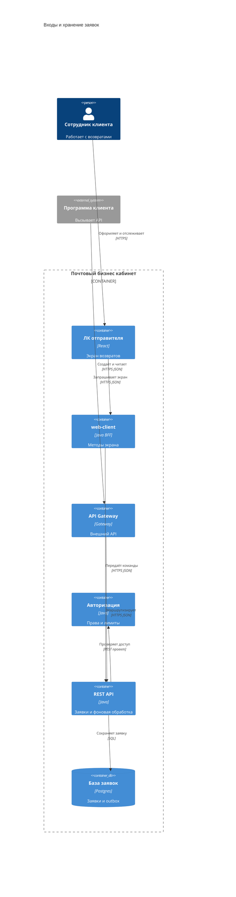
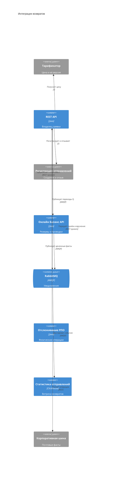

# Оценка и декомпозиция

В объём входят оформление по одному и списком, отслеживание, отмена до приёма, расчёт стоимости и аналитика. Работа почтовых отделений и возврат стоимости прямой пересылки не меняются.

## Оценка

Оценка дана в человеко-днях и является учебным допущением. Она включает реализацию и проверку блоков, но не ожидание доработок смежных систем.

| Блок | Оценка |
| --- | --- |
| Уточнение контрактов и прототип интеграций | 3–5 |
| REST API, состояния, ключи и outbox | 6–10 |
| Баланс и регистрация отправлений | 5–9 |
| Массовая обработка | 4–7 |
| Экран, BFF и Gateway | 4–6 |
| Авторизация и аудит | 3–5 |
| Отслеживание и уведомления | 3–5 |
| Аналитика | 4–6 |
| Сквозная проверка и выпуск | 5–8 |
| **Итого** | **37–61** |

Основная неопределённость — поддержка ключей операций и безопасной отмены у смежных систем. Сначала проверяются эти контракты, затем реализуются одиночное оформление и отмена, после них — массовый вход и аналитика. Без подтверждения контрактов календарный срок определить нельзя.

## Контейнерная схема C4

Показаны два представления одной системы. REST API на обеих схемах — один контейнер. HTTPS/JSON для новых методов — проектный выбор; неизвестные протоколы внешних систем отмечены знаком «?».

## Изменения существующих модулей

| Модуль | Изменение |
| --- | --- |
| ЛК отправителя и web-client | Форма, список, карточка, загрузка файла и результат обработки |
| API Gateway | Маршруты возвратов, ограничение частоты и контекст программы |
| REST API и Postgres | Заявка, история, автомат состояний и фоновая обработка |
| Разбор файлов | Формат реестра, проверка строк и отчёт об ошибках |
| Онлайн Баланс API | Основания удержания, списания, освобождения и корректировки |
| Отслеживание РПО | Связь прямого и возвратного отправлений, приём и вручение |
| Авторизация | Операции возвратов, область клиента и филиала, лимит субаккаунта |
| Генератор форм и нотификации | Форма после готовности, уведомления о результате |
| Статистика отправлений | События возвратов и новая витрина |

Нужны четыре новых внутренних модуля: `returns-domain` хранит правила и состояния заявки; `return-finalizer` продолжает принятые операции после ответа HTTP; `returns-import` связывает строки файла с заявками; `returns-mart` строит показатели по истории событий. Без них правила оказались бы распределены между экраном, обработчиком файла и отчётами. Они размещаются в существующих сервисах: отдельный сервис возвратов пока не нужен, поскольку независимое масштабирование не обосновано.

Базы заявок и баланса имеют разных владельцев. Кабинет не пишет прямо в таблицы смежных систем. SOLR, геосервис и ручной ввод адреса в этом варианте не используются: данные берутся из исходного отправления.
