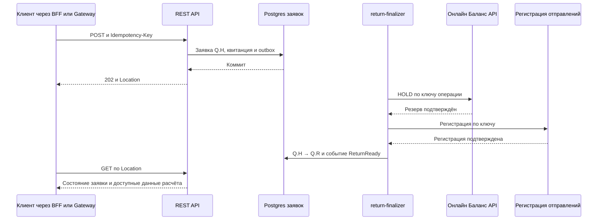

# Архитектура и изоляция отказов

Оба входа ведут в один REST API: экран через web-client, программа клиента через API Gateway. BFF формирует ответ для экрана, Gateway проверяет входной токен и частоту запросов. Принадлежность объекта, право операции и допустимый переход проверяет REST API. Пользователь не задаёт организацию произвольным полем запроса.

## Оформление и расчёты

POST сохраняет заявку, ключ, квитанцию и намерение фоновой работы одной транзакцией. Ответ 202 означает, что заявка принята; деньги и регистрация ещё могут ожидать подтверждения. Цена фиксируется по `quote_id`: тарификатор должен гарантировать её действие на время подготовки.

Удержание HOLD предшествует регистрации. При физическом приёме CAPTURE превращает резерв в расход. При подтверждённом неприёме RELEASE освобождает резерв. Если окончательная стоимость по фактическому весу отличается от списанной суммы, ADJUST проводит разницу: положительную доплату или возврат части расхода. HOLD и RELEASE сами не являются расходом.

У каждой денежной операции неизменный ключ, сумма и основание. Потерянный ответ проверяется по прежнему ключу; новый ключ при неизвестном исходе не создаётся. После окончательного отказа доплаты из-за нехватки средств следующая попытка возможна после пополнения, с отдельным ключом и актуальной разницей. Владелец баланса сохраняет ключ и проводку атомарно. Чужие базы не объединяются общей транзакцией.

До ответа 202 проверяются актуальное право и область объекта; лимит занимается атомарно с заявкой, квитанцией и outbox. Условие: резерв лимита + чистый расход периода + новый HOLD ≤ лимита периода. Это локальное разрешение расхода, а не подтверждение HOLD владельцем баланса. Все пути расхода используют одного владельца учёта лимита. Если право хранится отдельно, нужен согласованный протокол версии разрешения и отзыва; одна локальная транзакция не обеспечивает атомарность между сервисами. Если отзыв предшествует решению допуска, новый расход запрещён. Если разрешение уже сохранено, обязательство урегулирует системный субъект. Отзыв доступа сотрудника не отменяет долг по уже принятому отправлению.

UUID ключа принимается в записи с дефисами и нормализуется без учёта регистра. Область ключа — `(tenant_id, createReturn, UUID)`; ключ внешнего HOLD дополнительно включает тип денежной операции и передаётся в однозначной кодировке. Повтор возвращает квитанцию после текущей проверки доступа, даже при остановленном новом приёме; другое тело под тем же ключом даёт 409. Новый ключ не обходит уникальность активного `(tenant_id, shipment_id)`: проверка и создание выполняются в той же транзакции, конфликт даёт DUPLICATE_RETURN. Снятие уникальности допустимо только после подтверждённого завершения и отсутствия невыясненных эффектов.

## Протоколы

Для приёма и чтения выбран HTTPS/JSON: клиент сразу получает идентификатор и понятный результат запроса. RPC поверх RabbitMQ тоже возможен, но ожидание ответа остаётся синхронным, а потерянный ответ всё равно требует сверки. RabbitMQ используется для уведомлений после коммита. Работа с корпоративной шиной остаётся через существующий REST-мост.

Состояние и outbox записываются вместе. Потребитель сохраняет ID сообщения, локальный результат и следующую задачу до подтверждения брокеру. Повторная доставка не создаёт новую заявку или проводку; старое событие не понижает версию состояния.

## Изоляция отказов

У каждого внешнего направления отдельные таймаут, ограниченный пул запросов и размыкатель. Учебные настройки: таймаут 3 с, пул до 8 вызовов; окно размыкателя 60 с, минимум 4 завершения, порог отказов 50%, пауза 10 с. Ошибки данных клиента в статистику отказов не входят. Защита применяется и к фоновым вызовам, а не только в BFF.

| Сбой | Поведение |
| --- | --- |
| BFF или Gateway | Недоступен соответствующий вход. Другой вход и уже принятые задания продолжают работу |
| REST API или его БД | Без подтверждённого коммита 202 не возвращается. Потерянный ответ восстанавливается повтором с тем же ключом |
| Авторизация | Новые защищённые операции временно отклоняются; исполнение принятых обязательств не зависит от токена сотрудника |
| Тарификатор | Без действующей цены новое оформление не принимается. После приёма ожидается окончательная цена |
| Баланс или финансовый учёт | Денежная операция остаётся ожидающей. Внешний исход сверяется, резерв не считается освобождённым по таймауту |
| Регистрация | После HOLD заявка остаётся Q.H. Для отмены нужно подтверждение неприёма и запрет поздней регистрации |
| Шина или отслеживание | Показан последний подтверждённый статус и его время; отсутствие нового события не доказывает неприём |
| Хранилище файла или разборщик | Без сохранённого файла пакет не принимается; принятое задание ждёт обработки. Одиночный вход остаётся доступным |
| RabbitMQ | События остаются в outbox. При заполнении установленного лимита очереди новый приём временно останавливается |
| Генератор форм или нотификации | Готовность возврата сохраняется; повторяется только создание документа или доставка уведомления |
| Аналитика | Операции возвратов продолжаются; отчёт показывает время последнего обновления |

До приёма запроса временный сбой возвращает 503 с Retry-After, превышение входной квоты — 429. После 202 ошибка фонового шага отражается в состоянии заявки. Размыкатель ограничивает неудачные исходящие вызовы, квота — входящий поток, отдельные пулы не дают одной зависимости занять все ресурсы.

## Массовое оформление

Файл сохраняется вместе с заданием на обработку; клиент получает 202, `job_id` и адрес результата. Учебный предел — 1000 CSV-записей и 10 МиБ. До приёма проверяются размер, синтаксис CSV и число записей: повреждённый файл получает 400, превышение предела — 413. Полевые и бизнес-проверки выполняются фоном.

Задание проходит ACCEPTED → VALIDATING → CREATING → COMPLETED. Для каждой строки хранится исход: обработано, отклонено, требуется исправление CLIENT или разбор SUPPORT. COMPLETED означает готовность отчёта по всем строкам, а не успешное оформление каждой. Невозможность обработать само задание даёт FAILED.

Ключ строки включает клиента, задание, номер строки и ревизию. Повтор возвращает прежний `return_id`; успешная строка не оформляется снова. Исправленная ревизия разрешена после доказанного отказа до побочного эффекта. При неизвестном денежном исходе новая заявка запрещена. Позднее решение SUPPORT обновляет ревизию отчёта и вызывает уведомление.

Фоновая задача хранит шаг, ключ, срок следующей попытки и срок аренды исполнителем. Сеть вызывается вне транзакции; сохранение результата проверяет версию заявки и аренду. Перезапуск обработчика продолжает ту же операцию. Уникальность активного возврата исходного отправления защищает от дублей между разными файлами и ключами.
