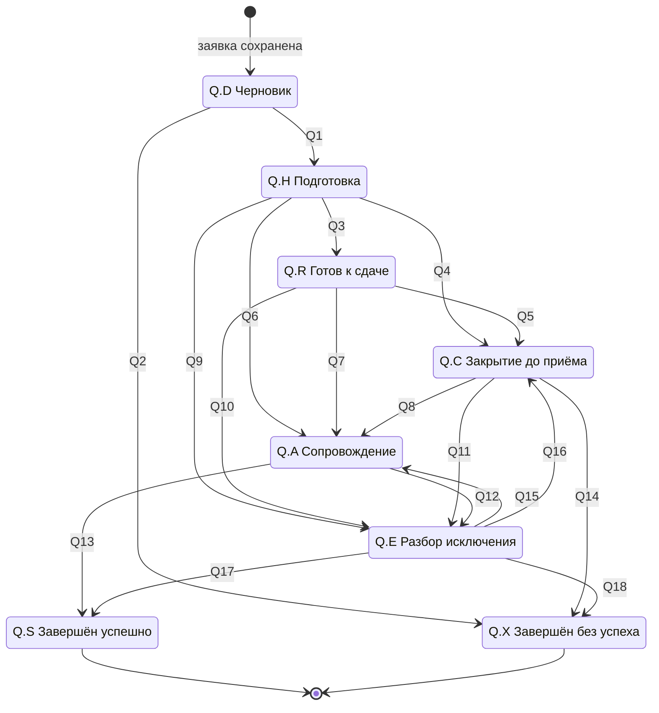
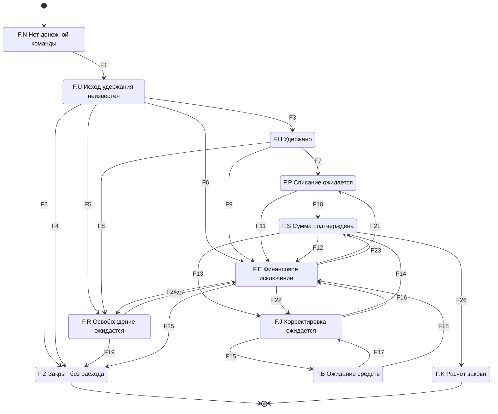

# Машина состояний

REST API владеет заявкой Q, Онлайн Баланс API — расчётом F. Физический приём и вручение подтверждает почтовая сеть. Состояния Q и F изменяются независимо: принятое отправление может ещё ожидать расчёта.

## Состояния заявки

Метки стрелок раскрыты в таблице; условие проверяет владелец соответствующего автомата.

| Метка | Переход | Основание и условие |
| --- | --- | --- |
| Q1 | Q.D → Q.H | оформить / данные и действующая цена проверены |
| Q2 | Q.D → Q.X | отменить / денежных команд нет |
| Q3 | Q.H → Q.R | удержание и регистрация подтверждены; срок подготовки не истёк |
| Q4 | Q.H → Q.C | отказ, отмена или 15 минут без готовности |
| Q5 | Q.R → Q.C | отмена, отказ в приёме или срок сдачи истёк |
| Q6 | Q.H → Q.A | подтверждён запоздавший приём |
| Q7 | Q.R → Q.A | приём подтверждён |
| Q8 | Q.C → Q.A | приём победил отзыв регистрации |
| Q9 | Q.H → Q.E | противоречивые факты |
| Q10 | Q.R → Q.E | конфликт или резерв утрачен |
| Q11 | Q.C → Q.E | 24 часа без безопасного закрытия |
| Q12 | Q.A → Q.E | неуспех доставки или срок этапа 24 ч или срок доставки 30 дней |
| Q13 | Q.A → Q.S | вручение и закрытый расчёт F.K |
| Q14 | Q.C → Q.X | приём исключён и деньги закрыты в F.Z |
| Q15 | Q.E → Q.A | приём подтверждён / сопровождение продолжается |
| Q16 | Q.E → Q.C | требуется безопасное закрытие до приёма |
| Q17 | Q.E → Q.S | вручение и закрытый расчёт F.K |
| Q18 | Q.E → Q.X | неуспех подтверждён / обязательств нет |

Из Q.H регистрация отправляется только после подтверждённого удержания. Если её ответ потерян, готовность ещё не публикуется, но внешний приём уже может состояться; поэтому предусмотрен Q.H → Q.A. В Q.C поздний ответ о регистрации не возвращает Q.R. Подтверждённый физический приём имеет приоритет над намерением отмены.

Переход Q3 атомарно проверяет Q.H, версию и текущее время владельца состояния: не позже `committed_at(Q.H) + 900 с`. Таймер Q4 использует ту же версию. После истечения срока запоздавший обработчик не публикует Q.R, даже если таймер ещё не успел изменить запись. Повторная доставка не сдвигает срок. Если физический приём уже доказан, выполняется Q6, а не отмена по одному лишь таймауту.

## Состояния расчёта

Метки стрелок раскрыты в таблице; условие проверяет владелец соответствующего автомата.

| Метка | Переход | Основание и условие |
| --- | --- | --- |
| F1 | F.N → F.U | намерение удержания сохранено |
| F2 | F.N → F.Z | отмена / денежных команд нет |
| F3 | F.U → F.H | удержание подтверждено; намерение закрытия отсутствует |
| F4 | F.U → F.Z | удержание окончательно отклонено / приём исключён |
| F5 | F.U → F.R | закрытие запрошено / исход выясняется |
| F6 | F.U → F.E | неожиданный приём или конфликт |
| F7 | F.H → F.P | приём подтверждён |
| F8 | F.H → F.R | отзыв регистрации подтверждён |
| F9 | F.H → F.E | резерв утрачен или данные противоречивы |
| F10 | F.P → F.S | базовый расход подтверждён |
| F11 | F.P → F.E | конфликт или 24 ч неизвестного исхода |
| F12 | F.S → F.E | 24 ч ожидания окончательной цены |
| F13 | F.S → F.J | новая цена отличается от чистого расхода |
| F14 | F.J → F.S | корректировка подтверждена или разница равна нулю |
| F15 | F.J → F.B | попытка окончательно отклонена / средств мало |
| F16 | F.J → F.E | конфликт или 24 ч неизвестного исхода |
| F17 | F.B → F.J | пополнение или новая подтверждённая цена |
| F18 | F.B → F.E | конфликт или 24 ч ожидания средств |
| F19 | F.R → F.Z | приём исключён; резерв освобождён либо HOLD окончательно не исполнен; поздние эффекты запрещены |
| F20 | F.R → F.E | конкуренция с приёмом или 24 ч неизвестного исхода |
| F21 | F.E → F.P | резерв найден, приём подтверждён; базовое списание ещё не подтверждено, сохранён прежний ключ |
| F22 | F.E → F.J | приём и базовый расход подтверждены; нужна корректировка известной суммы |
| F23 | F.E → F.S | сумма и версия подтверждены сверкой |
| F24 | F.E → F.R | приём исключён / резерв найден |
| F25 | F.E → F.Z | приём исключён / расхода и резерва нет |
| F26 | F.S → F.K | окончательная цена и исход доставки известны / расхождений нет |

F.S — промежуточное состояние: сумма уже подтверждена, но окончательная цена или исход доставки ещё могут ожидаться. Конечные состояния F — только K и Z. Переход S → K проверяет `price_final`, соответствие суммы окончательной версии, отсутствие незавершённых денежных попыток и решение по исходу доставки. Он не требует конечного Q, поэтому взаимного ожидания автоматов нет. Q закрывается после подтверждённого F.K или F.Z.

Намерение закрытия сохраняется с версией F: поздний ответ HOLD при F.R уточняет факт резерва, но не выполняет F3. F19 без резерва требует окончательного отказа HOLD и запрета позднего исполнения исходного ключа; тогда публикуется SettlementClosedWithoutCharge, а не ReleaseConfirmed. Если эффект неизвестен, F.R не закрывается. При F21 неизвестная попытка CAPTURE только сверяется или повторяется с прежним ключом и телом; новый базовый ключ запрещён. Уже подтверждённый CAPTURE переводит разбор в F.S либо F.J, а не создаёт второе базовое списание.

Приём после подтверждённого освобождения противоречит контракту регистрации. До закрытия это F.E; после закрытия создаётся связанное дело. Оно выполняет только необходимые корректировки по исходному `return_id`, сохраняя прежние основания и запрет повторного базового списания. Новый HOLD или CAPTURE для уже закрытого возврата не создаётся.

## Запреты и точка невозврата

Все переходы, отсутствующие на схемах, запрещены. Новая команда проверяет права, версию записи и условие перехода. Повтор с прежним ключом и телом после проверки доступа возвращает сохранённый результат; тот же ключ с другим телом даёт 409 IDEMPOTENCY_CONFLICT.

| Запрещённое действие | Причина |
| --- | --- |
| CAPTURE до физического приёма | Нет основания списания |
| Q.H или Q.R → Q.D с изменением параметров | Цена и денежное основание уже зафиксированы |
| Q.A → Q.C | Отправление уже принято |
| Q.C → Q.X по таймауту | Неприём и закрытие денег не подтверждены |
| RELEASE после подтверждённого приёма | Резерв обеспечивает возникший расход |
| Новая денежная попытка при неизвестном исходе прежней | Возможна повторная проводка |
| Переоткрытие Q.S/Q.X или F.K/F.Z | Поздняя поправка оформляется отдельным связанным делом |

Точка невозврата — физический приём, а не выдача идентификатора возврата. Приём и отзыв регистрации должны взаимоисключаться у внешнего владельца: если первым произошёл приём, выполняются доставка и расчёт; если отзыв — дальнейший приём запрещается. При потерянном ответе регистрации отзыв должен закрывать и исходный ключ создания, иначе поздняя команда может исполниться после отмены.

## Ожидание и отказы

При неизвестном HOLD сохраняются Q.H/F.U; при потере ответа регистрации — Q.H/F.H. После приёма недоступность баланса оставляет Q.A/F.P, а неизвестная корректировка — Q.A/F.J. Последний физический статус показывается с временем источника. Таймаут не считается отказом денежной операции и не освобождает резерв.

Интервалы — учебные допущения. Сверка выполняется через 30 с, 2 мин, 5 мин и далее каждые 5 мин. В 15 минут без готовности Q.H переходит в Q.C; позднее подтверждение регистрации уже не возвращает Q.R. Через 7 дней после Q.R без сдачи начинается отзыв. Через 24 часа неразрешённого денежного этапа или закрытия — Q.E; контроль доставки — 30 дней после приёма. Ожидание обычной доставки не является просрочкой денежного этапа.

Срок считается от начала этапа, повтор его не обнуляет. Возврат из исключения требует решения ответственного и нового срока контроля; возраст исходной операции сохраняется. После неуспешной доставки Q.X допустим только при подтверждённом исходе и урегулированных обязательствах. Неопределённость остаётся в Q.E.

## Событийные уведомления

| Событие | Когда возникает | Для чего используется |
| --- | --- | --- |
| ReturnSubmitted | Q.D → Q.H | Начало оформления и аналитика |
| ReturnReady | Q.H → Q.R | Готовность, форма и уведомление клиента |
| ReturnAccepted | Первый подтверждённый физический приём, включая выход из Q.E | Основание CAPTURE и время приёма |
| ReturnClosed | Q.S или Q.X | Итог заявки |
| HoldConfirmed, CaptureConfirmed, ReleaseConfirmed, AdjustmentConfirmed | Подтверждённый денежный эффект у владельца F | Сверка заявки и финансовая витрина |
| SettlementClosed | Расчёт завершён | Условие закрытия заявки |
| PriceFinalized, DeliveryOutcomeConfirmed | Владелец подтвердил цену или исход доставки | Окончательный расчёт |
| BatchItemOutcomeChanged | Сохранена ревизия результата строки | Отчёт по пакету и ошибки загрузки |

Событие сообщает об уже сохранённом факте. Потребитель обновляет свою проекцию или выполняет разрешённый переход в собственной базе; уведомление не меняет чужое состояние напрямую. Потеря уведомления задерживает проекцию, но не откатывает факт у источника.

Первый приём учитывается один раз, даже если заявка повторно выходит из Q.E. Окончательный отказ HOLD без резерва даёт HoldDeclined и SettlementClosedWithoutCharge; ReleaseConfirmed возникает только при фактическом освобождении резерва. В F.E сохраняются прежний ключ, шаг, резерв и расход, поэтому исключение не разрешает новое списание.
