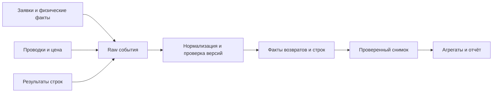

# Аналитика возвратов

## Вопросы и данные

| Вопрос | Показатель |
| --- | --- |
| Где оформление не достигает готовности за 15 минут | Доля своевременных Q.R по сегменту и каналу, охват известных исходов |
| У каких принятых возвратов не закрыт расчёт | Разница расхода и окончательной цены, возраст денежного этапа |
| Какие ошибки повторяются при загрузке реестра | Доля исходных строк с ошибкой CLIENT по полю и причине |

Начало оформления — ReturnSubmitted при Q.D → Q.H, готовность — ReturnReady при Q.H → Q.R. Загрузка файла не заменяет начало заявки: отклонённая строка может не иметь return_id. Порог 15 минут — учебное допущение.

## Конвейер

Выбран ELT: сначала сохраняются исходные события, затем строятся факты. Так можно изменить правила нормализации и пересчитать показатели без повторной выгрузки операционных баз. ETL тоже допустим, но потребовал бы заранее закрепить преобразования; ранняя агрегация затруднила бы разбор конкретных причин. Хранилище — существующий ClickHouse контура статистики.

Raw содержит source_system, event_id, tenant_id, entity_type, entity_id, entity_version, schema_version, occurred_at, ingested_at и полезную нагрузку. Персональные адреса, токены и исходные файлы не копируются. Повтор `(source_system, tenant_id, event_id)` пропускается; другой текст с тем же ключом изолируется как конфликт. Версии сравниваются внутри `(source_system, tenant_id, entity_type, entity_id)`. Пропуск версии доказывает неполноту только при контракте непрерывного потока всех изменений сущности. Для отфильтрованных денежных событий полнота определяется курсором и границей источника, а не отсутствием промежуточных entity_version. Время загрузки не подменяет время события.

## Витрина

| Таблица и зерно | Основные поля |
| --- | --- |
| fact_return — один возврат в одном снимке | snapshot_id, tenant_id, return_id, contract_id, started_at, first_ready_at, accepted_at, delivery_outcome, initial_quote_minor, final_price_minor, captured_minor, debited_adjustment_minor, credited_adjustment_minor, settled_at, currency, полнота истории |
| fact_batch_item — одна ревизия строки | snapshot_id, tenant_id, job_id, row_id, revision, return_id, outcome, error_code, error_stage |
| dim_client — версия клиента | canonical_client_id, сегмент, valid_from, valid_to |
| Измерения заявки | Канал, подразделение, роль при начале, причина, тип отправления |

Клиент сопоставляется по source_system + source_client_id; сегмент выбирается на started_at. Неизвестное измерение остаётся отдельной группой. Историческая роль не переписывается после изменения прав.

Чистый расход D = CAPTURE + доплаты − возвраты списанной суммы. HOLD и RELEASE не входят в D. При неполном журнале D неизвестен. Разница D − C, где C — окончательная цена, оценивается вместе со сроком расчёта: незавершённая операция сама по себе не доказывает ошибку. Журналы цены и денег сначала сводятся по `(snapshot_id, tenant_id, return_id, currency)`, затем присоединяются к заявке по тем же полям, чтобы не размножить суммы и не смешать клиентов. Суммы разных валют не складываются без отдельно заданного курса и даты пересчёта.

Для ошибки CLIENT исходная строка учитывается один раз, даже если её исправили несколькими ревизиями: внутри снимка ревизии сворачиваются по `(tenant_id, job_id, row_id)` с признаком хотя бы одного CLIENT. Знаменатель — уникальные исходные строки той же когорты, а не число ревизий. SUPPORT обозначает технический разбор и не включается в ошибки данных клиента.

## Агрегаты

agg_return_daily группируется по снимку, дню начала в Europe/Moscow, сегменту и каналу. Он хранит total, known, on_time, unknown_count, сумму известных длительностей и их количество. В оценку готовности входят только заявки, для которых прошли 15 минут.

Подтверждённая готовность в срок даёт 1. При полной истории отсутствие готовности в срок даёт 0. При пробеле истории исход неизвестен; позднее первое известное Q.R не доказывает, что раньше готовности не было.

Доля среди известных — on_time / known; охват — known / total. Нижняя граница общей доли — on_time / total, верхняя — (on_time + unknown_count) / total. Нулевой знаменатель даёт NULL. Проценты каналов не усредняются: складываются числители и знаменатели.

Учебный пример: из 4 заявок исход известен у 3, вовремя готовы 2. Доля среди известных — 66,67%, охват — 75%, общая доля находится между 50% и 75%.

## Полнота и свежесть

Учебный интервал публикации — 5 минут, предупреждение об отставании — после 10 минут. data_as_of определяется по минимальной подтверждённой границе полноты заявок, строк, физических событий, цены и денег. MAX(occurred_at) не доказывает полноту; если источник её не подтверждает, отчёт получает quality=GAPS.

В ClickHouse создаётся новый snapshot_id, проверяются данные и переключается указатель опубликованного снимка. Читатель использует один снимок. Поздняя корректировка создаёт следующий, прежний отчёт воспроизводится по ID. Клиентский доступ ограничен tenant_id; межклиентский отчёт требует отдельного служебного права.

Пример происхождения показателя: ReturnSubmitted.occurred_at → raw → fact_return.started_at → день начала в суточном агрегате.
