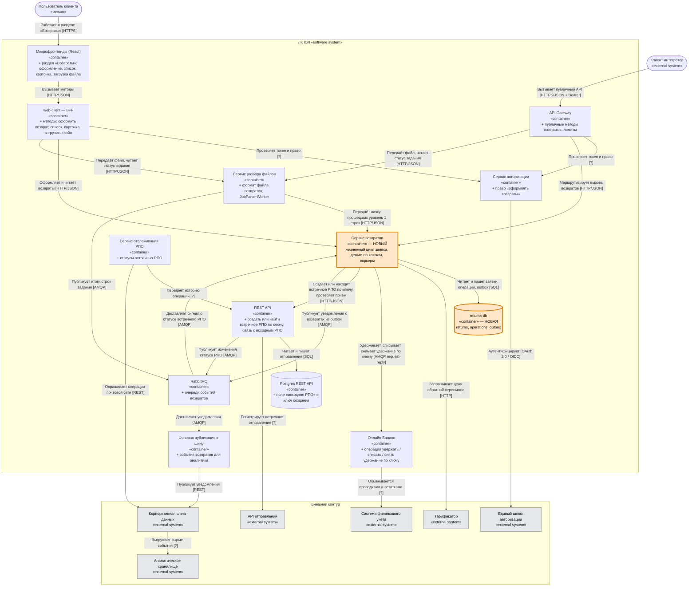

# (0) Оценка и декомпозиция фичи «Управление возвратами»

[← к оглавлению](README.md)

Черновик: З-5. Изменения при сборке перечислены в [README](README.md#что-изменилось-относительно-черновиков).

## 1. Оценка фичи на верхнем уровне

**Что делает фича.** Клиент — юридическое лицо — оформляет **возврат отправления**: по исходному РПО создаётся встречное почтовое отправление, а стоимость его пересылки оплачивается с баланса клиента в личном кабинете. Оформить возврат можно тремя способами: в веб-интерфейсе (одна заявка), через API (интегратор) и файлом (массовое оформление, см. [конвейер](a-architecture.md#4-конвейер-массового-оформления-возвратов)).

**Чего фича не делает.** Возврат **денег** за исходное отправление (перерасчёт, компенсация) — отдельный процесс в другом финансовом контуре с другой смежной системой. В этой работе он не моделируется: деньги в фиче — это только оплата обратной пересылки (удержание → окончательное списание или снятие удержания).

**Почему фича нетривиальна** (оценка сложности словами, без чисел — это внутренняя оценка для целей курса):

| Фактор | Почему это сложно |
|---|---|
| Деньги и физический мир в одном процессе | Удержание и списание выполняет баланс, а приём посылки фиксирует почтовая сеть. Одной транзакцией их не связать — нужна машина состояний с точкой невозврата и компенсациями. |
| Неизвестный исход внешних вызовов | Таймаут при удержании или при создании РПО не означает отказа. Нужны ключи идемпотентности и сверка. |
| Три канала входа | Веб, API и файл должны приводить к одной и той же заявке и одним и тем же правилам. |
| Изменения в унаследованных сервисах | REST API, Онлайн Баланс, трекинг и шина уже работают. Фича требует от них новых полей и операций — это главный риск, разобранный в пункте [(г)](g-constraints.md). |

**Итог оценки:** фича среднего-высокого масштаба: один новый сервис со своей базой, доработка шести существующих контейнеров и интеграция с шестью внешними системами.

## 2. Диаграмма контейнеров C4

Нотация C4 (уровень container) записана через Mermaid `flowchart`, потому что он стабильно отрисовывается в GitHub. Цвета: **оранжевый** — новый контейнер, **синий** — существующий контейнер (что в нём меняется, указано после «+»), **серый** — внешняя система. На каждой связи указано действие по направлению и протокол; `[?]` — протокол источником не назван.

## 3. Какие реальные модули затрагивает фича

| Контейнер | Что меняется | Почему без изменения нельзя |
|---|---|---|
| Микрофронтенды | Раздел «Возвраты»: форма, список, карточка с состоянием заявки, загрузка файла и отчёт по заданию | Пользователю нужен способ оформить возврат и увидеть промежуточные состояния (например, «удержание проверяется»). |
| web-client (BFF) | Методы для раздела «Возвраты» | Микрофронтенды ходят только через BFF. |
| API Gateway | Публичные методы возвратов, лимиты | Основной канал для интеграторов (маркетплейсов) — API. |
| Сервис авторизации | Право «оформлять возвраты» | Возврат создаёт денежную операцию, поэтому нужно отдельное право, а не только факт входа. |
| Сервис разбора файлов | Новый формат файла и разбор по строкам | Массовое оформление — отдельный канал (З-8). |
| REST API | Операция «создать или найти встречное РПО по ключу», связь «исходное ↔ встречное» | Только REST API создаёт отправления. Без поиска по ключу повтор после таймаута создаст второе РПО. |
| Онлайн Баланс | Операции «удержать», «списать», «снять удержание» с внешним ключом и запросом статуса по ключу | Оплата обратной пересылки идёт с баланса клиента. Без ключа повтор вызова может удержать деньги дважды. |
| Сервис отслеживания РПО | Отслеживание встречных РПО | Приём встречного РПО — точка невозврата фичи. |
| RabbitMQ, фоновая публикация в шину | Новые очереди и типы уведомлений | Уведомления потребителям и выгрузка в аналитику (пункт [(в)](v-analytics.md)). |

## 4. Какие новые модули нужны и почему без них нельзя

| Новый модуль | Почему без него нельзя |
|---|---|
| **Сервис возвратов** | У заявки на возврат свой жизненный цикл из одиннадцати состояний, который не совпадает с жизненным циклом отправления. Если положить его в REST API, сервис отправлений начнёт владеть деньгами (удержание и списание) и ручным разбором — это смешение ответственности. Если положить его в Онлайн Баланс, баланс начнёт владеть почтовыми статусами. Только отдельный владелец может хранить ключи всех трёх внешних операций (удержание, РПО, списание) и сверять их между собой. |
| **returns-db** | Принцип «база на сервис» (уже действующий в системе). Состояние заявки, таблица операций с уникальным ключом и outbox должны меняться **в одной локальной транзакции** — иначе уведомление может уйти без записи состояния или наоборот. |
| **Воркеры** (JobParserWorker в сервисе разбора файлов, ReturnProgressWorker в сервисе возвратов) | Это процессы внутри существующих контейнеров, а не новые контейнеры. Без них нельзя довести заявку до конца, если клиент закрыл страницу, а внешняя система ответила с задержкой. |

Отдельный сервис «возврата денег» **не заводится**: возврат денег за исходное отправление — другой процесс в другом контуре (см. п. 1).
