# (а) Архитектура и дизайн

[← к оглавлению](README.md)

Черновики: З-5 (связи), З-7 (финансовый сценарий), З-8 (конвейер). Схема контейнеров — в [пункте (0)](0-decomposition.md#2-диаграмма-контейнеров-c4).

Все интервалы и пределы в этом файле — **учебные допущения**, их список — в [README](README.md#учебные-допущения).

## 1. Границы ответственности

| Владелец | Чем владеет (источник истины) | Чем **не** владеет |
|---|---|---|
| Сервис возвратов | Заявка на возврат и её состояние; ключи операций; связь `return_id` ↔ транзакция баланса ↔ встречное РПО | Деньгами на счёте, отправлением, фактом приёма |
| Онлайн Баланс | Удержания, списания, остаток клиента | Тем, зачем удерживаются деньги |
| REST API | Встречное РПО как отправление, его связь с исходным | Заявкой на возврат и деньгами |
| Почтовая сеть (через трекинг и шину) | Физический факт приёма и вес | Чем-либо в кабинете |
| Тарификатор | Цена обратной пересылки | Решением, можно ли оформить возврат |
| Сервис разбора файлов | Задание (`job_id`), файл, формальная проверка строк, отчёт по заданию | Бизнес-правилами возврата (уровень 2) |

Главное правило: **сервис возвратов меняет своё состояние только после подтверждения факта его владельцем**. Сообщение в очереди — это сигнал «пора проверить», а не сам факт (см. [пункт (б)](b-states.md#6-событийные-уведомления--не-переходы)).

## 2. Связи и протоколы

| Связь (кто → кому: действие) | Протокол | Синхронно? | Почему так, а не иначе |
|---|---|---|---|
| Микрофронтенды → BFF: вызывает методы раздела | HTTP/JSON | да | Существующий канал; альтернативы нет. |
| Интегратор → API Gateway: публичный API | HTTPS/JSON + Bearer | да | Существующий публичный канал. |
| BFF, Gateway → Сервис авторизации: проверка токена и права | `[?]` | да | Протокол источником не назван. |
| BFF, Gateway → Сервис возвратов: оформить, прочитать | HTTP/JSON | да, но ответ — `return_id` и текущее состояние, а не результат всей цепочки | Пользователю нужен немедленный ответ «заявка принята». Альтернатива — синхронно ждать удержания и РПО — отвергнута: исход внешних вызовов может быть неизвестен часами. |
| BFF, Gateway → Сервис разбора файлов: передать файл, читать статус | HTTP/JSON | приём синхронный, обработка асинхронная | См. п. 4. |
| Сервис разбора файлов → Сервис возвратов: пачка прошедших уровень 1 строк | HTTP/JSON, один вызов на пачку | да | Ответ построчный. Альтернатива — по одному вызову на строку — даёт до тысячи вызовов на файл без выигрыша в надёжности. Альтернатива «через очередь» отвергнута: парсеру нужен построчный результат уровня 2 для отчёта. |
| Сервис возвратов → Тарификатор: цена обратной пересылки | HTTP | да | Цена нужна до удержания; без неё оформить нельзя. |
| Сервис возвратов → Онлайн Баланс: удержать / списать / снять удержание / узнать статус по ключу | AMQP request-reply | нет (ответ коррелируется по ключу) | Онлайн Баланс уже общается с кабинетом через RabbitMQ в режиме RPC (схема З-5). Альтернатива — синхронный HTTP — потребовала бы нового интерфейса у унаследованного сервиса (см. [пункт (г)](g-constraints.md)). Минус выбранного варианта: потерянный ответ не отличить от медленного — поэтому у каждой операции свой ключ и запрос статуса. |
| Сервис возвратов → REST API: создать или найти встречное РПО по ключу; проверить приём | HTTP/JSON | да | REST API — единственная точка создания отправлений. Поиск по ключу `reverse:<return_id>` делает повтор безопасным. |
| Сервис возвратов → RabbitMQ: уведомления из outbox | AMQP | нет | Потребители (аналитика, уведомления клиенту) не должны тормозить заявку. |
| RabbitMQ → Сервис возвратов: сигнал о статусе встречного РПО | AMQP | нет | Сигнал только ставит отметку «пора проверить»; приём проверяется запросом в REST API. |
| REST API → API отправлений: регистрирует отправление | `[?]` | — | Протокол источником не назван. |
| Трекинг → шина: опрашивает операции | REST | — | Существующая связь, только опрос (см. [пункт (г)](g-constraints.md)). |
| Онлайн Баланс → Система финансового учёта | `[?]` | — | Существующая связь; фича её не меняет. |

## 3. Изоляция отказов смежных систем

Общие механизмы:

1. **Ключ идемпотентности на каждую внешнюю операцию** (`hold:<return_id>`, `reverse:<return_id>`, `debit:<return_id>:<acceptance_id>`, `release:<return_id>`, `adjust:<return_id>:<acceptance_id>:<tariff_revision>`). Таблица `operations` хранит `operation_key UNIQUE`, тип, сумму, статус, внешний идентификатор. Повтор после таймаута — **с тем же ключом** и после запроса статуса.
2. **Transactional outbox**: состояние заявки и уведомление пишутся в returns-db одной транзакцией; отказ RabbitMQ не теряет уведомление.
3. **Воркер вместо ожидания в запросе**: ReturnProgressWorker доводит заявку до конца независимо от клиента.
4. **Размыкатель (circuit breaker) на каждой исходящей синхронной связи**: после серии неудач новые вызовы не отправляются, заявки остаются в своём промежуточном состоянии, работает только воркер с паузами.
5. **Единый график повторов** (допущение): 1, 2, 4, 8, 15 минут, дальше раз в 15 минут; через 30 минут — оповещение дежурного; через 24 часа неизвестного исхода — `ManualReview` и остановка автоповторов.
6. **Неизвестно ≠ отказ**: таймаут не переводит заявку в отказ и не снимает деньги «вслепую».

### Что будет с фичей при отказе каждой системы

| Отказала | Где остановится заявка | Что видит клиент | Что делает система |
|---|---|---|---|
| **API Gateway** (собственный вход) | Новые заявки через API не создаются; уже созданные продолжают обрабатываться воркером | Интегратор получает ошибку соединения или 5xx. Повтор с тем же `Idempotency-Key` после восстановления вернёт существующую заявку, а не создаст вторую. | Веб-канал (BFF) работает — шлюз и BFF независимые входы. Заявки, запрос которых дошёл до сервиса возвратов, но ответ потерян, находятся по ключу клиента. |
| **BFF** (собственный вход) | Новые заявки через веб не создаются; уже созданные продолжают обрабатываться | Раздел «Возвраты» недоступен; сообщение «сервис временно недоступен». Двойного оформления нет: форма отправляет тот же ключ при повторе. | Канал API работает. Загрузку файла через BFF клиент повторяет позже: незавершённое задание без `job_id` не создано, задание с `job_id` продолжает обрабатываться. |
| Сервис авторизации / Единый шлюз авторизации | Новые операции не начинаются | «Не удалось проверить права» | Без проверки права операция не выполняется (отказ в безопасную сторону). Воркеры работают со служебной учётной записью и не зависят от токена клиента. |
| Тарификатор | `Verify` | «Цена недоступна, оформить пока нельзя» | Удержания и РПО нет — ничего откатывать не нужно. В массовом задании строка помечается PENDING и проверяется повторно. |
| **Онлайн Баланс** при удержании | `HoldPending` | «Удержание проверяется, возврат ещё не создан», `return_id`, время последней синхронизации, кнопки повторного оформления нет | Повтор с тем же ключом, запрос статуса. Встречное РПО **не создаётся**, пока удержание не подтверждено. 24 часа неизвестности → `ManualReview`. |
| Онлайн Баланс при списании | `DebitPending` | «Посылка принята, итоговый расчёт выполняется» | Повтор `debit:` с тем же ключом. Посылка уже принята — отменять нечего. |
| Онлайн Баланс при снятии удержания | `ReleasePending` | «Возврат отменён, снимаем удержание» | Заявка не закрывается, пока снятие не подтверждено. |
| REST API при создании РПО | `CreatePending` | «Средства зарезервированы, проверяем создание отправления» | Повтор «создать или найти» по ключу `reverse:`. Никогда не создаём РПО с новым ключом. |
| API отправлений | `CreatePending` (как отказ REST API) | То же | REST API возвращает ошибку или таймаут; дальше — как выше. |
| Трекинг / шина / почтовая сеть | `AwaitAccept` | Последний известный статус и его время; «деньги окончательно не списаны» | Ожидание без автоматического списания. Задержка статуса не двигает заявку ни вперёд, ни назад. |
| RabbitMQ | Заявки двигаются (вызовы баланса не проходят → `HoldPending`, `DebitPending`) | Как при отказе баланса | Outbox копит уведомления и отправит их после восстановления; дубли отсекаются по `event_id`. |
| returns-db | Сервис возвратов не принимает новых заявок | «Сервис временно недоступен» | Ничего не начинается без записи: внешний вызов делается только после фиксации операции в `operations`. |
| Сервис разбора файлов | Новые задания не принимаются | «Загрузка файлов временно недоступна, используйте API или форму» | Уже принятые задания хранятся в jobs и продолжатся после восстановления. |
| Фоновая публикация / шина / хранилище | Заявки не затронуты | Ничего | Отстаёт только аналитика; витрина показывает границу актуальности ([пункт (в)](v-analytics.md#6-граница-актуальности)). |
| Система финансового учёта | Заявки не затронуты напрямую | Ничего | Расхождения выявляет ежедневная сверка (п. 5). |

## 4. Конвейер массового оформления возвратов

Черновик З-8. Сценарий: клиент-маркетплейс, основной канал — API, файл — дополнительный канал для массовых операций (допущение). «Обработано» для конвейера значит: встречное РПО оформлено (`AwaitAccept`), а не принято и не оплачено окончательно.

```mermaid
flowchart LR
  subgraph I["I. Приём задания — синхронно"]
    direction TB
    f["Файл ≤ 1000 строк<br/>граница на входе (допущение)"] --> st["Сохранение файла<br/>файловое хранилище"]
    st --> jo["jobs + outbox<br/>одна транзакция"]
    jo --> resp["Ответ клиенту<br/>job_id, QUEUED, status_url"]
  end
  subgraph II["II. Разбор и проверка — асинхронно"]
    direction TB
    jp["JobParserWorker<br/>опрашивает jobs.status = QUEUED / RETRY"] --> l1["Уровень 1: формальная проверка<br/>по одной строке"]
    l1 --> batch["Одна пачка прошедших строк<br/>→ Сервис возвратов (batch_key, row_key)"]
    batch --> l2["Уровень 2: бизнес-проверка<br/>в сервисе возвратов, ответ по строкам"]
  end
  subgraph III["III. Доведение и отчёт"]
    direction TB
    rec["Заявка + outbox<br/>Verify → HoldPending"] --> rpw["ReturnProgressWorker<br/>удержание → встречное РПО"]
    rpw --> aa["AwaitAccept<br/>строка обработана"]
    aa --> rep["Отчёт по job_id<br/>обработано / отклонено / требует вмешательства"]
  end
  resp -.-> jp
  l2 --> rec
```

| Вопрос | Решение |
|---|---|
| Граница на входе и кто за неё платит | Не больше 1000 строк в файле (учебное допущение для проектируемого модуля). Клиент с 5000 строками делает пять загрузок и сверяет пять отчётов — платит клиент подготовкой и ожиданием. О границе клиент узнаёт **до** загрузки: описание API, подсказка в интерфейсе, проверка числа строк до разбора. Превышение — ошибка уровня задания, без частичной обработки. |
| Что клиент получает сразу | `job_id`, `status = QUEUED`, `status_url` и текст «задание принято, отправления ещё не созданы». |
| Как узнаёт результат | Опрос `GET /jobs/{job_id}` — авторитетный статус; уведомление о готовности отчёта — дополнительное, может прийти повторно. |
| Если клиент закрыл вкладку | Файл, задание и outbox уже записаны; обработка не зависит от страницы. |
| Уровень 1 (строки достаточно) | Пустой или неверный номер РПО, неверная дата, причина не из справочника. Отсеянная строка не блокирует остальные. |
| Уровень 2 (нужен контекст) | РПО уже вручено, срок возврата истёк, РПО принадлежит другому клиенту, цена и удержание — в сервисе возвратов. |
| Повтор при сбое передачи пачки | Тот же `batch_key` и те же `row_key`; сервис возвратов по `row_key` возвращает уже созданные заявки, а не создаёт новые. |
| Повтор после регистрации заявки | Только незавершённая операция с её ключом (`hold:`, `reverse:`) — без нового удержания и нового РПО. |
| Три множества в отчёте | **Обработано** — встречное РПО создано. **Отклонено** — исправить нельзя (срок истёк). **Требует вмешательства** — клиент исправляет строку и загружает её заново (нет причины) или оператор разбирает `ManualReview` (новый возврат по этой строке оформлять нельзя). Строка с неизвестным исходом помечена PENDING и не попадает ни в одно итоговое множество до выяснения. |
| Когда отчёт закрывается | Когда все строки получили итог или перешли в `ManualReview` (24 часа, допущение). Позднее урегулирование создаёт новую версию отчёта. |

## 5. Обнаружение расхождений

- ReturnProgressWorker раз в 5 минут (допущение) выбирает заявки в `HoldPending`, `CreatePending`, `DebitPending`, `ReleasePending` и запрашивает статус операции по ключу.
- Раз в сутки — сверка всех открытых операций: `return_id` + `operation_key` + транзакция баланса + сумма + встречное РПО + `acceptance_id`.
- Отсутствие записи в одной системе **не доказывает** её отсутствия в другой: заявка остаётся в промежуточном состоянии или уходит в `ManualReview`.
