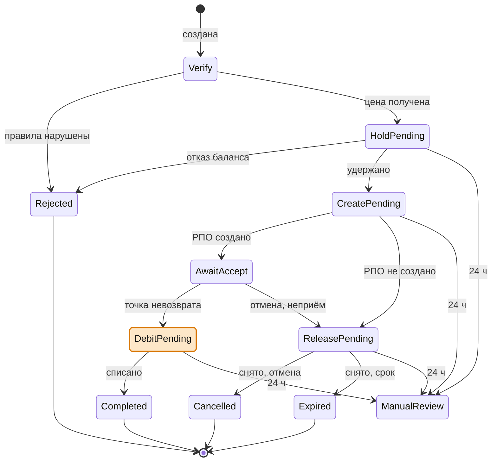
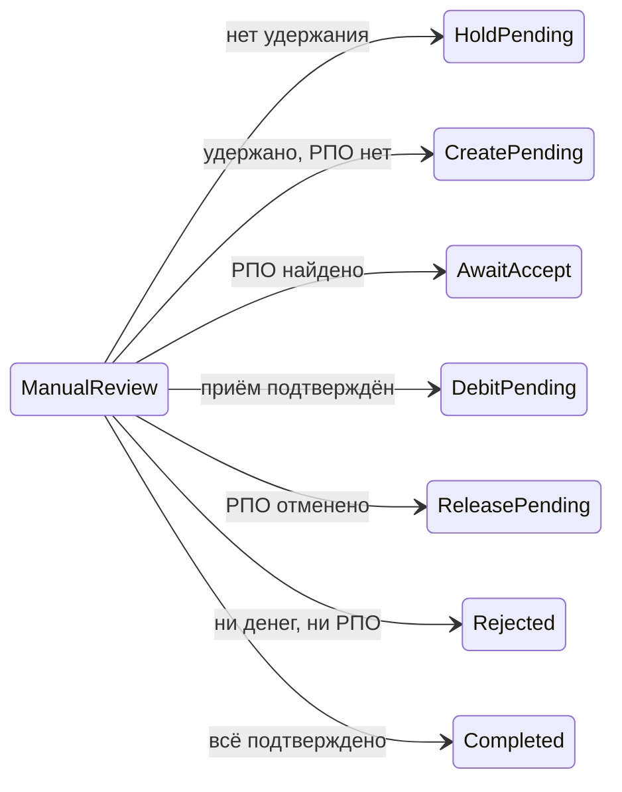

# (б) Машина состояний заявки на возврат

[← к оглавлению](README.md)

Черновики: З-6 (модель), З-7 (точки движения денег, точка невозврата), З-8 (воркер).

Модель описывает **заявку на возврат** в сервисе возвратов (`returns.state`). Встречное РПО — отдельная сущность со своим жизненным циклом в REST API; его физические статусы продвигает почтовая сеть. Заявка меняет состояние только после подтверждения факта владельцем.

Интервалы 30 минут и 24 часа — **учебные допущения**.

## 1. Диаграмма

### Основной жизненный цикл

Подписи на стрелках — кратко; полное условие каждого перехода — в таблице [п. 6](#6-событийные-уведомления--не-переходы) и [п. 5](#5-поведение-при-недоступности-смежного-сервиса). «24 ч» — исход внешней операции неизвестен 24 часа (допущение).

Оранжевым выделено первое состояние после **точки невозврата** — подтверждённого почтовой сетью приёма встречного РПО ([п. 4](#4-точка-невозврата)).

### Выход из ручного разбора

Оператор выбирает только переход, подтверждённый найденным фактом.

## 2. Состояния

| Состояние | Деньги | Что разрешено | Что запрещено |
|---|---|---|---|
| `Verify` | не движутся | Проверить права, владельца исходного РПО, срок возврата, получить цену | Создавать РПО, удерживать деньги без цены |
| `HoldPending` | удержание запрошено, исход может быть неизвестен | Повторять и проверять удержание с ключом `hold:<return_id>` | Считать таймаут отсутствием удержания; создавать РПО |
| `CreatePending` | удержано | Создать **или найти** встречное РПО по ключу `reverse:<return_id>` | Создать второе РПО при потерянном ответе; удержать повторно |
| `AwaitAccept` | удержано | Показывать статус РПО; проверять приём; отменить до приёма | Признать приём без подтверждения сети; списать окончательно |
| `DebitPending` | удержано, есть право на списание | Списать по ключу `debit:<return_id>:<acceptance_id>`, скорректировать по фактическому весу | Отменить заявку; списать по новому ключу |
| `ReleasePending` | удержано, удержание надо снять | Снять удержание по ключу `release:<return_id>` | Закрыть заявку до подтверждения снятия |
| `ManualReview` | неизвестно | Оператор сверяет баланс и реестр РПО и выбирает **только** переход, подтверждённый найденным фактом | Угадывать исход; повторять операцию с новым ключом |
| `Completed` | списано окончательно | Читать итог | Менять сумму, повторно подтверждать приём |
| `Rejected` | не движутся (или отсутствие удержания подтверждено) | Читать причину; оформить **новую** заявку | Оживлять эту заявку |
| `Cancelled`, `Expired` | удержание снято | Читать причину | Возобновлять как успешную |

Точки движения денег из З-7 и переходы, которые их фиксируют:

| Точка движения денег (З-7) | Переход |
|---|---|
| Удержание | `HoldPending → CreatePending` |
| Окончательное списание и корректировка по весу | `DebitPending → Completed` |
| Снятие удержания | `ReleasePending → Cancelled / Expired` |

## 3. Запрещённые переходы и что происходит при попытке

Ответы — проект контракта для ЛР-3.

| Откуда | Попытка | Что делает система |
|---|---|---|
| `Verify` | Подтвердить приём (РПО ещё нет) | `409 INVALID_STATE`; состояние не меняется. Приём подтверждает только почтовая сеть. |
| `HoldPending` | Оформить второй возврат по тому же исходному РПО | `409 OPERATION_PENDING` с существующим `return_id`; повтор с тем же ключом клиента возвращает текущее состояние. |
| `HoldPending` | Создать встречное РПО до подтверждения удержания | Переход отсутствует в модели; воркер не выбирает такие заявки для создания РПО. |
| `CreatePending` | После таймаута создать РПО с новым ключом | `409 OUTCOME_UNKNOWN`; сначала поиск по `reverse:<return_id>`. |
| `AwaitAccept` | Списать деньги без подтверждённого приёма | `409 ACCEPTANCE_NOT_CONFIRMED`; списания нет. |
| `AwaitAccept` | Перейти в `DebitPending` по одному сообщению из очереди | Переход не выполняется; сообщение ставит отметку, приём проверяется запросом (п. 6). |
| `DebitPending` | Отменить возврат | `409 TOO_LATE_TO_CANCEL`; посылка уже в физическом процессе, возможно только отдельное урегулирование. |
| `Completed` | Повторить списание | Тот же ключ → сохранённый результат; другой ключ → `409`. |
| `Rejected`, `Cancelled`, `Expired` | Любой переход | `409 FINAL_STATE`; нужна новая заявка. |
| `ManualReview` | Автоматический повтор воркером | Воркер такие заявки не выбирает; переход выполняет только оператор. |

## 4. Точка невозврата

**`AwaitAccept → DebitPending` — подтверждённый почтовой сетью приём встречного РПО.**

Почему именно здесь:

- До приёма всё обратимо: удержание снимается (`ReleasePending`), встречное РПО можно отменить, и никто не пострадает.
- После приёма посылка находится в физическом процессе перевозки. Отмена заявки в кабинете не вернёт посылку, поэтому отменять заявку бессмысленно и опасно: деньги снимутся, а перевозка продолжится бесплатно.
- Удержание (`HoldPending → CreatePending`) — **не** точка невозврата: оно снимается.
- Окончательное списание (`DebitPending → Completed`) — следствие уже пройденной точки, а не сама точка: решение о списании принято в момент приёма.

Компенсация после точки невозврата — отдельная обратная денежная операция, а не откат записи.

## 5. Поведение при недоступности смежного сервиса

| Недоступен | Состояние | Что видит пользователь | Как выходит из состояния |
|---|---|---|---|
| Тарификатор | `Verify` | «Цена недоступна, оформить пока нельзя» | Повтор проверки; удержаний и РПО нет. |
| Онлайн Баланс при удержании | `HoldPending` | «Удержание проверяется, возврат ещё не создан», время последней синхронизации, без кнопки повторного оформления | Повтор с тем же ключом → подтверждение (дальше) или отказ (`Rejected`); 30 мин → оповещение; 24 ч → `ManualReview`. |
| REST API после удержания | `CreatePending` | «Средства зарезервированы, проверяем создание отправления» (не «создать не удалось») | «Создать или найти» с тем же ключом; 24 ч → `ManualReview`. |
| Трекинг / почтовая сеть | `AwaitAccept` | Последний известный статус и его время; «окончательно не списано» | Ждёт подтверждения; таймер на автоматическое списание не ставится. |
| Онлайн Баланс при списании | `DebitPending` | «Посылка принята, идёт итоговый расчёт» | Повтор `debit:` с тем же ключом; 24 ч → `ManualReview`. |
| Онлайн Баланс при снятии удержания | `ReleasePending` | «Возврат отменён, снимаем удержание» | Повтор `release:`; 24 ч → `ManualReview`. |

**Пример с экзамена — биллинг недоступен в середине операции.** Если удержание запрошено, а ответа нет: заявка в `HoldPending`, РПО не создаётся, повтор только с ключом `hold:<return_id>`, через 24 часа — оператор. Если удержание подтверждено, РПО создано, и баланс отказал при списании после приёма: заявка в `DebitPending`, посылка уже едет, отменять нечего — повторяем списание с тем же ключом, пока баланс не ответит.

## 6. Событийные уведомления — не переходы

Переход — изменение `returns.state` в returns-db после подтверждения факта владельцем. Уведомление — сообщение в RabbitMQ (через outbox) **после** перехода или сигнал от другого сервиса **до** проверки. Если уведомление не дошло, состояние заявки не меняется.

**Исходящие уведомления** (сервис возвратов публикует в одной транзакции с переходом):

| Уведомление | После какого перехода | Кто потребляет | Если не дошло / пришло дважды |
|---|---|---|---|
| `return_registered` | создание заявки (`[*] → Verify`) | аналитика, уведомление клиенту | outbox повторит; дубль отсекается по `event_id` |
| `return_rejected` (с `reason_code`) | `→ Rejected` | аналитика, клиент | то же |
| `hold_confirmed` (с суммой) | `HoldPending → CreatePending` | аналитика | то же |
| `reverse_shipment_confirmed` (с `reverse_rpo_id`, `occurred_at`) | `CreatePending → AwaitAccept` | аналитика, клиент, отчёт задания | то же |
| `acceptance_confirmed` (с `acceptance_id`, весом) | `AwaitAccept → DebitPending` | аналитика, клиент | то же |
| `return_settled` (с итоговой суммой) | `DebitPending → Completed` | аналитика, клиент | то же |
| `return_closed` (`cancelled` или `expired`) | `ReleasePending → Cancelled / Expired` | аналитика, клиент | то же |
| `return_manual_review` | `→ ManualReview` | оператор, аналитика | то же |

**Входящий сигнал** — `reverse_shipment_status_changed` от REST API. Он **не является переходом**: потребитель только записывает в заявку `acceptance_signal_at`. Переход `AwaitAccept → DebitPending` выполняет воркер после проверки приёма запросом в REST API по `acceptance_id`. Поэтому потерянный, повторный или пришедший раньше времени сигнал не приводит ни к двойному списанию, ни к списанию без приёма.

## 7. Воркер на модели

**ReturnProgressWorker** (сервис возвратов) выбирает заявки по полям returns-db:

| Что выбирает | Какой переход продвигает |
|---|---|
| `state = 'Verify'` и проверки пройдены (для массовых заявок, принятых пачкой) | `Verify → HoldPending` |
| `state = 'HoldPending'` и `operations.status IN ('NEW', 'RETRY', 'UNKNOWN')` для ключа `hold:` | `HoldPending → CreatePending / Rejected` |
| `state = 'CreatePending'` и операция `reverse:` не завершена | `CreatePending → AwaitAccept / ReleasePending` |
| `state = 'AwaitAccept'` и `acceptance_signal_at IS NOT NULL` | `AwaitAccept → DebitPending` после проверки приёма |
| `state IN ('DebitPending', 'ReleasePending')` и операция не завершена | `→ Completed / Cancelled / Expired` |
| любое промежуточное состояние и `now() - state_entered_at > 24 ч` | `→ ManualReview` |

**JobParserWorker** (сервис разбора файлов) выбирает `jobs.status IN ('QUEUED', 'RETRY')`; он не меняет состояние заявок, а создаёт их пачкой в `Verify`.

## 8. Самопроверка модели

- Все состояния достижимы из `[*]`; из каждого промежуточного есть путь к итоговому состоянию или к `ManualReview`.
- Есть успешный исход (`Completed`) и три неуспешных (`Rejected`, `Cancelled`, `Expired`).
- Каждая точка движения денег из З-7 соответствует переходу (п. 2).
- Каждый показатель витрины порождается одним из уведомлений п. 6 ([пункт (в)](v-analytics.md#1-состав-данных)).
