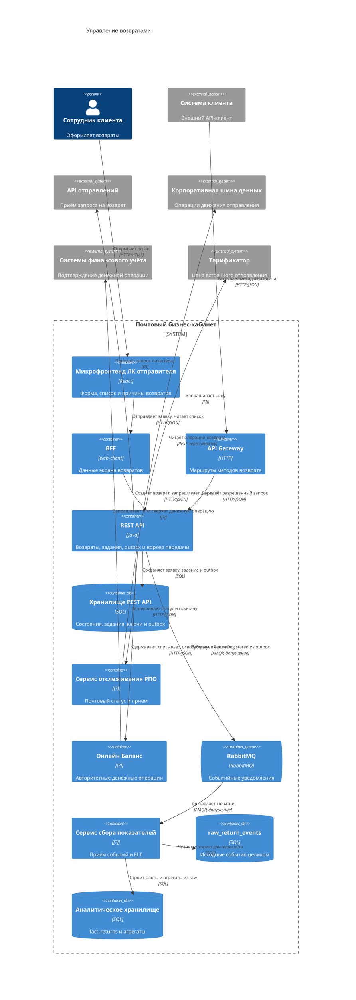

# Оценка и декомпозиция

## Оценка верхнего уровня

Фича: "Управление возвратами". Возвратное отправление - самостоятельное встречное отправление; цену пересылки сообщает тарификатор. При оформлении стоимость удерживается с онлайн-баланса клиента. Окончательное списание - при приёме возвратного отправления в отделении. Если приём не состоялся - удержание возвращается на баланс. Если вес отличается - доначисление или возврат разницы. Деньги следуют за приёмом, а не за созданием возврата.

Работа затрагивает оба входа, прикладную логику, почтовую интеграцию, финансовый контур и аналитику. Основная сложность - частичный отказ между удержанием и регистрацией, а также неоднократная доставка почтового приёма. Сквозная транзакция между системами не предполагается.

## Модули и изменения

| Существующий модуль | Ответственность в фиче |
|---|---|
| Микрофронтенд ЛК отправителя, React | Форма, список и причины возвратов; загрузка и результат задания |
| BFF web-client | Данные для экрана возвратов; сохранение исходного канала |
| API Gateway | Маршруты методов возврата для системы клиента |
| REST API, Java | Создание одного возврата и списка; проверка клиента, прав и повторного запроса |
| Сервис отслеживания РПО | Статус и причина возврата, подтверждение физического приёма |
| Онлайн Баланс | Авторитетный остаток, удержание, списание, освобождение и сверка |
| Тарификатор (З-7) | Цена встречного отправления и расчёт разницы по весу |
| RabbitMQ и сервис сбора показателей (З-9) | Доставка и сбор аналитических событий |
| API отправлений | Приём запроса на возврат, регистрация встречного отправления |
| Корпоративная шина данных | Операции движения отправления через REST-обвязку |
| Системы финансового учёта | Подтверждение денежной операции |

## Новые модули внутри существующих контейнеров

Новый отдельно развёртываемый сервис не нужен. В REST API добавляются модуль возвратов (проверки и состояния), модуль заданий (построчный результат и идемпотентный приём), outbox и воркер передачи. Без состояния нельзя отличить незавершённую операцию от новой; без задания теряются частичные результаты; без outbox нельзя гарантировать продолжение после ответа клиенту. Воркер внутри REST API выбран в З-8, отдельный сервис для небольшого потока избыточен.

В Онлайн Балансе необходим учёт ключей денежных операций; без атомарной уникальности повтор физического приёма может списать деньги снова. В аналитике добавляются raw_return_events, fact_returns и дневной агрегат. Хранилища на схеме - логические границы владения данными.

## Диаграмма контейнеров C4

HTTP/JSON перенесён со схемы З-5. Для API Gateway указан HTTP, для работы с БД - SQL. Взаимодействия с RabbitMQ обозначены AMQP как проектное допущение. Каждая связь подписана действием по направлению.

Воркер является частью контейнера REST API, а не дополнительным контейнером. Подтверждённый приём читается REST API через сервис отслеживания; после этого REST API инициирует DEBIT в Онлайн Балансе. Отчёт строится в аналитическом контуре, который не блокирует оформление.
