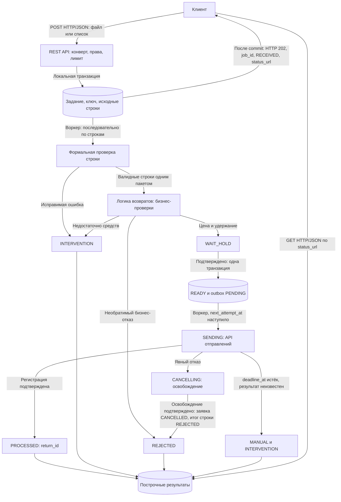

# Архитектура и дизайн

## Связи и границы ответственности

[Контейнерная схема со всеми протоколами](0-decomposition.md#диаграмма-контейнеров-c4). BFF готовит данные экрана, API Gateway принимает внешние запросы; бизнес-проверки и владение заявкой остаются в REST API. Клиент определяется по проверенному контексту, а не полю тела. Канал WEB, FILE или API сохраняется при первом входе; загрузка файла через веб имеет канал FILE.

Синхронный HTTP/JSON между входами и REST API даёт ответ о приёме и позволяет читать результат. Альтернатива - ждать весь пакет в одном HTTP-запросе - делает время ответа зависимым от смежных систем и провоцирует повтор всего пакета. Поэтому исполнение отложено. Аналитические уведомления доставляются через RabbitMQ; прямой синхронный вызов аналитики связал бы доступность оформления с отчётностью. Для неизвестных внешних протоколов сохранена пометка [?]; до реализации нужно согласовать контракт, таймаут и способ проверки результата.

## Изоляция отказов

Общее проектное дополнение: конечные таймауты вызовов, отдельные ограниченные пулы для каждой зависимости, ограниченная параллельность, circuit breaker и сохранённые задачи вместо бесконечного ожидания HTTP. Отдельный сбой не занимает все потоки REST API. Неизвестный результат денежной операции не означает отказ и не разрешает создать новую операцию. Клиент видит последнюю подтверждённую сумму и время её обновления; решение принимается по авторитетному значению Онлайн Баланса.

| Что недоступно | Состояние и продолжение | Что видит клиент |
|---|---|---|
| Микрофронтенд | Принятые задания продолжаются; API-канал доступен | Экран временно недоступен |
| BFF | Веб-запрос не принят либо ответ потерян; уже сохранённое задание продолжается. API Gateway независим | Ошибка веб-входа; после восстановления повтор с прежним ключом |
| API Gateway | Внешний запрос не принят либо ответ потерян; принятые задания продолжаются. BFF независим | Временная ошибка API; повтор с тем же ключом и телом |
| REST API | Новые задания не принимаются; после восстановления продолжаются сохранённые задачи | Временная недоступность; 202 до фиксации данных не возвращается |
| База REST API | Нет надёжного приёма и новых переходов; внешние вызовы без сохранённого намерения не запускаются | 503 при приёме; прежний запрос повторяется с тем же ключом |
| Тарификатор | NEW; после неудачного расчёта REJECTED с технической причиной | Цена не получена, оформление не выполнено. Можно начать заново после восстановления |
| Онлайн Баланс при удержании | WAIT_HOLD; проверка результата по прежнему ключу; после предельного срока MANUAL | "Проверяем удержание" |
| Онлайн Баланс при освобождении | CANCELLING до подтверждения; затем CANCELLED либо MANUAL | "Ожидает освобождения", отмена ещё не завершена |
| Онлайн Баланс при списании/корректировке | Заявка REGISTERED; денежная операция ожидает подтверждения | "Отправление принято, оплата уточняется" |
| API отправлений | SENDING; сверка и безопасный повтор; затем MANUAL при неизвестном результате | "Результат передачи уточняется". Не предлагаем повторно оплатить |
| Сервис отслеживания РПО | Последний известный почтовый статус; без подтверждения приёма DEBIT не запускается | Статус и время последнего обновления |
| Корпоративная шина/REST-обвязка | REGISTERED остаётся REGISTERED; приём догружается после восстановления | Новое движение пока не подтверждено |
| Системы финансового учёта | Онлайн Баланс сохраняет незавершённую операцию и сверяет; отсутствие ответа не равно возврату денег | Подтверждение оплаты уточняется |
| RabbitMQ | Уведомление остаётся в outbox, оформление не откатывается | Регистрация завершена, отчёт может отставать |
| Сервис сбора показателей | Сообщение подтверждается после надёжного сохранения raw; повтор дедуплицируется | Отчёт отстаёт, основная фича работает |
| raw/аналитическое хранилище | Возобновление доставки/пересчёт из сохранённой истории | Последняя подтверждённая актуальность отчёта |

При длительной недоступности очереди/хранилищ контролируется заполнение outbox. Если надёжно сохранить новую работу невозможно, вход возвращает временный отказ, а не ложный успех. Восстановление после падения воркера использует сохранённую задачу, ограниченную аренду захвата и прежний ключ.

## Конвейер массового оформления из З-8

Код 202 Accepted означает "задание принято". В теле возвращаются идентификатор задания job_id, статус RECEIVED и адрес проверки status_url. Код 202 и статус RECEIVED сообщают только о приёме задания. Результатов по строкам пока нет, их нужно получить отдельно.

Интерфейс опрашивает статус задания, а после завершения показывает уведомление с количеством обработанных, отклонённых и требующих вмешательства строк. Обработка на сервере продолжится, если клиент закрыл вкладку. После возвращения клиент сможет открыть результат по идентификатору задания.

До 202 проверяются JSON-конверт, наличие списка, права, ключ и общий размер. После 202 формальная проверка идёт последовательно по одной строке: идентификатор и причина заполнены строками; масса, если указана, является положительным целым числом. Валидные строки передаются одним пакетом в логику создания возвратов, результат отдельно по каждой строке. Бизнес-проверки: принадлежность клиенту, отправление ещё не вручено, срок не истёк, услуга доступна, цена получена, средств для удержания достаточно. Последние проверки требуют тарификатор и авторитетный баланс.

Предел указан рядом с кнопкой загрузки и в документации API. При превышении сервер возвращает 413 JOB_TOO_LARGE и не начинает обработку. Клиент сам разделяет список на несколько заданий и тратит время на дополнительные загрузки и проверку результатов.

| Множество | Пример из З-8 | Действие клиента |
|---|---|---|
| PROCESSED | Удержание подтверждено, встречное отправление зарегистрировано, получен return_id | Смотреть состояние в списке возвратов |
| REJECTED | Исходное отправление уже вручено, ALREADY_DELIVERED | Посмотреть причину и не повторять эту операцию |
| INTERVENTION | Недостаточно денег, INSUFFICIENT_FUNDS | Пополнить баланс в "Финансах" и отправить только эту строку новым заданием |

Статус задания RECEIVED -> PROCESSING -> COMPLETED или FAILED не заменяет состояния заявки. COMPLETED означает наличие итога у каждой строки, включая INTERVENTION. FAILED - сбой всего задания, не отдельный бизнес-отказ. Успешные строки не откатываются из-за соседней строки. MANUAL - прекращение автоматических попыток, а не доказательство внешнего отказа.

## Надёжность и повторы из З-7, З-8, З-10

При переходе WAIT_HOLD -> READY состояние заявки и задача передачи записываются в outbox базы REST API одной локальной транзакцией. Воркер передачи внутри существующего REST API выбирает задачи PENDING, у которых наступило next_attempt_at, и проверяет deadline_at. READY -> SENDING фиксируется до внешнего вызова. Отмена READY -> CANCELLING и захват задачи конкурируют через условное обновление состояния: успешным бывает только один из них.

Повторяется только незавершённый технический шаг: удержание, передача запроса на возврат или освобождение удержания. Успешные строки и окончательные бизнес-отказы не повторяются. Используется прежний ключ операции. При успехе задача закрывается. При окончательном отказе сохраняется причина. После истечения предельного срока при неизвестном результате задача получает MANUAL, строка - INTERVENTION; запись сохраняется для оператора.

Денежный ключ: client_id + return_id + тип операции HOLD, DEBIT или RELEASE. В базе Онлайн Баланса ключ, сумма, статус и результат фиксируются атомарно с денежным изменением. return_id назначается локально до удержания; идентификатор внешнего встречного отправления хранится отдельно. Это уточнение необходимо, чтобы ключ HOLD существовал до регистрации.

При повторном сообщении о физическом приёме новое списание не создаётся: сопоставляется бизнес-ключ DEBIT, а не только идентификатор сообщения. Заявка остаётся REGISTERED. Несопоставимая запись передаётся оператору. При разнице веса исполняется только разница; отдельный тип ADJUSTMENT и идентификатор подтверждённого перерасчёта позволяют не использовать прежний DEBIT с иной суммой.

Ключ приёма задания из З-10: client_id + createReturnJob + Idempotency-Key. Тот же ключ и тело возвращают прежний job_id; другое тело - 409 IDEMPOTENCY_CONFLICT. Порядок полей JSON не важен, порядок строк важен. Соответствие ключа, тела и результата сохраняется с заданием одной транзакцией. Денежные ключи хранятся отдельно с операциями.

## Учебные допущения о параметрах

Все значения в таблице - допущения, не производственные показатели. Основания: небольшой поток ММСБ, последовательный разбор ограниченного списка, возможность сверки при доступности смежных систем и безопасного повтора по ключу.

| Параметр | Учебное допущение из практикума |
|---|---|
| Предел задания | 1000 строк и 5 МиБ, З-8 |
| Опрос результата и выбор задач воркером | Каждые 5 секунд, З-8 |
| Паузы повтора | 10, 20, 40, 80, 160 секунд, затем по 300 секунд, З-8 |
| Автоматические повторы | До 24 часов с создания задачи, З-6/З-8; deadline_at фиксируется и не продлевается повтором |
| Финансовая сверка | Каждые 5 минут при доступности систем, З-7; это срок обнаружения, не гарантия завершения при отказе |
| Сохранение ключа задания | 7 суток, З-10; после срока сначала проверить старое задание |

Распознанный дубль не создаёт расхождения; это не обещание нулевой сетевой задержки. Точные таймауты и размеры пулов требуют измерений и в этой работе не назначаются произвольно.
