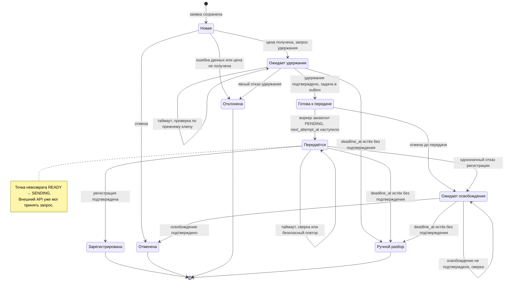
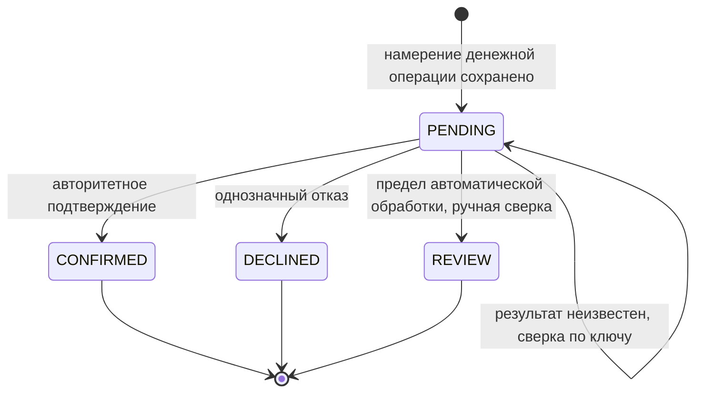

# Машина состояний

## Жизненный цикл заявки из З-6

Самопетли обозначают сохранение состояния во время ожидания, а не новый результат операции. MANUAL завершает автоматический сценарий, но требует сверки оператором. Переходов оператора без подтверждающих данных в модели нет. Предельный срок - 24 часа с создания задачи (учебное допущение З-6/З-8).

## Разрешения и запреты из З-6

| Состояние | Что можно делать | Что нельзя |
|---|---|---|
| NEW | Проверить данные, получить цену тарификатора, отменить заявку | Передавать отправление без цены и подтверждения удержания |
| WAIT_HOLD | Проверять результат операции по её ключу, повторять запрос с тем же ключом | Считать деньги удержанными по таймауту, передавать заявку в логистику |
| READY | Смотреть заявку, отменить с освобождением удержания; воркер может начать передачу | Создавать второе удержание для этой заявки |
| SENDING | Уточнять результат передачи и безопасно повторять тот же запрос | Свободно отменять: запрос уже мог принять внешний сервис |
| REGISTERED | Читать заявку и внешний почтовый статус | Вернуть заявку в NEW, освобождать удержание без подтверждения неприёма |
| CANCELLING | Проверять и повторять освобождение с тем же ключом | Показывать отмену как завершённую до подтверждения денег |
| CANCELLED | Читать результат | Повторно передавать эту заявку или удерживать деньги |
| REJECTED | Читать причину; при другой допустимой операции создать новую заявку | Продвигать отклонённую заявку автоматически |
| MANUAL | Смотреть причину; оператор сверяет внешний результат и деньги | Автоматически повторять без ограничения или считать деньги возвращёнными |

| Из состояния | Попытка | Ответ системы                                                                                 |
|---|---|-----------------------------------------------------------------------------------------------|
| NEW или WAIT_HOLD | Передать в логистику | 409 INVALID_STATE: удержание не подтверждено                                                  |
| READY | Повторно удержать деньги как новую операцию | По прежнему ключу - сохранённый результат; новая повторная операция - 409 DUPLICATE_OPERATION |
| SENDING или REGISTERED | Отменить как ещё не переданную | 409 INVALID_STATE: передача началась; нужен отдельный согласованный сценарий                  |
| CANCELLED или REJECTED | Передать в логистику | 409 INVALID_STATE: заявка завершена                                                           |
| MANUAL | Продолжить автоматическую обработку командой клиента | 409 MANUAL_REVIEW_REQUIRED: сначала требуется сверка                                          |

Все отсутствующие переходы запрещены: команда возвращает 409 INVALID_STATE и не меняет состояние и деньги. Для повтора уже выполненной операции действует идемпотентный ответ.

## Точка невозврата и отказы

Точка невозврата - начало передачи, переход READY в SENDING. Внешний API уже мог зарегистрировать встречное отправление, даже если ответ потерялся. Поэтому до выяснения результата нельзя считать, что ничего не произошло. При однозначном отказе регистрации возможна компенсация CANCELLING, но она не разрешена по одному таймауту.

Физический приём в отделении - отдельная граница почтового и финансового контуров: после него требуется окончательное списание, а не освобождение удержания. REGISTERED завершает оформление заявки, но не весь почтовый и финансовый процесс.

При отказе тарификатора цена не получена: NEW -> REJECTED с технической причиной. При отказе удержания остаётся WAIT_HOLD, при неизвестном результате передачи - SENDING, при отказе освобождения - CANCELLING. После deadline_at - MANUAL. Недоступность корпоративной шины не отменяет REGISTERED: показываются последний известный почтовый статус и время обновления. [Полная таблица отказов, включая BFF и API Gateway](a-architecture.md#изоляция-отказов).

Воркер З-8 внутри REST API продвигает READY -> SENDING, затем SENDING -> REGISTERED по подтверждённой регистрации. Он выбирает PENDING по next_attempt_at, проверяет deadline_at. Состояние READY и задача записаны одной транзакцией; после падения исполнителя задача восстанавливается с прежним ключом.

## Отдельный жизненный цикл денежной операции

Это дополнение сводит З-6 с З-7: движение денег после регистрации не меняет состояние заявки. Для каждой операции используется отдельная запись с ключом, типом, суммой и результатом.

| Операция | Когда создаётся | Как связано с заявкой                                |
|---|---|------------------------------------------------------|
| HOLD | Получена цена и проверены данные | Подтверждение продвигает WAIT_HOLD -> READY          |
| RELEASE до регистрации | Отмена READY или однозначный отказ SENDING | Подтверждение продвигает CANCELLING -> CANCELLED     |
| DEBIT | Получено достоверное подтверждение физического приёма | Заявка остаётся REGISTERED, почтовый статус "принято" |
| RELEASE после регистрации | Подтверждён неприём; проверено, что списание не завершено | REGISTERED сохраняется, меняется денежная операция   |
| ADJUSTMENT | Подтверждён фактический вес и получена новая цена | REGISTERED сохраняется; исполняется только разница   |

Для конкретного удержания DEBIT и RELEASE не исполняются независимо: денежный контур атомарно проверяет состояние резерва. При противоречивых подтверждениях - сверка, а не оба действия. Неизвестный результат не позволяет перейти в CONFIRMED. Повтор с прежним ключом возвращает сохранённый результат, а попытка использовать тот же ключ с другой суммой отклоняется.

## Переходы и событийные уведомления из З-6

| Уведомление | Меняется ли состояние, если сообщение не дойдёт | Владелец сущности                                          | Повторная доставка |
|---|---|------------------------------------------------------------|---|
| ReturnRegistered | Нет, REGISTERED уже записано | REST API                                                   | Аналитика пропускает уже обработанный event_id |
| HoldConfirmed | Денежная запись не изменится. Заявка может задержаться в WAIT_HOLD до сверки | Онлайн Баланс владеет денежной записью; REST API - заявкой | Операция узнаётся по ключу, новое удержание не создаётся |
| PostalOperationReceived | Почтовое состояние не изменится; в кабинете задержится отображение | Учётная система почтовой сети                              | Сервис отслеживания не дублирует одну операцию |

Публикация ReturnRegistered записывается в outbox в одной транзакции с SENDING -> REGISTERED. HoldConfirmed сообщает об уже выполненном удержании у владельца денег; получатель подтверждения может выполнить переход своей заявки WAIT_HOLD -> READY. PostalOperationReceived о приёме запускает отдельный DEBIT, но не переход REGISTERED -> "оплачено" в модели заявки. Дедупликация event_id защищает доставку, бизнес-ключ DEBIT защищает деньги даже при разных идентификаторах сообщений об одном приёме.
