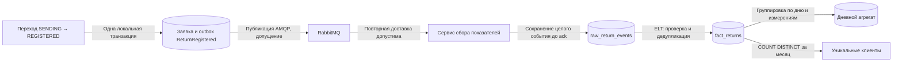

# Организация аналитики

## Вопросы владельца продукта из З-9

| Вопрос | Какое решение поддерживает |
|---|---|
| Сколько уникальных клиентов ММСБ оформили возврат за месяц через веб и API? | Выбрать канал, в котором нужно улучшить оформление |
| Какие причины оформления возврата встречаются чаще? | Выбрать подсказки и проверки при оформлении |
| Какая сумма удержана при регистрации возвратов по сегментам и каналам? | Оценить объём резервирования. Это не выручка и не текущий баланс |

## Факт и состав данных

Один факт - одна регистрация возврата: ReturnRegistered при переходе SENDING -> REGISTERED. Одна строка на return_id. Числовые показатели факта: return_count = 1; held_amount_kopecks - сумма подтверждённого удержания на момент регистрации.

| Измерение | Решение | Источник ключа |
|---|---|---|
| Клиент | Отделить рост числа организаций от активности сотрудников | client_id из проверенного контекста; соответствие с договором и финансовой системой, а не user_id |
| Сегмент | Проверить использование ММСБ | segment_code из карточки клиента на момент регистрации |
| Канал | Решить, где улучшать оформление | WEB, FILE или API из первого входа; BFF сохраняет исходный канал |
| Период | Сравнить месяцы | registered_at события, UTC |
| Причина оформления | Выбрать нужные подсказки | requested_reason_code из reason_code входной строки |

Дополненный контракт ReturnRegistered: event_id, event_type, schema_version, return_id, client_id, segment_code, channel, registered_at, requested_reason_code, held_amount_kopecks. Названия сегментов согласуются со справочником; MMSB в SQL ниже - условный код ММСБ. ФИО сотрудников и клиентов в аналитическое событие не включаются.

raw_return_events хранит event_id (уникальный), исходное тело события и ingested_at. fact_returns хранит return_id (первичный ключ), event_id (уникальный), перечисленные измерения, return_count и held_amount_kopecks, а также loaded_at. Клиент, сегмент, канал и причина связаны со справочниками. Сегмент фиксируется на момент регистрации: последующее изменение карточки не переписывает исторический факт. Код причины и подпись хранятся отдельно.

## Тип конвейера из З-9

ELT. Сначала сохраняем событие целиком, затем строим витрину. Маршрут: outbox REST API -> RabbitMQ -> существующий сервис сбора показателей, raw_return_events -> аналитическое хранилище, fact_returns. Историю можно пересчитать.

Альтернатива - ETL с преобразованием до сохранения. requested_reason_code: если при ETL заменить точный код общей подписью "возврат", причины из истории уже не восстановить. Код и подпись храним отдельно. ETL может уменьшить объём хранимых данных, но здесь важнее возможность пересчёта и проверки смысла полей.



Сбой после сохранения raw и до подтверждения очереди приводит к повтору, который устраняется по event_id. Повторная сборка фактов использует уникальность return_id, поэтому не увеличивает агрегаты повторно. Ошибочные события сохраняются для разбора и не считаются успешно загруженными; при восстановлении схема позволяет пересчитать агрегат из фактов.

## Прослеживаемость requested_reason_code

| Шаг                   | Поле | Преобразование и смысл |
|-----------------------|---|---|
| Входная строка        | reason_code | Причина, по которой клиент запросил возврат |
| Заявка REST API       | requested_reason_code | Код сохраняется без замены общей подписью |
| SENDING -> REGISTERED | ReturnRegistered.requested_reason_code | Снимок причины оформления, не почтовая причина неприёма |
| Исходный слой         | raw_return_events.payload.requested_reason_code | Исходный код события сохраняется целиком |
| Витрина               | fact_returns.requested_reason_code | Ключ справочника причин; подпись отдельно |

Причина оформления и причина технического/бизнес-отказа строки - разные поля. Смешивать их в одном измерении нельзя.

## Агрегаты и SQL

Агрегат из З-9: за день по сегменту, каналу и причине - число возвратов, сумма известных удержаний, число фактов с неизвестной суммой. Частый отчёт по объёму не должен читать всю историю. Уникальных клиентов за месяц считаем по фактам: дневные числа уникальных клиентов складывать нельзя.

:month_start и :next_month_start - UTC-границы выбранного календарного месяца. WEB и API считаются отдельно; один клиент может быть в обоих каналах, поэтому их результаты не складываются для получения общего числа.

```sql
SELECT channel, COUNT(DISTINCT client_id) AS unique_clients
FROM fact_returns
WHERE segment_code = 'MMSB'
  AND channel IN ('WEB', 'API')
  AND registered_at >= :month_start
  AND registered_at < :next_month_start
GROUP BY channel;
```

```sql
SELECT requested_reason_code, COUNT(*) AS returns_count
FROM fact_returns
WHERE registered_at >= :month_start
  AND registered_at < :next_month_start
GROUP BY requested_reason_code
ORDER BY returns_count DESC;
```

```sql
SELECT (registered_at AT TIME ZONE 'UTC')::date AS day_utc,
       segment_code, channel, requested_reason_code,
       SUM(return_count) AS returns_count,
       SUM(held_amount_kopecks) AS known_held_amount_kopecks,
       COUNT(*) FILTER (WHERE held_amount_kopecks IS NULL)
         AS unknown_amount_count
FROM fact_returns
GROUP BY (registered_at AT TIME ZONE 'UTC')::date,
         segment_code, channel, requested_reason_code;
```

Для ответа на вопрос о сумме за месяц дневные суммы объединяются по сегменту и каналу с сохранением unknown_amount_count. Отдельный COUNT(DISTINCT client_id) по фактам без GROUP BY channel даёт число клиентов в объединении WEB и API.

## Неизвестные значения и актуальность

NULL в held_amount_kopecks означает "неизвестно", а не нулевое удержание. Нормальный ReturnRegistered содержит подтверждённую сумму; NULL предусмотрен для неполного исторического/повреждённого события и поднимает сигнал качества. SUM суммирует известные суммы, COUNT фиксирует пропуски; если все суммы неизвестны, SUM остаётся NULL. Нельзя заменять неизвестное нулём и выдавать сумму за полную. Отсутствующие измерения выделяются как UNKNOWN без угадывания сегмента или канала.

В отчёте: "Витрина обновлена по состоянию на <UTC-время последнего успешного завершения загрузки>. Период регистраций: <начало — конец>. Есть неизвестные суммы: <число>". Отметка означает завершение загрузки доступного набора событий, а не гарантию отсутствия ещё не доставленных событий из источника. MAX(registered_at) не является доказательством полноты.

Без сквозной контрольной позиции outbox нельзя обещать все регистрации до этого времени. При очереди с задержкой или ошибками преобразования показывается предупреждение о неполноте. Для строгой полноты нужен подтверждённый непрерывный checkpoint источника. Поздние события обновляют соответствующий исторический день, а исторический отчёт может быть пересчитан.
