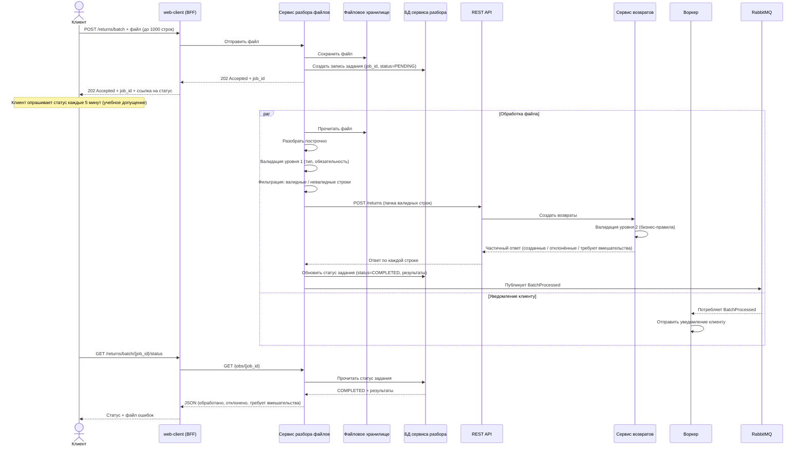

# Пункт (а) - Архитектура и дизайн

**Фича:** Управление возвратами  
**Основа:** черновики З-5, З-7, З-8  
**Связь:** дополняет пункт (0) протоколами, отказами, конвейером массового оформления

---

## Связи, протоколы, границы ответственности

### Таблица связей

| От | К | Действие | Протокол | Обоснование |
|---|---|---|---|---|
| Пользователь | Микрофронтенды | Uses | HTTPS | Браузер |
| Микрофронтенды | web-client (BFF) | Calls | HTTP/JSON | Внутренняя связь фронта с бэком |
| web-client | REST API | Makes API calls | HTTP/JSON | BFF агрегирует данные из публичного API |
| web-client | Сервис разбора файлов | Sends file | [?] | Источники не называют протокол передачи файла |
| Сервис разбора файлов | REST API | Creates batch | [?] | Вызов API с пачкой возвратов |
| Клиент-интегратор | API Gateway | Calls /returns | HTTP/JSON + Bearer | Вход интегратора-маркетплейса |
| API Gateway | REST API | Routes | HTTP/JSON | Маршрутизация на публичный контракт |
| REST API | Сервис авторизации | Checks token | [?] | Проверка токена доступа |
| Сервис авторизации | Единый шлюз авторизации | Authenticates | OAuth 2.0 / OIDC | Стандарт корпоративной аутентификации (вывод из контекста З-10) |
| REST API | Сервис возвратов | Creates / reads | HTTP/JSON | Создание и чтение возвратов |
| Сервис возвратов | БД возвратов | Reads / writes | SQL | Postgres |
| Сервис возвратов | API отправлений | Reads shipment by ШПИ | [?] | Проверка связи возврата с прямым отправлением |
| Сервис возвратов | Тарификатор | Calculates cost | HTTP | Расчёт стоимости услуги возврата |
| Сервис возвратов | RabbitMQ | Publishes events | AMQP | Вывод из типа брокера (занятие 6) |
| Сервис возвратов | Сервис нотификаций | Sends notifications | [?] | Уведомления клиенту |
| Сервис отслеживания РПО | Корпоративная шина данных | Reads operations | REST | Чтение операций почтовой сети |
| Сервис отслеживания РПО | RabbitMQ | Publishes operations | AMQP | Публикация статусов возвратов |
| RabbitMQ | Сервис возвратов | Consumes | AMQP | Потребление операций для обновления статусов |
| RabbitMQ | Фоновая публикация в шину | Consumes | AMQP | Потребление событий возвратов |
| Фоновая публикация в шину | Корпоративная шина данных | Publishes | REST | Передача событий во внешний контур |
| RabbitMQ | Онлайн Баланс | Consumes ReturnDelivered | AMQP | Денежная операция при вручении возврата |
| Онлайн Баланс | Системы финансового учёта | Exchanges charges | [?] | Финансовый контур |

**[?] = протокол неизвестен.** Это честность источника, а не дефект работы (занятие 5).

---

## Границы ответственности

| Сервис | Зона ответственности | Что НЕ входит |
|---|---|---|
| **Сервис возвратов** | Жизненный цикл возврата, связь с прямым отправлением, валидация бизнес-правил (срок, право на возврат) | Тарификация, физический приём на ПВЗ, аутентификация |
| **REST API** | Публичный контракт, валидация формата запросов, маршрутизация | Бизнес-правила (передаёт в сервис возвратов) |
| **Сервис разбора файлов** | Разбор файла, формальная валидация (тип, обязательность), фильтрация невалидных строк | Бизнес-правила (передаёт в REST API) |
| **Онлайн Баланс** | Денежные операции, удержание и списание за возврат | Состояние возврата (подписывается на событие, не владеет) |
| **Сервис отслеживания РПО** | Публикация операций почтовой сети | Интерпретация статуса (делает сервис возвратов) |

**Правило:** Бизнес-правила живут в сервисе-владельце сущности (сервис возвратов). Входы (REST API, сервис разбора файлов) проверяют только формат.

---

## Механизм изоляции отказов смежных систем

**Принцип:** Отказ смежной системы не должен блокировать создание возврата, но может отложить вычисление зависимых данных или перевести возврат в состояние ожидания.

### Изоляция отказов - сводная таблица

| Смежная система | Что будет с фичей при отказе | Механизм изоляции | Восстановление |
|---|---|---|---|
| **Единый шлюз авторизации** | Не работают оба входа: ни экран, ни API интегратора не могут аутентифицировать пользователя. Возвраты не создаются, перечень недоступен. | Нет изоляции - это критическая зависимость. Кэширование токенов на стороне сервиса авторизации продлевает работу на время жизни кэша. | После восстановления шлюза аутентификация возобновляется немедленно. |
| **API Gateway (вход интегратора)** | Интегратор-маркетплейс не может создавать возвраты через API. Вход через веб (BFF) работает. | Изоляция по входу: отказ шлюза не влияет на веб-вход. | После восстановления шлюза вызовы интегратора возобновляются. |
| **web-client / BFF (вход веб)** | Пользователи не могут оформить возврат через экран. Вход через API работает. | Изоляция по входу: отказ BFF не влияет на API-вход. | После восстановления BFF экран возобновляется. |
| **API отправлений** | Нельзя проверить право на возврат по ШПИ (отправление вручено? срок не истёк?). Возвраты создаются в состоянии `CREATED` с флагом `validation_pending = true`. Воркер повторяет проверку каждые 5 минут. Перечень и статусы видны. | **Отложенная валидация:** запись создаётся, проверка откладывается через механизм отложенных задач (занятие 8, воркер). Дедлайн - 24 часа. | Воркер пытается проверить при каждом опросе. При восстановлении API - проверка завершается, флаг `validation_pending` снимается. |
| **Тарификатор** | Стоимость возврата не рассчитывается. Возврат создаётся со значением `cost = null`, клиенту возвращается "стоимость будет рассчитана позже". Перечень работает. | **Отложенный расчёт:** воркер пытается рассчитать стоимость с экспоненциальной паузой. Если при переходе `CREATED -> ACCEPTED` стоимость всё ещё `null` - флаг `requires_manual_review = true`. | При восстановлении тарификатора воркер рассчитывает стоимость для всех записей с `cost = null`. |
| **Корпоративная шина данных** | Статусы возвратов перестают обновляться. Клиенту показывается последнее известное состояние с отметкой "Данные по состоянию на..." (граница актуальности, занятие 9). Создание возвратов работает. | **Отображение устаревших данных:** последнее известное состояние хранится в БД возвратов. Обновления приходят с задержкой. | События приходят с задержкой после восстановления шины, статусы догоняют текущее состояние. |
| **Сервис нотификаций** | Уведомления о статусе возврата не уходят. Создание, перечень, переходы состояния работают. | **Паттерн outbox (занятие 8):** уведомления откладываются в таблицу задач, воркер повторяет отправку с экспоненциальной паузой до успеха. | При восстановлении сервиса нотификаций отложенные уведомления уходят. |
| **Системы финансового учёта** | Денежный контур откладывается: списания и зачисления ждут в очереди RabbitMQ. Возврат отправления не страдает. | **Очередь как буфер:** событие `ReturnDelivered` публикуется в RabbitMQ независимо от доступности финансовых систем. Онлайн Баланс потребляет из очереди при восстановлении. | Очередь доставляет сообщения при восстановлении, списания выполняются с задержкой. |

### Отказ собственных входов

**Типовая ошибка З-5:** Ни одна работа не сказала, что будет с фичей при отказе шлюза или BFF.

| Вход | Что будет при отказе | Механизм изоляции |
|---|---|---|
| **API Gateway** | Интегратор не может создавать возвраты через API. Веб-вход работает. | Изоляция по входу: отказ одного входа не влияет на другой. |
| **web-client (BFF)** | Пользователи не могут оформить возврат через экран. API работает. | Изоляция по входу: отказ BFF не влияет на прямой вызов REST API интегратором. |

**Критическая зависимость без изоляции:** Единый шлюз авторизации. При его отказе оба входа не работают.

---

## Конвейер массового оформления возвратов (З-8)

### Последовательность обработки



### Асинхронная обработка

**Принцип (занятие 8):** Система принимает задание, возвращает идентификатор (job_id), выполняет работу вне контекста запроса.

**Код ответа:** `202 Accepted` (принято, не выполнено) - это семантически отличается от `200 OK` (выполнено). Спецификация интерфейса (занятие 10) обязана явно указать, что код 202 означает "задание принято".

**Опрос статуса (поллинг):** Клиент опрашивает `GET /returns/batch/{job_id}/status` каждые 5 минут ([Д] учебное допущение). Альтернатива - webhook (клиент даёт адрес для уведомления), но это требует от клиента публичного адреса.

### Двухуровневая валидация

**Уровень 1 - формальный (сервис разбора файлов):**

- Тип значения (строка, число, дата)
- Обязательность поля
- Формат (ШПИ - 14 цифр, email - содержит @)

**Граница:** "достаточно строки" - проверка не требует контекста предметной области.

**Уровень 2 - бизнес-правила (сервис возвратов через REST API):**

- Отправление с таким ШПИ существует
- Отправление вручено (нельзя вернуть отправление в пути)
- Срок возврата не истёк (14 дней с момента вручения, [Д])
- Клиент - отправитель этого отправления

**Граница:** "нужен контекст" - проверка требует обращения к другим сервисам (API отправлений).

### Три множества результата

| Множество | Смысл | Действие клиента |
|---|---|---|
| **Обработано** | Возвраты созданы успешно | Нет действий |
| **Отклонено** | Исправить нельзя (отправление не вручено, срок истёк, клиент не отправитель) | Убрать из следующей загрузки |
| **Требует вмешательства** | Ошибки валидации (неверный формат ШПИ, пустое поле) | Исправить и повторить загрузку |

**Формат ответа:** JSON с массивом результатов по каждой строке файла:

```json
{
  "job_id": "a1b2c3d4",
  "status": "COMPLETED",
  "total": 1000,
  "processed": 987,
  "rejected": 10,
  "requires_action": 3,
  "items": [
    {
      "line": 1,
      "shipment_id": "12345678901234",
      "status": "CREATED",
      "return_id": "ret_xyz"
    },
    {
      "line": 5,
      "shipment_id": "98765432109876",
      "status": "REJECTED",
      "reason": "SHIPMENT_NOT_DELIVERED",
      "message": "Отправление ещё в пути, возврат невозможен"
    },
    {
      "line": 42,
      "shipment_id": "invalid",
      "status": "VALIDATION_ERROR",
      "reason": "INVALID_SHIPMENT_ID_FORMAT",
      "message": "ШПИ должен содержать 14 цифр"
    }
  ]
}
```

### Ограничение на входе: не более 1000 возвратов на файл

**Решение (занятие 8):** Ограничить размер пакета на входе, а не разбивать на порции внутри системы.

**Обоснование:**

- Клиент-маркетплейс (сегмент из ЛР-1) уже обрабатывает массовые операции пакетами в своей системе. Он умеет резать файлы.
- Альтернатива (разбиение внутри): система дробит файл на порции, управляет повторами каждой порции, отслеживает общий прогресс - сложность растёт, граница отказа размывается.
- Плательщик превышения: **клиент**. Он проходит цикл ожидания N раз, если файлов много. Для клиента-маркетплейса это приемлемо (профиль сегмента: автоматизация).

**Если превышен:** Код ответа `400 Bad Request`, машиночитаемый код `BATCH_SIZE_EXCEEDED`, сообщение "Файл должен содержать не более 1000 возвратов".

### Гранулярность обработки

| Этап | Гранулярность | Следствие |
|---|---|---|
| Разбор файла | Построчный | Ошибка разбора убивает одну строку |
| Фильтрация | Построчная | Невалидные строки отсеиваются |
| Передача в REST API | Одна пачка (все валидные строки) | Ошибка передачи касается всего пакета. Ответ обязан быть частичным по составу (занятие 8): какие позиции приняты, какие отклонены |

---

## Учебные допущения

[Д] Период опроса статуса клиентом - 5 минут  
[Д] Ограничение пакета - не более 1000 возвратов на файл  
[Д] Срок возврата - 14 дней с момента вручения прямого отправления  
[Д] Дедлайн проверки права на возврат (при недоступности API отправлений) - 24 часа