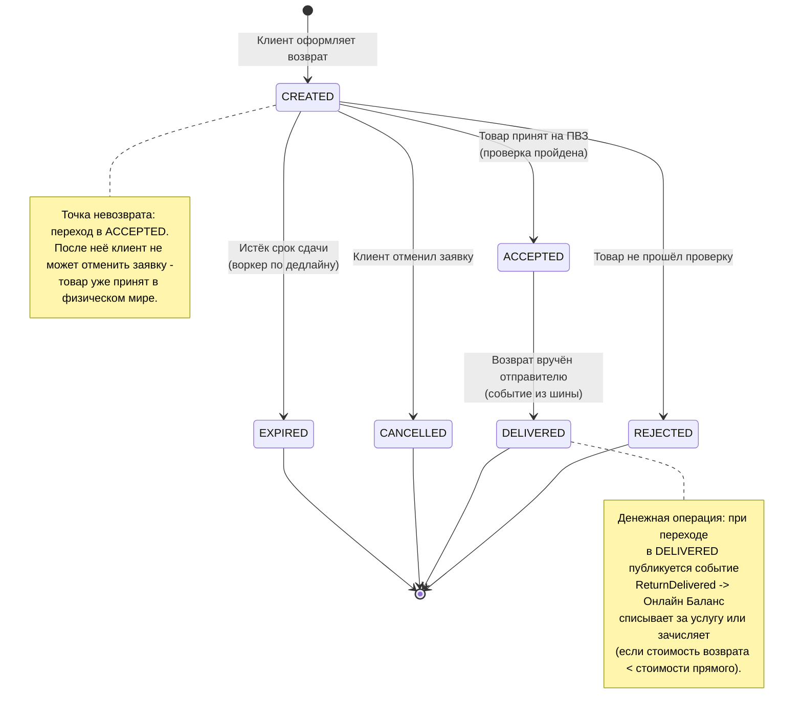

# Пункт (б) - Машина состояний

**Фича:** Управление возвратами  
**Основа:** черновики З-6, З-7, З-8  
**Связь с другими пунктами:** воркер из З-8, точка невозврата из З-7

---

## Жизненный цикл возврата - конечный автомат

### Состояния возврата

| Состояние | Смысл | Допустимые операции |
|---|---|---|
| `CREATED` | Заявка создана в системе, ожидает сдачи товара клиентом | Отмена (клиентом), просмотр статуса |
| `ACCEPTED` | Товар принят на ПВЗ, проверка пройдена | Просмотр, ожидание вручения |
| `REJECTED` | Товар не прошёл проверку на ПВЗ | Только просмотр, отмена невозможна |
| `DELIVERED` | Возврат вручён отправителю (финальное успешное) | Только просмотр |
| `CANCELLED` | Заявка отменена клиентом до сдачи товара | Только просмотр |
| `EXPIRED` | Истёк срок сдачи товара | Только просмотр |

### Диаграмма состояний

---

## Запрещённые переходы

**Принцип:** переходы, не входящие в модель, запрещены. Попытка выполнить запрещённый переход - ошибка, которую система обязана перехватить и обработать явно

### Примеры запрещённых переходов и их обработка

| Из состояния | В состояние | Почему запрещён | Обработка |
|---|---|---|---|
| `ACCEPTED` | `CANCELLED` | Товар уже принят в физическом мире, отмена невозможна | Код ошибки `RETURN_ALREADY_ACCEPTED`, сообщение "Возврат уже принят и не может быть отменён" |
| `DELIVERED` | `CREATED` | Возврат уже завершён | Код ошибки `RETURN_ALREADY_COMPLETED` |
| `REJECTED` | `ACCEPTED` | Товар не прошёл проверку, повторная проверка не предусмотрена | Код ошибки `RETURN_REJECTED`, инструкция "Создайте новую заявку" |
| `EXPIRED` | любое | Истёк срок, возврат автоматически закрыт | Код ошибки `RETURN_EXPIRED` |
| `CANCELLED` | `ACCEPTED` | Отменённая заявка не может быть возобновлена | Код ошибки `RETURN_CANCELLED` |

**Проверка в коде:** Перед изменением состояния сервис возвратов проверяет текущее состояние и целевое по таблице допустимых переходов. Если переход запрещён, возвращается ошибка 409 Conflict с машиночитаемым кодом (занятие 10)

---

## Точка невозврата

**Определение (занятие 6):** Граница, после которой внешний мир узнал о решении системы. До неё переходы обратимы, после - нет

**В модели возвратов:** Переход `CREATED -> ACCEPTED`.

**Почему:**

- **До точки невозврата (`CREATED`):** заявка существует только в системе. Клиент может отменить её через интерфейс, товар ещё не сдан. Обратимо

- **После точки невозврата (`ACCEPTED`):** ПВЗ физически принял товар, проверил его и подтвердил приёмку в системе. Товар больше не у клиента, он в логистической цепочке. Отмена невозможна - можно только довести возврат до конца или зафиксировать отказ (`REJECTED`)

**Граница совпадает с границей внешнего мира (занятие 6):** как только товар принят физически, система обязана гарантировать, что он будет доставлен обратно отправителю или зафиксирован отказ

---

## Поведение при недоступности смежного сервиса

**Принцип (занятие 7):** Недоступность смежной системы не должна блокировать создание возврата, но может отложить вычисление зависимых данных

| Смежный сервис | Участвует в переходе | Поведение при недоступности |
|---|---|---|
| **API отправлений** | `-> CREATED` (проверка права на возврат по ШПИ) | Возврат создаётся в состоянии `CREATED`, но с флагом `validation_pending`. Воркер повторяет проверку каждые 5 минут. Если через 24 часа API не ответил - `-> EXPIRED` с причиной "не удалось проверить право на возврат" |
| **Тарификатор** | `-> CREATED` (расчёт стоимости возврата) | Возврат создаётся со стоимостью `null`. Клиенту возвращается "стоимость будет рассчитана позже". Воркер пытается рассчитать на шаге `CREATED -> ACCEPTED`. Если тарификатор недоступен и при `ACCEPTED` - стоимость остаётся `null`, списание не происходит, случай требует ручного разбора |
| **Корпоративная шина данных** | `ACCEPTED -> DELIVERED` (событие вручения) | Переход не происходит, состояние остаётся `ACCEPTED`. Клиенту показывается последнее известное состояние с отметкой "Данные по состоянию на..." (занятие 9). Когда шина восстанавливается, события приходят с задержкой, и переход выполняется |
| **Онлайн Баланс** | `DELIVERED` (денежная операция) | Событие `ReturnDelivered` публикуется в RabbitMQ независимо от доступности баланса. Если баланс недоступен - сообщение лежит в очереди, обрабатывается при восстановлении. Гарантия доставки - на стороне брокера (занятие 6) |
| **Сервис нотификаций** | Все переходы (уведомление клиента) | Уведомление - не часть бизнес-логики. Если сервис недоступен, переход выполняется, уведомление откладывается через механизм отложенных задач (занятие 8). Воркер повторяет с экспоненциальной паузой до успеха |

---

## Событийное уведомление против перехода состояния

**Принцип (занятие 6):** Модель состояний отвечает на вопрос "что можно делать с сущностью сейчас". Событийная интеграция - "как остальные об этом узнают". Смешение - ошибка проектирования

### Переходы состояния (меняют состояние возврата)

| Переход | Кто инициирует | Что меняется в БД |
|---|---|---|
| `-> CREATED` | Клиент (через REST API) | Создаётся запись возврата, `status = CREATED` |
| `CREATED -> ACCEPTED` | ПВЗ (подтверждение приёмки) | `status = ACCEPTED`, `accepted_at = now()` |
| `CREATED -> REJECTED` | ПВЗ (товар не прошёл проверку) | `status = REJECTED`, `rejection_reason` |
| `CREATED -> CANCELLED` | Клиент (отмена заявки) | `status = CANCELLED`, `cancelled_at = now()` |
| `CREATED -> EXPIRED` | Воркер (истёк срок сдачи) | `status = EXPIRED`, `expired_at = now()` |
| `ACCEPTED -> DELIVERED` | Событие из корпоративной шины | `status = DELIVERED`, `delivered_at = now()` |

### Событийные уведомления (не меняют состояние, а информируют другие сервисы)

| Событие | Когда публикуется | Кто потребляет | Зачем |
|---|---|---|---|
| `ReturnCreated` | После перехода `-> CREATED` | Сервис нотификаций | Уведомление клиенту "возврат создан, код для сдачи: ..." |
| `ReturnStatusChanged` | После любого перехода состояния | Сервис нотификаций, ЕИАП (аналитика) | Уведомление + витрина |
| `ReturnDelivered` | После перехода `ACCEPTED -> DELIVERED` | Онлайн Баланс | Списание за услугу возврата |

**Ключевое различие:**

- **Переход:** Изменяет поле `status` в базе данных сервиса возвратов. Это источник истины о состоянии
- **Событие:** Уведомляет других о том, что уже произошло. Потеря сообщения в очереди не меняет состояние возврата - оно уже записано. Потребитель пропустил уведомление, но может запросить текущее состояние через API

**Антипаттерн, которого избегаем:** Считать сообщение в очереди источником истины. Если при обработке `ReturnDelivered` Онлайн Баланс отказал, это не откатывает состояние возврата обратно в `ACCEPTED` - возврат уже вручён в физическом мире. Баланс повторяет попытку списания отдельно (занятие 7, компенсирующая операция)

---

## Воркер: механизм гарантированного выполнения

**Задача (занятие 8):** Продвинуть запись из промежуточного состояния в целевое, даже если смежный сервис временно недоступен

### Воркер возвратов

**Что делает:** Периодически опрашивает таблицу возвратов по статусу и полю `next_check_at`. Если запись требует проверки - пытается выполнить отложенное действие

**Три задачи воркера:**

1. **Проверка права на возврат (при недоступности API отправлений):**
   - Опрашивает записи `status = CREATED` AND `validation_pending = true` AND `next_check_at <= now()`
   - Вызывает API отправлений, проверяет ШПИ
   - Если успешно: `validation_pending = false`
   - Если ошибка: `next_check_at = now() + экспоненциальная пауза` (5 мин, 10 мин, 20 мин, ...)
   - Если после 24 часов не удалось: `status = EXPIRED`, `expiration_reason = 'validation_failed'`

2. **Расчёт стоимости возврата (при недоступности тарификатора):**
   - Опрашивает записи `status = CREATED` AND `cost IS NULL` AND `cost_retry_at <= now()`
   - Вызывает тарификатор
   - Если успешно: записывает `cost`
   - Если ошибка: повторяет с экспоненциальной паузой
   - Если при переходе `-> ACCEPTED` стоимость всё ещё `null` - флаг `requires_manual_review = true`

3. **Истечение срока сдачи товара:**
   - Опрашивает записи `status = CREATED` AND `deadline <= now()`
   - Переход `CREATED -> EXPIRED`
   - Публикует событие `ReturnExpired`

**По какому полю узнаёт, что пора:** `next_check_at` (timestamp следующей проверки) и `deadline` (дедлайн сдачи товара). Обе колонки индексированы

**Периодичность:** каждые 60 секунд (учебное допущение).

**Паттерн outbox (занятие 8):** Изменение состояния + запись задачи в таблицу `outbox_tasks` выполняются в одной транзакции. Воркер читает `outbox_tasks` и пытается выполнить задачу (например, отправить уведомление). При успехе - удаляет запись

---

## Проверки модели

### 1. Недостижимые состояния

**Проверка:** Из начального состояния `[*] -> CREATED` есть ли путь в каждое состояние?

**Результат:** Все состояния достижимы:
- `CREATED` - начальное
- `ACCEPTED` ← `CREATED`
- `REJECTED` ← `CREATED`
- `CANCELLED` ← `CREATED`
- `EXPIRED` ← `CREATED`
- `DELIVERED` ← `ACCEPTED`

**Вывод:** Недостижимых состояний нет

### 2. Тупиковые состояния

**Проверка:** Из каждого конечного состояния есть ли переход в `[*]` или оно объявлено финальным?

**Результат:** `REJECTED`, `DELIVERED`, `CANCELLED`, `EXPIRED` - все финальные, переходят в `[*]`

**Вывод:** Тупиковых состояний нет

### 3. Отсутствие пути отказа

**Проверка:** Есть ли состояние отказа для каждого класса ошибок?

**Результат:**
- Отказ в проверке товара -> `REJECTED`
- Истёк срок -> `EXPIRED`
- Клиент передумал -> `CANCELLED`

**Вывод:** Все классы отказа обработаны

### 4. Необработанные запрещённые переходы

**Проверка:** Для каждого запрещённого перехода определён код ошибки?

**Результат:** Да, см. таблицу запрещённых переходов выше

**Вывод:** Все запрещённые переходы обрабатываются явно
