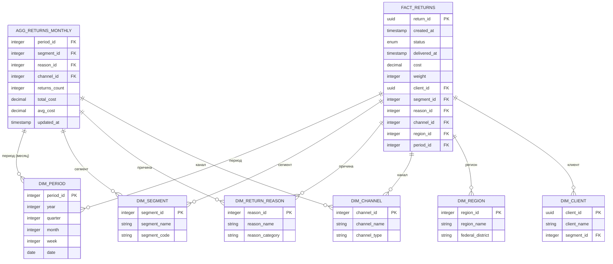

# Пункт (в) - Организация аналитики

**Фича:** Управление возвратами  
**Основа:** черновик З-9  
**Связь:** события из пункта (б), конвейер из пункта (а)

---

## Вопросы владельца продукта

**Принцип (занятие 9):** Витрина строится от вопросов, а не от данных

### Три вопроса к витрине возвратов

1. **Сколько возвратов по каждой причине возврата за период?**
   - Измерения: причина возврата, период (месяц)
   - Показатель: количество возвратов

2. **Какова доля возвратов, оформленных через API (интегратором), против веб-входа?**
   - Измерения: канал создания (API / WEB), период
   - Показатель: доля возвратов (%)

3. **Какова средняя стоимость возврата по сегментам клиентов и регионам?**
   - Измерения: сегмент клиента, регион, период
   - Показатель: средняя стоимость возврата, количество возвратов

---

## Состав данных витрины

### Факт: `fact_returns`

**Гранулярность:** Один возврат

| Поле | Тип | Смысл | Источник |
|---|---|---|---|
| `return_id` | UUID | Идентификатор возврата | Сервис возвратов, БД возвратов |
| `created_at` | Timestamp | Дата создания заявки | БД возвратов, поле `created_at` |
| `status` | Enum | Текущее состояние (CREATED, ACCEPTED, DELIVERED, REJECTED, ...) | БД возвратов, поле `status` |
| `delivered_at` | Timestamp | Дата вручения возврата отправителю (если `status = DELIVERED`) | БД возвратов, поле `delivered_at` |
| `cost` | Decimal(10,2) | Стоимость услуги возврата (руб) | БД возвратов, поле `cost` |
| `weight` | Integer | Вес возвратного отправления (г) | БД возвратов, связь с прямым отправлением |
| `client_id` | UUID | FK -> Измерение клиента | БД возвратов |
| `segment_id` | Integer | FK -> Измерение сегмента | БД возвратов через клиента |
| `reason_id` | Integer | FK -> Измерение причины возврата | БД возвратов, поле `rejection_reason` или `return_reason` |
| `channel_id` | Integer | FK -> Измерение канала создания | REST API фиксирует при создании: `WEB` (BFF) или `API` (шлюз) |
| `region_id` | Integer | FK -> Измерение региона | БД возвратов, регион ПВЗ приёма |
| `period_id` | Integer | FK -> Измерение периода | Вычисляется из `created_at` |

**Числовые показатели:**

- `cost` - для расчёта средней и суммарной стоимости
- `weight` - для расчёта среднего веса возвратов (вспомогательный показатель)

### Измерения

#### 1. `dim_period` - Период

| Поле | Смысл |
|---|---|
| `period_id` | Суррогатный ключ |
| `year` | Год |
| `quarter` | Квартал (1..4) |
| `month` | Месяц (1..12) |
| `week` | Неделя года (1..53) |
| `date` | Дата (для гранулярности "день") |

**Гранулярность:** День. Агрегация - по месяцам, кварталам, годам

#### 2. `dim_segment` - Сегмент клиента

| Поле | Смысл |
|---|---|
| `segment_id` | Суррогатный ключ |
| `segment_name` | Наименование сегмента (КРБ, Маркетплейс, Интернет-магазин) |
| `segment_code` | Код сегмента |

**Источник:** Классификация клиентов, ЛР-1. Для задачи курса - маркетплейс

#### 3. `dim_return_reason` - Причина возврата

| Поле | Смысл |
|---|---|
| `reason_id` | Суррогатный ключ |
| `reason_name` | Наименование причины (брак товара, не подошёл размер, отказ покупателя, ...) |
| `reason_category` | Категория причины (качество товара, логистика, клиент передумал) |

**Источник:** Справочник причин возврата, заполняется клиентом при оформлении возврата

**Иерархия:** Причина -> Категория. Позволяет группировать по категориям

#### 4. `dim_channel` - Канал создания возврата

| Поле | Смысл |
|---|---|
| `channel_id` | Суррогатный ключ |
| `channel_name` | Наименование (Веб, API) |
| `channel_type` | Тип (WEB, API) |

**Источник:** REST API фиксирует канал при создании возврата:

- `WEB` - если вызов пришёл через BFF (пользователь оформил через экран)
- `API` - если вызов пришёл через API Gateway (интегратор-маркетплейс)

**Связь с расхождением из README:** В черновике З-9 показатель "доля возвратов через API" есть, но в схеме З-5 не было явной записи канала. Исправлено: REST API теперь фиксирует признак канала

#### 5. `dim_region` - Регион

| Поле | Смысл |
|---|---|
| `region_id` | Суррогатный ключ |
| `region_name` | Наименование региона (Московская область, Санкт-Петербург, ...) |
| `federal_district` | Федеральный округ |

**Источник:** Регион ПВЗ, который принял возврат

#### 6. `dim_client` - Клиент

| Поле | Смысл |
|---|---|
| `client_id` | UUID клиента |
| `client_name` | Наименование клиента |
| `segment_id` | FK -> `dim_segment` |

**Источник:** Справочник клиентов, БД сервиса авторизации

---

## Агрегаты

**Принцип (занятие 9):** Агрегат - предвычисленная сумма/количество по частым сочетаниям измерений. Нужен, когда пересчёт всего факта каждый раз занимает слишком долго

### Агрегат: `agg_returns_monthly`

**Гранулярность:** Месяц × Сегмент × Причина возврата × Канал

| Поле | Смысл |
|---|---|
| `period_id` | FK -> `dim_period` (месяц) |
| `segment_id` | FK -> `dim_segment` |
| `reason_id` | FK -> `dim_return_reason` |
| `channel_id` | FK -> `dim_channel` |
| `returns_count` | Количество возвратов |
| `total_cost` | Сумма стоимости возвратов |
| `avg_cost` | Средняя стоимость возврата |
| `updated_at` | Отметка последнего обновления |

**Обоснование, почему без него не обойтись:**

- Владелец продукта спрашивает "сколько возвратов по причине X за последний квартал" - запрос каждый раз сканирует миллионы строк факта
- С агрегатом: читаем 3 строки (3 месяца квартала) × N причин × M сегментов - на порядки быстрее
- Агрегат обновляется раз в сутки (пакетно), а не при каждом запросе

**Служебное значение (занятие 9):** Если для сочетания измерений данных недостаточно (например, сегмент новый, возвратов ещё не было), `returns_count = 0`, `avg_cost = NULL`. Это означает не "средняя = 0", а "средняя не определена"

---

## Конвейер загрузки: ETL vs ELT

### Выбор: **ELT** (Extract -> Load -> Transform)

**Последовательность:**

1. **Extract:** Сырые данные извлекаются из БД возвратов и БД клиентов.
2. **Load:** Загружаются в ClickHouse без преобразований (таблицы `raw_returns`, `raw_clients`).
3. **Transform:** Преобразуются внутри ClickHouse через Materialized View:
   - Вычисляется `period_id` из `created_at`
   - Связывается `client_id` с `segment_id` через JOIN
   - Создаются записи в `fact_returns`

### Обоснование выбора ELT

**Ключевой вопрос (занятие 9):** "Что мы потеряем безвозвратно, если выберем ETL?"

**Ответ:**

- **ETL:** Преобразуем данные до загрузки. Если через полгода владелец продукта скажет "причину возврата нужно разделить на два поля: основная причина и детализация", придётся перезаливать историю - а её может не быть в исходной системе (БД возвратов хранит только текущее состояние, история удаляется через 3 месяца)

- **ELT:** Сырые данные грузятся как есть. Если определение изменится - изменяем view, история пересчитывается из сырых данных без перезаливки

**Дополнительно:**

- У фичи возвратов нет устоявшейся модели - владелец продукта ещё формулирует вопросы (занятие 9). Гибкость важнее объёма.
- ClickHouse эффективно хранит сырые данные в сжатом виде. Потеря места некритична

### Два пути в аналитику (занятие 9)

**Путь А (событийный):**

```
Сервис возвратов -> RabbitMQ (ReturnStatusChanged) -> ЕИАП -> Система статистики
```

**Путь Б (пакетный):**

```
Сервис возвратов -> БД возвратов -> Планировщик (читает порциями) -> ЕИАП -> Система статистики
```

**Для витрины возвратов выбираем Путь Б:**

- Витрина обновляется раз в сутки (пакетно), не требует событийного потока
- Планировщик читает БД возвратов порциями (например, по 10 000 записей), грузит в ClickHouse
- Периодичность: раз в сутки, ночью ([Д] учебное допущение)

**Почему не Путь А:**

- Событийный поток хорош для оперативной аналитики (обновление дашборда в реальном времени). Для витрины, которая отвечает на вопросы "за месяц", задержка в сутки приемлема
- При событийном потоке нужно обрабатывать каждое изменение состояния возврата. При пакетном - читаем финальное состояние раз в сутки

---

## Структура витрины



---

## Запросы к витрине (примеры)

### Запрос 1: Количество возвратов по причинам за октябрь 2026

```sql
SELECT 
    r.reason_name,
    COUNT(f.return_id) AS returns_count
FROM fact_returns f
JOIN dim_return_reason r ON f.reason_id = r.reason_id
JOIN dim_period p ON f.period_id = p.period_id
WHERE p.year = 2026 AND p.month = 10
GROUP BY r.reason_name
ORDER BY returns_count DESC;
```

**Альтернатива через агрегат (быстрее):**

```sql
SELECT 
    r.reason_name,
    SUM(a.returns_count) AS returns_count
FROM agg_returns_monthly a
JOIN dim_return_reason r ON a.reason_id = r.reason_id
JOIN dim_period p ON a.period_id = p.period_id
WHERE p.year = 2026 AND p.month = 10
GROUP BY r.reason_name
ORDER BY returns_count DESC;
```

### Запрос 2: Доля возвратов через API (последний квартал)

```sql
SELECT 
    c.channel_name,
    SUM(a.returns_count) AS returns_count,
    ROUND(100.0 * SUM(a.returns_count) / SUM(SUM(a.returns_count)) OVER (), 2) AS share_pct
FROM agg_returns_monthly a
JOIN dim_channel c ON a.channel_id = c.channel_id
JOIN dim_period p ON a.period_id = p.period_id
WHERE p.year = 2026 AND p.quarter = 4
GROUP BY c.channel_name;
```

### Запрос 3: Средняя стоимость возврата по сегментам и регионам (октябрь 2026)

```sql
SELECT 
    s.segment_name,
    rg.region_name,
    AVG(f.cost) AS avg_cost,
    COUNT(f.return_id) AS returns_count
FROM fact_returns f
JOIN dim_segment s ON f.segment_id = s.segment_id
JOIN dim_region rg ON f.region_id = rg.region_id
JOIN dim_period p ON f.period_id = p.period_id
WHERE p.year = 2026 AND p.month = 10
  AND f.cost IS NOT NULL
GROUP BY s.segment_name, rg.region_name
ORDER BY avg_cost DESC;
```

---

## Граница актуальности и расхождения

**Граница актуальности (занятие 9):** Отчёт должен содержать отметку "Данные по состоянию на..."

**Для витрины возвратов:**

- Отчёт по возвратам за октябрь 2026 содержит отметку: "Данные обновлены: 2026-11-01 03:00 UTC"
- Если корпоративная шина данных недоступна (пункт а), статусы возвратов не обновляются. Отчёт показывает последнее известное состояние с явной отметкой

**Три класса расхождений (занятие 9):**

1. **Расхождение данных:** Задержка конвейера. Возврат создан сегодня утром, а в отчёте появится завтра (обновление раз в сутки). Решение: граница актуальности

2. **Расхождение определений:** "Доля возвратов через API" может считаться по-разному: по созданным возвратам или по завершённым (DELIVERED). Владелец продукта обязан явно определить

3. **Величина не та:** Поле в витрине подписано неверно (например, `total_cost` подписано как `avg_cost`). Самый опасный класс - не мешает работать, поэтому живёт долго (занятие 9)

**Для витрины возвратов фиксируем определение:**

- **Доля возвратов через API:** считается по возвратам в состоянии `CREATED` и выше (то есть по всем созданным заявкам, включая отменённые и отклонённые)
- **Средняя стоимость возврата:** считается только по возвратам в состоянии `DELIVERED` (завершённые возвраты), где `cost IS NOT NULL`

---

## CQRS: разделение моделей чтения и записи

**Упрощённая форма (занятие 9):** Операционная нагрузка (создание возвратов) идёт в Postgres (БД возвратов). Аналитическая нагрузка (отчёты) идёт в ClickHouse (витрина). Это не классический CQRS (где модели чтения и записи спроектированы по-разному), а разделение по профилю нагрузки

**Что это даёт:**

- Отчёт не создаёт нагрузку на операционную базу
- Изменение схемы витрины не влияет на сервис возвратов
- Разные типы хранилищ под разные задачи: Postgres (строчное, OLTP) vs ClickHouse (колоночное, OLAP)

**Согласованность в конечном счёте (занятие 9):** Витрина отстаёт от операционной базы на период обновления конвейера (раз в сутки). Для пользователя отчёта это выглядит как "данные вчерашние", что приемлемо

---

## Учебные допущения

[Д] Периодичность обновления витрины - раз в сутки, ночью (03:00 UTC)  
[Д] Размер порции при загрузке - 10 000 записей  
[Д] Срок хранения истории в БД возвратов - 3 месяца (после чего удаляется), в витрине - бессрочно  
[Д] Период агрегации - месяц (агрегат `agg_returns_monthly`)  
[Д] Гранулярность факта - один возврат (детализация до строки)
