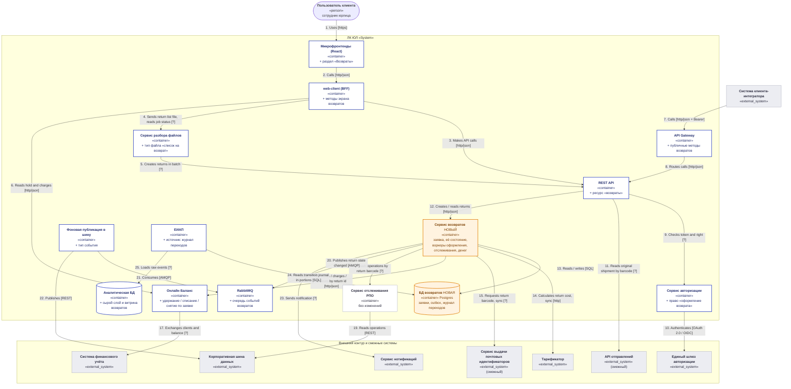

# (0) Оценка и декомпозиция

[<- оглавление](README.md)

**Фича «Управление возвратами».** Клиент оформляет возврат ранее отправленного отправления (по одному -- на экране и через API, списком -- файлом на экране), видит перечень возвратов, состояние и причину, и видит, что возврат делает с его деньгами: стоимость пересылки **удерживается** при оформлении, **списывается** при приёме в отделении, **удержание снимается**, если приёма не было (условие задачи занятия 7).

Пометки: **[допущение]** -- учебное допущение; **\*** -- мой вывод, а не факт из материалов курса; **[?]** -- протокол неизвестен.

## Оценка на верхнем уровне

| Что | Оценка |
|---|---|
| Новые контейнеры | **2**: Сервис возвратов и его БД (новый сервис один) |
| Существующие контейнеры, которые меняются | **10** (таблица ниже) |
| Смежные и внешние системы, от которых зависит фича | **8** |
| Синхронные зависимости на пути оформления | **3**: тарификатор, сервис выдачи ШПИ, Онлайн Баланс (удержание) |
| Главные риски | у тарификатора нет деградированного режима, поэтому без цены возврат не оформить; состояние возвратного отправления рождается не в кабинете, а приходит из почтовой сети через шину; признака сегмента клиента в системе нет (занятие 2) |
| Объём работ | S -- до спринта, M -- 1-2 спринта, L -- больше [допущение]; по контейнерам -- в таблице |

Ядро фичи -- **возврат отправления**. Возврат денег -- его следствие в другом контуре (Онлайн Баланс и система финансового учёта), поэтому деньги не живут в Сервисе возвратов, а только запускаются из него (занятие 5).

## Диаграмма контейнеров C4

Номера связей (`1.`, `2.` ...) -- те же, что в таблице связей пункта [(а)](a-architecture.md#2-связи-и-протоколы).

Оранжевый -- новые контейнеры, синий -- существующие, которые меняются, серый -- внешние и смежные системы. Протоколы существующих связей (1-3, 4-5, 6-10, 17, 19, 21-22) -- как на учебной схеме занятия 5; [AMQP] у RabbitMQ -- вывод из вида брокера. Новые связи -- моё проектное решение. Смежные корпоративные системы названы по функции.

## Какие существующие модули затрагиваются

| Контейнер | Что меняется | Вход | Объём [допущение] |
|---|---|---|---|
| Микрофронтенды (React) | Новый раздел «Возвраты»: перечень, карточка (состояние, причина, деньги), оформление, загрузка списка | экран | M |
| web-client (BFF) | Методы экрана: карточка собирается из Сервиса возвратов (через REST API) и денег из Онлайн Баланса; передача файла в Сервис разбора | экран | S |
| API Gateway | Маски для публичных методов возвратов, лимиты | API | S |
| Сервис авторизации | Новое право «оформление возврата»: возврат тратит деньги клиента | оба | S |
| REST API | Ресурс «возвраты»: проверить, что исходное отправление принадлежит клиенту, передать в Сервис возвратов. Общая точка двух входов -> правила одни | оба | M |
| Сервис разбора файлов | Тип файла «список на возврат»: проверка задания, построчная проверка, пакетный вызов REST API, три множества результата ([(а), конвейер](a-architecture.md#6-конвейер-массового-оформления-з-8)) | экран | M |
| Онлайн Баланс | Операции «удержать / списать / снять удержание» по номеру заявки с ключом идемпотентности «заявка + тип операции» | оба | M |
| RabbitMQ | Очередь «состояние заявки на возврат изменилось» | -- | S |
| Фоновая публикация в шину | Новый тип события. Кабинет -- не владелец предметной области, другие контуры должны знать о возвратах из ЛК* | -- | S |
| ЕИАП | Новый источник для планировщика (путь Б, занятие 9): журнал переходов из БД возвратов | -- | S |
| Аналитическая БД | Сырой слой событий возвратов и витрина ([(в)](v-analytics.md)) | -- | M |

**Используется без изменений:** Сервис отслеживания РПО -- он уже отдаёт историю операций по ШПИ (на учебной схеме -- в REST API). Сервис возвратов -- просто ещё один читатель, по ШПИ **своего** возвратного отправления.

## Какие новые модули нужны и почему без них нельзя

| Новый контейнер | Что делает | Почему нельзя не заводить |
|---|---|---|
| **Сервис возвратов** | Владеет **заявкой на возврат** и её состоянием ([(б)](b-states.md)); три воркера: оформление, отслеживание, деньги; запускает денежные операции в Онлайн Балансе | **Не в REST API:** это синхронный фасад обоих входов; фоновые воркеры внутри него связали бы сбой опроса отслеживания с созданием всех отправлений -- нарушение первого требования изоляции отказов занятия 5\*. **Не в Онлайн Балансе:** ядро фичи -- возврат отправления, деньги -- его следствие; склеить их -- ошибка «один процесс на два возврата». **Не в Сервисе отслеживания:** он отражает операции всех отправлений из шины; правила возврата и деньги сделали бы его владельцем чужой логики* |
| **БД возвратов** (Postgres) | Заявки, таблица задач outbox, журнал переходов (источник для аналитики) | По базе на сервис (учебная схема занятия 5). Задача outbox обязана лежать в той же базе и в той же транзакции, что и заявка (занятие 8) |

Возвратное отправление -- **встречное**, со своим ШПИ и необязательной ссылкой на прямое (занятие 6). Своё физическое состояние оно не ведёт, а получает из почтовой сети. Поэтому Сервис возвратов владеет **заявкой** (что разрешено клиенту в ЛК), а не копией почтового автомата.

## Что сознательно не выделено в новый сервис

| Функция | Где живёт | Почему этого достаточно |
|---|---|---|
| Массовое оформление | Сервис разбора файлов | Механизм «файл -> разбор -> пакет в REST API» уже есть (занятие 8), нужен только новый тип файла |
| Деньги | Онлайн Баланс | Баланс уже принадлежит ему; второй владелец денег клиента -- источник расхождений |
| Цена возврата | Тарификатор | Тарифная модель в фичу не входит (занятие 5); меняется вызов, а не владелец |
| ШПИ возврата | Сервис выдачи почтовых идентификаторов | Тот же механизм, что при формировании обычного отправления (занятие 6) |
| Публичные методы | API Gateway + REST API | Отдельный вход для возвратов не нужен |
| Аналитика | ЕИАП + аналитическая БД | Путь Б уже существует (занятие 9); добавляется источник, а не конвейер |

## Чего не хватает (вопросы техническому руководителю)

1. Есть ли у тарификатора расчёт цены возвратного (встречного) отправления или он считается как обычное с переставленными адресами?
2. Протокол чтения истории операций у Сервиса отслеживания ([?] на связи 18) и как часто его можно опрашивать.
3. Является ли аналитическая БД «для статистики» (ClickHouse) хранилищем конвейера ЕИАП -- связь не установлена (занятие 9), поэтому связь 25 с [?].
4. (:
