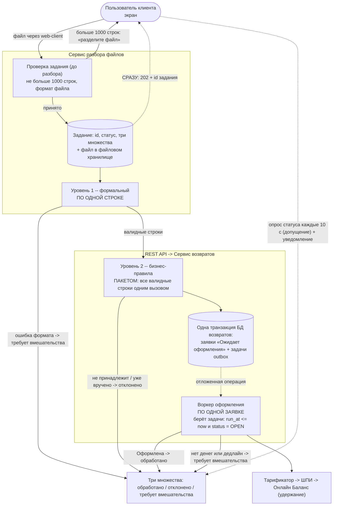

# (а) Архитектура и дизайн

[<- оглавление](README.md) · схема контейнеров -- в [(0)](0-decomposition.md#диаграмма-контейнеров-c4)

Пометки: **[допущение]** -- учебное допущение; **\*** -- мой вывод; **[?]** -- протокол неизвестен.

## 1. Границы ответственности

| Что | Кто владеет (источник истины) | Фича только... |
|---|---|---|
| Заявка на возврат и её состояние | **Сервис возвратов** | -- (владелец) |
| Физическое движение возвратного отправления | Почтовая сеть, через корпоративную шину | читает операции по ШПИ возврата через Сервис отслеживания |
| Баланс, удержания, списания | Онлайн Баланс (авторитетное значение -- система финансового учёта) | запускает операции по номеру заявки |
| Цена пересылки | Тарификатор | спрашивает при оформлении |
| ШПИ возвратного отправления | Сервис выдачи почтовых идентификаторов | запрашивает при оформлении |
| Исходное (прямое) отправление | API отправлений | проверяет «чьё оно и можно ли вернуть» |
| Вход, токен, права | API Gateway, web-client, Сервис авторизации | добавляет методы и право |
| Массовая загрузка и её задание | Сервис разбора файлов | получает пакет готовых строк |

## 2. Связи и протоколы

Номера -- как на схеме [(0)](0-decomposition.md#диаграмма-контейнеров-c4). «Есть» -- связь есть на учебной схеме занятия 5, «новая» -- моё решение.

| № | Откуда -> куда | Действие | Протокол | Синхр. / асинхр. | Статус |
|---|---|---|---|---|---|
| 1 | Пользователь -> Микрофронтенды | Uses | https | синхр. | есть |
| 2 | Микрофронтенды -> web-client | Calls | http/json | синхр. | есть |
| 3 | web-client -> REST API | Makes API calls (возвраты) | http/json | синхр. | есть |
| 4 | web-client -> Сервис разбора файлов | Sends return list file, reads job status | [?] | синхр. приём, дальше асинхр. | есть |
| 5 | Сервис разбора -> REST API | Creates returns in batch | [?] | синхр. | есть |
| 6 | web-client -> Онлайн Баланс | Reads hold and charges | http/json | синхр. | есть |
| 7 | Интегратор -> API Gateway | Calls | http/json + Bearer | синхр. | есть |
| 8 | API Gateway -> REST API | Routes calls | http/json | синхр. | есть |
| 9 | REST API -> Сервис авторизации | Checks token and right | [?] | синхр. | есть |
| 10 | Сервис авторизации -> Единый шлюз авторизации | Authenticates | OAuth 2.0 / OIDC | синхр. | есть |
| 11 | REST API -> API отправлений | Reads original shipment by barcode | [?] | синхр. | новая |
| 12 | REST API -> Сервис возвратов | Creates / reads returns | http/json | синхр. | новая |
| 13 | Сервис возвратов -> БД возвратов | Reads / writes | SQL | синхр. | новая |
| 14 | Сервис возвратов -> Тарификатор | Calculates return cost | http | синхр. (из воркера) | новая |
| 15 | Сервис возвратов -> Сервис выдачи ШПИ | Requests return barcode | [?] | синхр. (из воркера) | новая |
| 16 | Сервис возвратов -> Онлайн Баланс | Holds / charges / releases by return id | http/json | синхр. вызов из воркера по outbox | новая |
| 17 | Онлайн Баланс -> Система финансового учёта | Exchanges clients and balance | [?] | -- | есть |
| 18 | Сервис возвратов -> Сервис отслеживания | Reads operations by return barcode | [?] | опрос из воркера | новая |
| 19 | Сервис отслеживания -> Корп. шина | Reads operations | REST | -- | есть |
| 20 | Сервис возвратов -> RabbitMQ | Publishes return state changed | AMQP | асинхр. | новая |
| 21 | Фоновая публикация -> RabbitMQ | Consumes | AMQP | асинхр. | есть |
| 22 | Фоновая публикация -> Корп. шина | Publishes | REST | асинхр. | есть |
| 23 | Сервис возвратов -> Сервис нотификаций | Sends notification | [?] | асинхр. (outbox) | новая |
| 24 | ЕИАП -> БД возвратов | Reads transition journal in portions | SQL | пакетно по расписанию | новая |
| 25 | ЕИАП -> Аналитическая БД | Loads raw events | [?] | пакетно | новая |

25 связей, у 9 протокол неизвестен ([?]): источники называют связь, но не протокол, -- угадывать не стал.

## 3. Почему так: решения и альтернативы

| Решение | Альтернатива | Почему выбрал своё |
|---|---|---|
| Деньги (связь 16) -- HTTP-вызов из воркера по задаче outbox, ключ «заявка + тип операции» | RPC поверх RabbitMQ с подтверждением, как синхронизация баланса | Гарантию доставки уже даёт outbox + повтор (занятие 8), идемпотентность -- ключ и состояние (занятие 7). RPC поверх очереди в системе уже оказался долгом там, где он был не нужен (занятие 5) -- лишний механизм |
| Состояние возврата -- опрос Сервиса отслеживания по своему ШПИ (связь 18) | Подписка на «операции по возвратам» из шины | Чем возвратную операцию отличать от обычной -- не установлено (занятие 6), а ШПИ возврата мы знаем сами. И «состояние продвигают, а не рассылают»: сообщение -- только повод проверить. Цена -- задержка до следующего цикла опроса |
| Тарификатор и сервис ШПИ вызывает Сервис возвратов (14, 15) | Вызывает REST API, как для обычных отправлений | Оформление может идти в фоне (после ответа 202 и в массовой операции), а фоновой работе не место в синхронном фасаде. Цена: второй потребитель контракта тарификатора -- при его изменении править два места* |
| Аналитика -- журнал переходов в своей БД + планировщик ЕИАП (24) | Чтение событий из RabbitMQ (путь А) | RabbitMQ -- очередь, а не лог: доставил и забыл, перечитать историю нельзя (занятие 9). Для ELT нужна перечитываемая история -- её даёт журнал в базе. Цена: ЕИАП читает чужую базу -- связность по схеме журнала* |
| Ответ на оформление: 201 сразу или 202 «принято», если смежная система не ответила | Всегда ждать до конца | Ресурс тратится на ожидание, а не на работу; повтор клиента без ответа даст дубль. 202 + заявка в БД + воркер -- без дублей и без висящих запросов |

## 4. Механизм изоляции отказов

1. **Тайм-аут на каждом синхронном вызове** смежной системы -- 3 с [допущение]. Дольше клиент ждать не должен, а висящий запрос держит ресурс.
2. **Оформление не держится на запросе клиента.** Заявка и задача outbox пишутся в БД возвратов **в одной транзакции**. Если смежная система не ответила, клиент получает 202, а воркер доводит оформление сам.
3. **Повтор с растущей паузой и дедлайном:** 1 -> 2 -> 4 -> 8 -> 16 мин, дальше раз в 30 мин, дедлайн оформления 2 ч [допущение] (как в [З-8](../practical_works/8/%D0%97-8_%D0%B3%D1%80%D1%83%D0%BF%D0%BF%D0%B00_%D0%A2%D0%B8%D1%82%D0%BE%D0%B2.docx)). Растущая пауза не добивает упавшую систему.
4. **Чтение не зависит от смежных систем.** Перечень и карточка читаются только из БД возвратов. Данные отслеживания и денег показываются как **последнее известное значение с отметкой «по состоянию на ...»** -- отображаемое отделено от авторитетного (занятие 5, требование 2; занятие 7).
5. **Деньги и уведомления -- только через outbox.** Если получатель недоступен, задача ждёт в таблице, а не теряется в памяти или очереди.
6. **Два входа наблюдаются отдельно:** ошибки экрана и API считаются раздельно, чтобы концентрированный поток интегратора не усреднился (занятие 5, требование 3).
7. **Отказ фичи не роняет кабинет:** Сервис возвратов -- отдельный контейнер со своей базой; при его отказе отправления, партии и баланс работают как раньше.

## 5. Что будет с фичей при отказе каждой системы

| Что отказало | Что с фичей | Что видит пользователь | Когда разрешится |
|---|---|---|---|
| **API Gateway** (свой вход) | Интеграторы не могут оформлять и читать возвраты. Экран работает. Уже принятые заявки воркеры доводят -- им шлюз не нужен | Интегратор: соединение не устанавливается или 5xx шлюза -> повторить позже, с тем же ключом идемпотентности. Пользователи экрана ничего не замечают | Когда поднимется шлюз; повтор с тем же ключом не даст дублей |
| **web-client (BFF)** (свой вход) | Весь экран, включая «Возвраты» и загрузку файлов. API работает. Уже загруженные файлы и принятые заявки доводятся до конца -- задания живут в Сервисе разбора и БД возвратов | Пользователь: кабинет недоступен. Интегратор не замечает | Когда поднимется BFF; результат загрузки клиент увидит в уведомлении и в разделе «Загрузки» |
| Сервис авторизации / Единый шлюз авторизации | Не работает **весь** кабинет, оба входа. Фича ничего сделать не может -- граница не наша. Воркеры продолжают: им пользовательский токен не нужен | Не может войти / 401 | Когда поднимется авторизация |
| **Тарификатор** | Деградированного режима нет: без цены возврат не оформляется. Заявка ждёт в «Ожидает оформления», воркер повторяет до дедлайна | Экран и API: «Расчёт стоимости временно недоступен, возврат оформится автоматически, деньги не удержаны» (202). После дедлайна -- «не оформлено, повторите» | До 2 ч [допущение], потом заявка возвращается в Черновик |
| Сервис выдачи ШПИ | То же: без ШПИ заявка не оформлена. Удержание, если было, держится с тем же ключом, ШПИ запрашивается повторно | «Номер возврата ещё не присвоен, оформляем» | До дедлайна; после него удержание снимается |
| API отправлений | Нельзя проверить, что исходное отправление принадлежит клиенту и не вручено -> новую заявку не создаём (иначе вернём чужое) | 503 «проверка отправления временно недоступна, повторите» | Сразу после восстановления; заявок не появилось -- нечего доводить |
| **Онлайн Баланс** | Удержание при оформлении: заявка ждёт в «Ожидает оформления», воркер повторяет. Списание и снятие после приёма: заявка **уже** «Принята в сети» (состояние не ждёт денег), задача денег ждёт в outbox | «Деньги в обработке», баланс -- последнее известное значение с отметкой времени | После восстановления; потерянное найдёт ежедневная сверка ([(б)](b-states.md#8-воркеры-и-сверка)) |
| Система финансового учёта | Напрямую фича её не вызывает. Онлайн Баланс показывает последнее известное значение | Баланс с отметкой «по состоянию на» | Решает Онлайн Баланс; фича не блокируется |
| Корп. шина / Сервис отслеживания | Состояния замирают. Таймеры «Не принята» и «Задерживается» на это время **ставятся на паузу**, иначе наш сбой станет ложным отказом* | «Данные о движении обновлены в ЧЧ:ММ». Оформление и отмена работают | Когда операции снова пойдут; воркер догонит по ШПИ |
| RabbitMQ | Публикация в шину и уведомления задерживаются, события ждут в outbox. Оформление, деньги и отслеживание не страдают -- они через HTTP | Ничего, кроме задержки писем | Когда поднимется брокер |
| Сервис нотификаций | Письма задерживаются или теряются, фича работает | Нет письма; состояние видно в кабинете | Сразу; повтор из outbox |
| Сервис разбора файлов | Массовое оформление недоступно, по одному -- работает | «Загрузка списков временно недоступна, оформите по одному или позже» | Когда поднимется сервис |
| ЕИАП / аналитическая БД | Витрина отстаёт, сама фича работает | Владелец продукта видит в отчёте старую отметку «по состоянию на» | Журнал в БД возвратов никуда не делся -- планировщик догонит |
| Сервис возвратов / БД возвратов (сам) | Фича недоступна целиком; остальной кабинет работает (п. 4.7) | «Возвраты временно недоступны» | -- |

## 6. Конвейер массового оформления (З-8)

| Вопрос | Решение |
|---|---|
| Что клиент получает сразу | **202** и id задания: «принято», а не «сделано». Повторная загрузка того же файла тем же клиентом за 24 ч [допущение] возвращает **тот же** id (ключ -- клиент + контрольная сумма файла) -> обрыв связи не даёт дублей |
| Как узнаёт результат | Опрос статуса раз в 10 с [допущение], пока открыта вкладка, -- ждёт человек у экрана; плюс уведомление. Закрыл вкладку -- задание всё равно доводится, итог в разделе «Загрузки» |
| Граница на входе | **Не больше 1000 строк в файле** -- тот же предел, что у загрузки отправлений ([открытая база знаний сервиса](https://otpravka.pochta.ru/help)); файл до 5 МБ [допущение]. Предел и единый пакетный вызов держат друг друга (занятие 8) |
| Кто платит за превышение | Клиент с большим обратным потоком: сам режет список на файлы и проходит несколько циклов. Узнаёт **до** загрузки: подпись у кнопки, шаблон, счётчик строк на экране; при превышении -- «разделите файл», а не «исправьте строку» |
| Гранулярность | проверка задания -- файл целиком; уровень 1 -- по строке; уровень 2 -- пакетом; оформление -- по одной заявке |
| Два уровня валидации | 1 -- формат ШПИ, обязательные поля, причина из справочника, дубль ШПИ в файле (Сервис разбора; хватает строки). 2 -- отправление клиента, не вручено, нет активного возврата (REST API + Сервис возвратов; нужен контекст). Остаток на балансе -- в воркере, по авторитетному значению в момент удержания |
| Три множества | обработано -- заявка «Оформлена»; **отклонено** (исправить нельзя) -- уже вручено, чужое; **требует вмешательства** -- опечатка в ШПИ, нет денег, дедлайн смежной системы. Исправить можно в разделе «Требуют исправления», без новой загрузки |
| Повторы | только технические сбои; отказы бизнес-правил не повторяются никогда. Пауза растёт, дедлайн 2 ч [допущение] -> строка в «требует вмешательства» |
| Отложенная операция | оформление каждой заявки; задача outbox в той же транзакции, что заявка; доводит воркер оформления ([(б)](b-states.md#8-воркеры-и-сверка)) |

Массовое оформление -- только через файл на экране. Через API интегратор оформляет по одному: программе файл не нужен, у каждого вызова свой исход и свой ключ идемпотентности.
