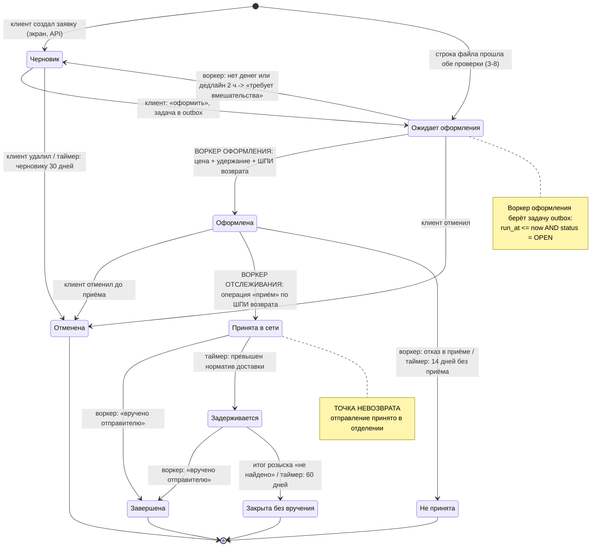
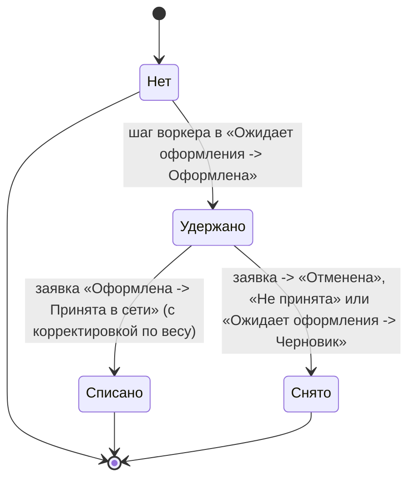

# (б) Машина состояний

[<- оглавление](README.md)

Пометки: **[допущение]** -- учебное допущение; **\*** -- мой вывод.

## 1. Чья это машина

Сущность -- **заявка на возврат**, владелец состояния -- **Сервис возвратов**. Возвратное отправление -- встречное, со своим ШПИ; своё физическое состояние оно не ведёт, а получает из почтовой сети (занятие 6). Поэтому почтовый автомат я **не копирую**: беру из него три факта (приём, вручение отправителю, отказ в приёме) как причины переходов заявки.

Один процесс -- два автомата (как подключение баланса на занятии 6): **состояние заявки** (п. 2) и **денежный статус заявки** (п. 3). Общего «состояния возврата» нет нигде -- оно складывается из двух.

## 2. Автомат заявки

Сроки 30 дней, 2 ч, 14 дней, 60 дней и норматив доставки -- **[допущение]**. Цикл «Черновик <-> Ожидает оформления» допустим: выход из него ограничен сроком черновика (занятие 6, «цикл без выхода -- дефект»).

## 3. Автомат денег заявки (из З-7)

| Точка движения денег ([З-7](../practical_works/7/%D0%97-7_%D0%A2%D0%B8%D1%82%D0%BE%D0%B2_2.docx)) | Переход заявки | Переход денег | Как выполняется |
|---|---|---|---|
| Удержание стоимости пересылки | Ожидает оформления -> Оформлена | Нет -> Удержано | Синхронно в шаге воркера, по авторитетному остатку в Онлайн Балансе; без удержания перехода нет |
| Окончательное списание (+ доначисление или возврат разницы по весу) | Оформлена -> Принята в сети | Удержано -> Списано | Задача outbox в той же транзакции, что переход; вызывает воркер денег |
| Снятие удержания | -> Отменена, -> Не принята, Ожидает оформления -> Черновик | Удержано -> Снято | То же |

## 4. Состояния: что можно и что нельзя

| Состояние | Можно | Нельзя |
|---|---|---|
| Черновик | Править, удалить, оформить | Отслеживать (нет ШПИ), деньги не затронуты |
| Ожидает оформления | Смотреть, отменить | Править (данные ушли в оформление) |
| Оформлена | Печатать документы, отменить, смотреть ШПИ и удержание | Менять адрес, вес, получателя -- данные закреплены ШПИ |
| Принята в сети | Отслеживать, смотреть причину и деньги | Отменить, править |
| Задерживается | Отслеживать, подать заявление на розыск | Отменить, править |
| Завершена / Отменена / Не принята / Закрыта без вручения | Смотреть историю; оформить новую заявку по тому же отправлению | Любые изменения -- конечное состояние |

## 5. Запрещённые переходы и ответ системы

| Из состояния | Попытка | Что возвращает система |
|---|---|---|
| Принята в сети, Задерживается | Отменить | 409 `RETURN_ALREADY_ACCEPTED` + текущее состояние; заявка не меняется |
| Ожидает оформления, Оформлена | Изменить адрес, вес, получателя | 409 `RETURN_LOCKED`: «отмените и оформите новую» |
| Ожидает оформления и дальше | Повторно «оформить» (двойное нажатие, повтор после тайм-аута) | **Не ошибка**: та же заявка, второй задачи outbox и второго удержания нет |
| Любое не конечное | Оформить второй возврат по тому же отправлению | 409 `RETURN_ALREADY_EXISTS` со ссылкой на активную заявку |
| Любое конечное | Любая команда клиента | 409 `RETURN_CLOSED` + конечное состояние |
| Черновик, Отменена | Пришла операция почтовой сети по ШПИ | Переход **не** выполняется: запись в журнал + флаг «расхождение контуров» оператору; вслепую не правим |
| Принята в сети и дальше | Повторно пришла уже учтённая операция «приём» | **Не ошибка**: подтверждаем, состояние не меняем (вариант 2 из [З-7](../practical_works/7/%D0%97-7_%D0%A2%D0%B8%D1%82%D0%BE%D0%B2_2.docx)) |
| Деньги: Списано, Снято | Удержать, списать или снять ещё раз по той же заявке | Онлайн Баланс возвращает уже сделанную операцию по ключу «заявка + тип»: второго движения денег нет |
| Деньги: Нет | Списать или снять | Отказ + задача на сверку: такого быть не должно |

## 6. Точка невозврата -- «Принята в сети»

После приёма в отделении о решении клиента узнал физический мир: отправление лежит в почтовой сети и едет. Отменять в системе нечего. Раньше, при присвоении ШПИ, ещё ничего физически не произошло -- отмена возможна (в справочнике операций почтовой сети есть отмена по требованию отправителя, занятие 6). С этой же точкой совпадает денежная граница: окончательное списание идёт при приёме ([З-7](../practical_works/7/%D0%97-7_%D0%A2%D0%B8%D1%82%D0%BE%D0%B2_2.docx)).

## 7. Недоступность смежного сервиса

| Что недоступно | В каком состоянии окажется заявка | Что видит пользователь |
|---|---|---|
| Тарификатор / сервис выдачи ШПИ | Остаётся «Ожидает оформления»; после дедлайна -- назад в «Черновик», удержание снято | «Оформляем автоматически, деньги не удержаны» -> после дедлайна «не оформлено, повторите» |
| Онлайн Баланс при удержании | То же | То же |
| Онлайн Баланс после приёма | Заявка идёт дальше («Принята в сети»), деньги остаются «Удержано», задача ждёт | «Списание в обработке», баланс по состоянию на ЧЧ:ММ |
| Корп. шина / Сервис отслеживания | Остаётся «Оформлена» или «Принята в сети» дольше; таймеры 14 дней [допущение] и норматива **на паузе** | «Данные о движении обновлены в ЧЧ:ММ» |
| API отправлений | Заявка не создаётся вовсе | «Проверка отправления временно недоступна» |

## 8. Воркеры и сверка

| Воркер | Какой переход продвигает | По какому полю узнаёт, что пора |
|---|---|---|
| **Воркер оформления ([З-8](../practical_works/8/%D0%97-8_%D0%B3%D1%80%D1%83%D0%BF%D0%BF%D0%B00_%D0%A2%D0%B8%D1%82%D0%BE%D0%B2.docx))** | Ожидает оформления -> Оформлена (или -> Черновик по дедлайну) | Задача outbox: `run_at <= now AND status = OPEN`; после неудачи `run_at` сдвигается с растущей паузой |
| Воркер отслеживания | Оформлена -> Принята в сети / Не принята, Принята -> Завершена | Заявка: `state IN (ISSUED, ACCEPTED, DELAYED) AND next_check_at <= now`; опрос Сервиса отслеживания по ШПИ возврата раз в 15 мин [допущение] |
| Таймеры (тот же планировщик) | -> Задерживается, -> Не принята, -> Отменена (черновик), -> Закрыта без вручения | Поля сроков: `accept_deadline`, `delivery_deadline`, `draft_expires_at` |
| Воркер денег | Денежный автомат: Удержано -> Списано / Снято | Задача outbox денег: `run_at <= now AND status = OPEN` |

**Сверка** (раз в 24 ч [допущение]) -- по ключу «номер заявки + тип операции» между БД возвратов и Онлайн Балансом. Она ищет: удержание без оформленной заявки, «Принята» без списания, конечный отказ с висящим удержанием, два списания по одной заявке. Сверка ловит то, что не предусмотрела ни одна компенсация (занятие 7).

## 9. Переходы и событийные уведомления

**Переходы** меняют состояние заявки. Меняет только Сервис возвратов, причина -- команда клиента, таймер или **проверенный** факт почтовой сети.

| Переход | Кто продвигает |
|---|---|
| [*] -> Черновик, Черновик -> Ожидает оформления, -> Отменена | клиент |
| Ожидает оформления -> Оформлена / Черновик | воркер оформления |
| Оформлена -> Принята в сети / Не принята, -> Завершена | **внешний контур** (почтовая сеть), но переход делает наш воркер после чтения операции по ШПИ |
| -> Задерживается, -> Закрыта без вручения, истечение черновика | таймер |

**Уведомления** сообщают другим о том, что уже произошло.

| Уведомление | Изменится ли состояние, если не дойдёт | Кто владелец сущности | Что при повторной доставке |
|---|---|---|---|
| Операция почтовой сети по ШПИ возврата (читаем сами) | Нет: это повод проверить, а не источник истины -- воркер всё равно опросит по ШПИ. Потеря = задержка, не расхождение | Физическое состояние -- почтовая сеть; заявка -- Сервис возвратов | Заявка уже в целевом состоянии -> подтверждаем без перехода |
| «Состояние заявки изменилось» -> RabbitMQ -> корп. шина | Нет | Сервис возвратов | Потребитель отбрасывает повтор по паре «номер заявки + версия» |
| Письмо клиенту через сервис нотификаций | Нет | Сервис возвратов | Отсекаем по паре «номер заявки + состояние», иначе клиент получит два письма |
| Журнал переходов -> ЕИАП -> аналитика | Нет | Сервис возвратов | Загрузка идемпотентна по «номер заявки + версия» |

**Команды денег** (удержать, списать, снять) -- не уведомления: если не дойдут, деньги не сдвинутся. Это переходы в автомате Онлайн Баланса, у которого свой владелец. Поэтому они идут через outbox с подтверждением и ключом «заявка + тип», а сверка ловит то, что не дошло.
