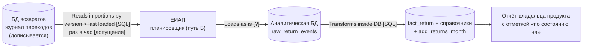

# (в) Организация аналитики

[<- оглавление](README.md)

Пометки: **[допущение]** -- учебное допущение; **\*** -- мой вывод. Имена таблиц и полей -- проектное решение, реальной структуры хранилища в источниках нет.

## 1. Вопросы владельца продукта (витрина строится от них)

| № | Вопрос | Какое решение поддерживает |
|---|---|---|
| 1 | Сколько возвратов в месяц оформляют клиенты каждого сегмента и какая доля оформлена не руками -- файлом или через API? | Развивать ли массовое оформление и API для возвратов; делать ли платную допуслугу пакетного возврата для КРБ (гипотеза 2 из [ЛР-1](../lr1/%D0%9B%D0%A0-1_%D0%9A%D0%A0%D0%91_%D0%A2%D0%B8%D1%82%D0%BE%D0%B2.pdf)) |
| 2 | По каким причинам возвращают отправления и какие причины растут -- по типам отправлений и сегментам? | Что чинить: растёт «адресат не найден» -> проверка адреса при оформлении прямого отправления; «отказ получателя» -- вопрос к клиенту, не к нам |
| 3 | Сколько дней от оформления возврата до вручения отправителю и где теряется время: до приёма или в доставке? | Куда направлять доработку (наш контур или почтовая сеть) и какой норматив ставить таймеру «Задерживается» ([(б)](b-states.md)) |

## 2. Состав данных и откуда каждое поле

Источник один -- **журнал переходов** в БД возвратов. Запись добавляется (не правится) **в той же транзакции**, что и переход заявки или денежная операция.

| Показатель / поле витрины | Порождающее событие ([(б)](b-states.md)) | Где на схеме [(0)](0-decomposition.md#диаграмма-контейнеров-c4) |
|---|---|---|
| Дата оформления, канал (экран / файл / API), клиент (ИНН + договор), причина (код + комментарий), тип исходного отправления | Переход «Ожидает оформления -> Оформлена» | связи 3/5/8 -> 12 -> 13; тип -- из связи 11 (снимок при создании заявки) |
| Удержанная сумма | Денежный переход «Нет -> Удержано» | связь 16 |
| Списанная сумма, корректировка по весу | «Удержано -> Списано» | связь 16 |
| Снятое удержание | «Удержано -> Снято» | связь 16 |
| Время приёма в отделении (время операции почтовой сети) | «Оформлена -> Принята в сети» | связи 18, 19 |
| Время вручения отправителю | «-> Завершена» | связи 18, 19 |
| Итоговое состояние | Последний переход заявки | связь 13 |
| Сегмент | **Нет события**: признака сегмента в системе нет (занятие 2). Вычисляется в хранилище по правилу из активности клиента, порог фиксируется заранее; нет данных -> «Неизвестно» | -- |

## 3. Тип конвейера -- ELT



| Вопрос | Ответ |
|---|---|
| ETL или ELT | **ELT**: сырые события грузятся как есть, витрина собирается внутри аналитической БД |
| Почему | Фича новая, вопросы к ней ещё меняются: гипотезы [ЛР-1](../lr1/%D0%9B%D0%A0-1_%D0%9A%D0%A0%D0%91_%D0%A2%D0%B8%D1%82%D0%BE%D0%B2.pdf), правило сегмента, справочник причин. При ELT новый вопрос -- это новый запрос и пересчёт истории, а не потеря истории. Событий немного (возвраты -- доля отправлений*), хранение дешёвое |
| Альтернатива | ETL дешевле в хранении, но если отбросить поле, через год на вопрос по нему ответа не будет. Путь А (события из RabbitMQ) отклонён: очередь не лог, перечитать нельзя (занятие 9) |
| Чем рискую при ETL | **Причиной возврата в исходном виде** -- кодом, который выбрал клиент, и комментарием. ETL свернёт её в укрупнённую группу, а комментарий выбросит |
| Цена ELT | Больше хранения; в сыром слое нельзя держать персональные данные -> адреса и ФИО не грузим, только ключи |

Почему раз в час: отчёт смотрит владелец продукта по месяцам, минутная свежесть ему не нужна, а частый опрос -- лишняя нагрузка на операционную базу (правило периода из занятия 8).

## 4. Структура витрины

**Один факт = одна заявка на возврат** (не клиент и не партия). Строка накопительная: даты вех из [(б)](b-states.md) и итоговое состояние; при каждом новом переходе строка пересобирается из сырого слоя, а не правится.

**Показатели факта:** удержано (руб.), списано (руб.), корректировка по весу (руб., ±), снято удержание (руб.); часы «оформление -> приём» и «приём -> вручение»; число попыток воркера оформления.

| Измерение | Какое решение даёт разрез | Ключ |
|---|---|---|
| Период (день -> неделя -> месяц) | Растёт ли машинное оформление; сезонность | Дата перехода «-> Оформлена» |
| Клиент | Кого брать в пилот (клиенты с наибольшим обратным потоком) | **ИНН + номер договора** -- общий ключ для ЛК, биллинга и поддержки. Внутренние идентификаторы систем не годятся: один клиент станет тремя строками |
| Сегмент (КРБ / ММСБ / маркетплейс / неизвестно) | Делать ли допуслугу для КРБ | Вычисляется из «клиента» по правилу (см. п. 2) |
| Канал (экран / файл / API) | Развивать ли массовое оформление и API | Поле канала в событии создания заявки |
| Причина возврата | Что чинить (вопрос 2) | Код из справочника причин с датой действия + исходный код и комментарий |
| Тип исходного отправления | Нужны ли разные правила по типам | Снимок при создании заявки (связь 11) |
| Итоговое состояние | Где теряются возвраты (вопрос 3) | Последний переход заявки |

| Вопрос | Чем отвечает витрина |
|---|---|
| 1 | период × сегмент × канал, число оформленных |
| 2 | причина × тип × сегмент × период, число |
| 3 | часы «оформление -> приём» и «приём -> вручение» × тип × итоговое состояние |

## 5. Агрегат для отчёта

`agg_returns_month`: **месяц × сегмент × канал × итоговое состояние** -> число заявок, суммы удержаний и списаний, сумма и **число известных** длительностей.

Без него нельзя: вопросы 1 и 3 смотрят каждый день за всю историю, а сегмент вычисляется по активности всех пользователей клиента -- тяжёлое соединение на каждый запрос. Храню суммы и счётчики, а не средние: среднее из средних не складывается.

## 6. Запрос к витрине -- ответ на вопрос 1

```sql
-- Вопрос 1: сколько возвратов оформляют клиенты каждого сегмента, через какой канал
-- и какая доля оформлена не руками (файл + API) -- по месяцам, за последние 12 полных месяцев.
SELECT
    d.month_start                                              AS month,
    s.segment_name                                             AS segment,       -- включая «Неизвестно»
    COUNT(*)                                                   AS issued_total,
    SUM(CASE WHEN c.channel_code = 'WEB'  THEN 1 ELSE 0 END)   AS via_web,
    SUM(CASE WHEN c.channel_code = 'FILE' THEN 1 ELSE 0 END)   AS via_file,
    SUM(CASE WHEN c.channel_code = 'API'  THEN 1 ELSE 0 END)   AS via_api,
    ROUND(100.0 * SUM(CASE WHEN c.channel_code IN ('FILE', 'API') THEN 1 ELSE 0 END)
          / COUNT(*), 1)                                       AS not_manual_pct,
    MAX(m.data_as_of)                                          AS data_as_of     -- граница актуальности
FROM fact_return f
JOIN dim_date    d ON d.date_key    = f.issued_date_key        -- дата перехода -> Оформлена
JOIN dim_segment s ON s.segment_key = f.segment_key
JOIN dim_channel c ON c.channel_key = f.channel_key
CROSS JOIN mart_freshness m                                    -- до какого момента события загружены полностью
WHERE m.mart_name = 'fact_return'
  AND f.issued_date_key IS NOT NULL                            -- только оформленные, черновики не считаем
  AND d.month_start >= date_trunc('month', m.data_as_of) - INTERVAL '12 months'
  AND d.month_start <  date_trunc('month', m.data_as_of)       -- неполный текущий месяц не берём
GROUP BY d.month_start, s.segment_name
ORDER BY d.month_start, s.segment_name;
```

## 7. Граница актуальности

В шапке отчёта: **«Данные по состоянию на <время> -- учтены все переходы возвратов до этого момента; операции почтовой сети -- по состоянию на <время>; текущий месяц неполный».**

«По состоянию на» -- это граница полноты, а не время формирования файла: всё, что раньше, уже загружено. Берётся минимум по источникам из `mart_freshness`. Операция есть в кабинете, но нет в отчёте и она позже отметки -> это **задержка**, а не потеря. Если раньше -> потеря, повод для сверки. Операции почтовой сети отмечены отдельно: они идут через шину и отстают сильнее.

## 8. Значение «неизвестно»

Есть. Длительности не известны у незавершённых возвратов и у тех, по которым не пришла операция почтовой сети; сегмент бывает «Неизвестно». Храню **NULL**, а не 0 и не −1: служебное значение, усреднённое вместе с измерениями, ломает среднее (график 4 занятия 9). Агрегат считает среднее только по известным и рядом хранит их число; «Неизвестно» -- отдельная строка сегмента, а не часть ММСБ.
